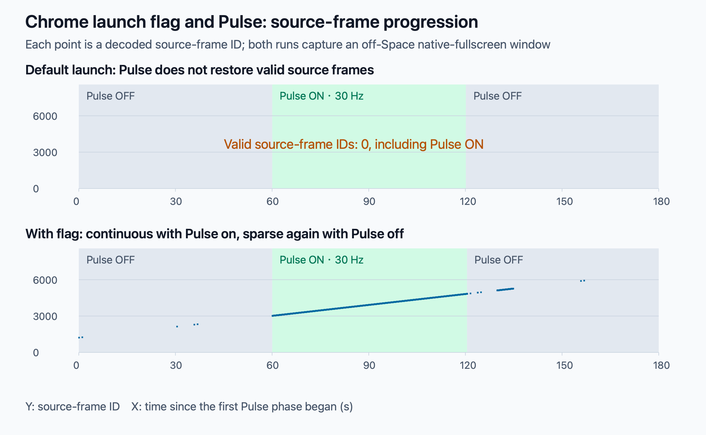
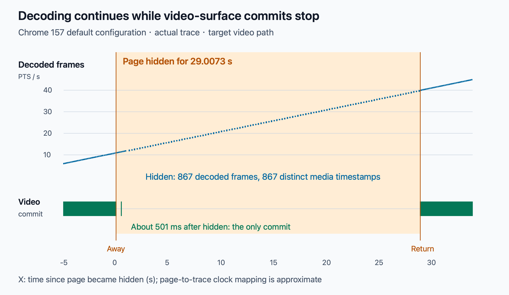
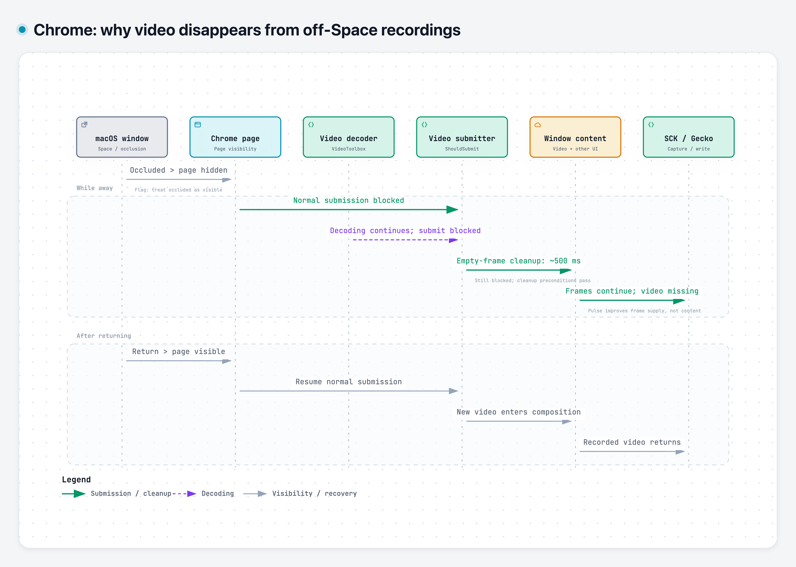

In [the Safari article](), I mentioned a clue that came from Chrome. To explain it, I need to return to Gecko's early tests of recording across macOS Spaces.

Back then, switching away from Chrome's Space mainly caused sparse picture updates. After introducing [Pulse](/posts/gecko-adaptive-pulse-design/) (in Chinese), I could capture continuously changing video frames.

Later, compatibility testing revealed black video in Safari while offscreen. Remembering that Chrome had worked, I returned to Chrome for comparison—and found that it now turned black too.

Recording continued, audio continued, and returning to the original desktop restored the picture. Yet I could no longer reproduce the earlier result of continuous updates with Pulse enabled.



*The recorded symptom: from 00:08 to 00:24, I am on another Space and the video region is black. The original recording retains its original interface language.*

Why was the same browser behaving differently? Had I broken capture, had Pulse stopped working, or had I missed a test condition?

## Trying Safari’s Canvas workaround in Chrome

Initially, I kept investigating the capture side: whether the transparent window was actually presenting, whether the refresh frequency matched, and whether capture settings had changed. But even with Pulse confirmed to be working, the video did not recover.

In Safari, drawing video into a hidden Canvas once restored the offscreen native video. I tried the same idea in Chrome, hoping for a common way forward.

Reusing the Safari page immediately exposed another problem: Chrome stopped delivering `requestVideoFrameCallback` (rVFC) callbacks while offscreen, so the draw scheduled inside that callback never executed. That established only that the intervention had not run, not whether Canvas could help.

I changed the trigger to a timer heartbeat. About seven seconds after the page became hidden, it attempted one `drawImage(video)` into the hidden Canvas; rVFC remained an observation only. The completion event confirmed that this time the operation ran:

| Observation | Result |
|---|---|
| Single draw completed | About 7.332 seconds after page hidden |
| Draw count and errors | One draw, no drawing error, no pixel readback |
| Time still hidden after drawing | About 19.466 seconds |
| Native video in the recording | Remained black until returning to the original desktop |

This ruled out failure to execute the draw, but it did not reproduce Safari's recovery.

Pulse did not restore the content, the Canvas intervention that worked in Safari did not help, and the earlier successful tests were still there. Development had stretched on, and I could not explain the contradiction. I wondered whether something had broken during development and more than once considered giving up.

## The missing clue in shell history

The investigation stalled there. Then, in early November, an incidental look through terminal history turned up an unusual Chrome launch command with an extra flag:

```text
open -a "Google Chrome" --args --disable-backgrounding-occluded-windows
```

Perhaps Chrome had been launched with this flag early on, and subsequent proof-of-concept (POC) tests had kept reusing that running instance. After restarting the computer or browser, a normal launch would omit the flag, potentially changing the results.

It was still a hypothesis. To see whether the flag really affected the outcome, I needed comparisons with and without it.

A manual comparison using Gecko was striking: **with the flag, offscreen video recorded normally; with a normal launch, the video region went black.**

## Reproducing the earlier result with the original POC

The manual Gecko comparison showed that Chrome's launch flag affected offscreen recording. But could it explain why the early POC had worked and later become impossible to reproduce?

I returned to the original minimal capture program and reran the same Pulse comparison, once with Chrome launched normally and once with the flag:

```text
Pulse OFF → Pulse ON (30 Hz) → Pulse OFF again
```

If the launch flag was the key condition, adding it should restore the earlier pattern: continuous updates with Pulse on, sparse updates again with Pulse off.

Both runs used the same capture and Pulse implementation and the same frame-number video; Chrome's launch mode changed. The Chrome version was **156.0.8078.81**.

The footage came from the reference video used in my [recording automation work](/posts/gecko-recording-test-automation/) (in Chinese). Each frame contained a decodable source-frame ID, allowing me to measure which video content arrived rather than just counting callbacks.

Pulse was a transparent Metal window, 1×1 logical point, in the capture process. While on, it redrew the same pixels at about 30 Hz; while off, it did not continuously redraw. The captured target was on another Space, in macOS native fullscreen mode.

### 1. Normal launch: Pulse presented, but content did not recover

First, Chrome launched without the flag. Excluding five seconds at each end of each phase gave:

| Phase | Stable interval | SCK complete | SCK idle | Valid source-frame IDs |
|---|---:|---:|---:|---:|
| Pulse off | 50.041 seconds | 0 | 2906 | 0 |
| Pulse on, 30 Hz | 50.107 seconds | 0 | 2880 | 0 |
| Pulse off again | 49.895 seconds | 0 | 2899 | 0 |

The Pulse log recorded 1803 valid presentations at about 30 Hz. **Pulse ran as expected, but capture still did not recover usable video content.**

### 2. Launching with the flag: sparse, continuous, then sparse again

With the flag, I repeated the same three phases:

| Phase | Stable interval | Distinct source-frame IDs per second | Content behavior |
|---|---:|---:|---|
| Pulse off | 50.037 seconds | 0.060 | Only three valid frame IDs |
| Pulse on, 30 Hz | 50.466 seconds | **30.001** | 1514 consecutive frame IDs |
| Pulse off again | 49.541 seconds | 2.705 | Sparse updates with long gaps |

The middle phase decoded source-frame IDs from **3183 through 4696**, with every adjacent difference equal to one: no repetitions or regressions. Continuous video content had returned; this was not merely SCK delivering more copies of the same picture.

The final phase averaged about 2.7 distinct frame IDs per second, but included an approximately **21-second** gap between updates. Calling that average stable low-frame-rate playback would be misleading.

Plotting the valid frame IDs from both original logs makes the distinction clearer:



*Each point is a successfully decoded source-frame ID. Missing updates remain gaps rather than being joined by lines. The chart shows complete phases; the tables exclude five seconds at each end of each phase.*

The comparison reproduced the earlier pattern: with the flag, updates became continuous when Pulse was enabled and sparse again when disabled. Under the default launch configuration, Pulse did not restore the content.

The POC also showed that, in this configuration, the flag alone did not ensure continuous recording: **updates stayed sparse with the flag but Pulse off; the flag and Pulse together restored consecutive source frames.**

That made the history command a strong explanation for the difference. The next question was what the flag actually changed—and why that affected whether Pulse could restore the picture.

## What does the flag change?

The word `occluded` became the important clue: it pointed to window occlusion, rather than a video-decoder option.

In [WebContentsImpl](https://chromium.googlesource.com/chromium/src/+/refs/tags/156.0.8078.81/content/browser/web_contents/web_contents_impl.cc) for the matching Chrome 156 release, `UpdateWebContentsVisibility` checks this flag. The key handling can be reduced to:

```cpp
if (occlusion_is_disabled && visibility == Visibility::OCCLUDED) {
  visibility = Visibility::VISIBLE;
}
```

Here, `VISIBLE` is the visibility state Chrome passes to subsequent logic. It does not mean macOS has actually moved the window back to the current desktop.

The window stays offscreen, but Chrome no longer handles it with the same occlusion state. That explains how a launch flag can change recording across Spaces.

It does not disable every background policy, either. This code specifically handles `OCCLUDED`; switching Spaces, minimizing a window, hiding the app, and switching browser tabs should not all be treated as the same operation.

I now needed to follow the state downstream: **once the page becomes invisible, where does the video pipeline stop?**

## From page invisibility to the video submission condition

The matching source connects the following path:

```text
WebMediaPlayerImpl::OnPageHidden
    ↓ Set page visibility
VideoFrameCompositor::SetIsPageVisible
    ↓ Forward to the video submitter
VideoFrameSubmitter::SetIsPageVisible
    ↓ Store the state and recalculate submission
UpdateSubmissionState
```

[WebMediaPlayerImpl](https://chromium.googlesource.com/chromium/src/+/refs/tags/156.0.8078.81/third_party/blink/renderer/platform/media/web_media_player_impl.cc) handles the hidden page and notifies [VideoFrameCompositor](https://chromium.googlesource.com/chromium/src/+/refs/tags/156.0.8078.81/third_party/blink/renderer/platform/media/video_frame_compositor.cc) across threads. The compositor forwards the state to `VideoFrameSubmitter`.

The submitter delivers video frames to the subsequent composition path. Its central condition is:

```cpp
bool VideoFrameSubmitter::ShouldSubmit() const {
  return (is_surface_visible_ && is_page_visible_) || force_submit_;
}
```

On the ordinary path, both the video surface and the page must meet the visibility conditions. `force_submit_` is an exemption path that I will return to later.

[SubmitFrame](https://chromium.googlesource.com/chromium/src/+/refs/tags/156.0.8078.81/third_party/blink/renderer/platform/graphics/video_frame_submitter.cc) returns `false` when the submission condition is not met.

At this point, “the browser stops producing video while offscreen” was too vague. **Decoding video frames and submitting them to the compositor are different steps.** Page visibility directly affects this submission path; whether decoding stops still needs runtime evidence.

But stopping submission seems to explain only a frozen picture. Why did the last frame disappear too, leaving the video area showing its background?

## Why black video instead of the last frame?

`UpdateSubmissionState` contains a less obvious resource-cleanup path.

When `ShouldSubmit()` is true, it attempts to submit the current frame. When false, it schedules `SubmitEmptyFrameIfNeeded` after **500 milliseconds**.

The source comments explain two considerations: stopping offscreen submission avoids creating and accumulating GPU resources on the receiving side; sending an empty compositor frame can then release resources held by the previous video frame.

The delay also has a reason. Page hiding and automatic Picture-in-Picture activation can arrive at different times. Clearing immediately could cause a flicker before PiP enables forced submission, so cleanup is checked a little later.

`SubmitEmptyFrameIfNeeded` rechecks the submission condition, compositor sink, and frame size. Once the cleanup preconditions pass, it calls `SubmitEmptyFrame`. The core operation can be summarized as:

```cpp
// Simplified: thread checks, metadata, and notifications omitted.
if (!compositor_frame_sink_ || !last_frame_id_.has_value())
  return;

last_frame_id_.reset();
auto frame = CreateCompositorFrame(/* ... */, nullptr, /* ... */);
compositor_frame_sink_->SubmitCompositorFrame(/* ... */, std::move(frame), /* ... */);
```

The `nullptr` matters: no actual video frame is passed into the compositor-frame construction.

`CreateCompositorFrame` calls `AppendQuads` to add video drawing primitives only when `video_frame` is non-null. A quad is a drawing primitive used by the compositor. This path therefore submits **a compositor frame without video drawing quads**; it does not make the decoder produce a black image.

This gives separate explanations for no further updates and the disappearance of the old picture: visibility blocks normal submission, then the empty frame clears the previous video content. The window and its other interface elements remain, but the video region loses its content.

Source code containing a path does not prove that a particular recording followed it. Runtime evidence was the next step.

## Tracing where video disappears at runtime

By this point, Chrome had updated to **157.0.8103.40**. I checked [the matching version's source](https://chromium.googlesource.com/chromium/src/+/refs/tags/157.0.8103.40/third_party/blink/renderer/platform/graphics/video_frame_submitter.cc), confirmed that its video submitter file was identical to the earlier 156 version, and collected a trace for the current version.

### 1. Reproducing black video while recording internal browser events

I continued using the local test page from the Safari investigation, playing the local reference footage with encoded frame numbers and performing no Canvas draws.

The page recorded actual `visibilitychange` events and video metrics; Gecko recorded the window externally; Chrome's trace recorded media-thread and composition-pipeline events.

To avoid interference from existing tabs and settings, Chrome launched with a fresh, isolated profile. The trace's command-line metadata confirmed that the occlusion-backgrounding flag was absent.

This ordinary Chrome window reproduced the same symptom: the video's recorded region stayed dark while away and recovered on return. It was recorded separately from the native-fullscreen frame-number comparison and was used to correlate the actual black interval with internal browser events.

Sampling only the video region of this recording at two images per second over 16–39 seconds produced 46 identical grayscale samples, all with zero pixels brighter than 180. This interval lacked dynamic video content.

Across the session, **all 1491 complete frames received by Gecko were written, with zero writer drops**. Pulse's measured average rate was about **59.77 Hz**. This was not a case of Pulse failing to run or the writer dropping the pictures it received.

### 2. Checking whether decoding stopped

I identified the target page's renderer in the trace, then filtered its `MojoVideoDecoder::OnVideoFrameDecoded` events rather than mixing in other pages or extensions.

The actual page-hidden interval lasted **29.0073 seconds**. During the corresponding trace interval:

| Observation | Result |
|---|---:|
| Decode-completion events | 867 |
| Distinct media timestamps | 867 |
| First and last media timestamps | 11.033333 → 39.900000 seconds |
| Decoder backend | VideoToolboxVideoDecoder |
| Frame format and size | NV12, 1280×720 |

Frame descriptions in those events contained advancing media timestamps, rather than repeated notifications of the same frame.

**This black-video interval was not caused by decoding stopping: 867 distinct timestamps showed that decoding continued.**

### 3. Checking whether decoded frames were actually submitted

The trace still contained `VideoFrameSubmitter::SubmitFrame` events. Counting by name alone would make it easy to conclude that video was being submitted throughout.

But the trace event is recorded **before** checking the submission condition:

```cpp
// Execution order: trace the function entry, then check submission eligibility.
TRACE_EVENT1("media", "VideoFrameSubmitter::SubmitFrame", "frame",
             video_frame->AsHumanReadableString());

if (!compositor_frame_sink_ || !ShouldSubmit()) {
  return false;
}
```

**Entering `SubmitFrame` does not mean a video frame was successfully submitted.**

`SubmitEmptyFrame` has a similar issue: it traces before checking the previous frame ID and can return immediately afterward. Its name appearing in a trace is not sufficient proof that an empty frame was sent.

I needed to follow the event downstream: identify the target video's FrameSink, then check GPU reception and the corresponding surface's `CommitFrame`. A FrameSink identifies a compositor-frame submission channel; a surface holds the content submitted through that channel. Submissions for other browser-window content could not be counted as video submissions.

Approximately aligning page time with the trace's navigation timestamp yielded:

| Time relative to the page becoming hidden | Event on the target video path |
|---|---|
| About 501 milliseconds | Entered `SubmitEmptyFrame` |
| About 355 microseconds after that entry | GPU received a compositor frame for the target video sink |
| About 381 microseconds after that entry | `CommitFrame` occurred on the surface corresponding to the same sink |
| Rest of the offscreen interval | The target video surface no longer committed continuously |
| After returning to the original desktop | The same video surface resumed continuous commits |

Both microsecond intervals are measured from that `SubmitEmptyFrame` entry. The page-to-trace clock mapping has uncertainty; the numbers establish ordering and temporal proximity, not precise end-to-end latency.

**Across the entire roughly 29-second hidden interval, that video surface had only this one commit.**

Plotting decoding and video submission for the same interval makes the contrast clear:



*Each point on the upper track is a decode-completion event, with media timestamp on the vertical axis. Each vertical mark on the lower track is one commit by the target video surface. Only the target page and video channel are included, not other browser surfaces.*

The blue decoding trajectory continued. The green video submissions disappeared after one cleanup and resumed on return. That matches the source's normal-submission gate, approximately 500-millisecond empty-frame cleanup, and missing video in the recording.

The trace did not directly record the compositor frame's complete quad payload. The empty-frame-cleanup interpretation rests on the combined target identity, timing, reception, commit, matching source, and recorded result.

## Conclusion: Chrome suppresses video submission and clears the old frame

**For the tested non-DRM video scenario, the cause was this: window occlusion changed page visibility, so the video submitter no longer met the normal submission condition. It then cleared the old video content through an empty compositor frame, leaving external window recording without the video picture. Decoding could still continue.**

The changes on departure and return can be summarized as follows:



*Arrows represent state propagation and content changes, not precise call latency. Decoding can continue while normal submission is suppressed. The launch flag changes Chrome's visibility handling; Pulse improves subsequent offscreen window-frame supply.*

Putting the layers back together:

| Stage | After switching away | After returning |
|---|---|---|
| Page visibility | Becomes hidden | Returns to visible |
| Video decoding | Continues producing frames with different timestamps in this run | Continues |
| Normal video submission | Suppressed by visibility conditions | Resumes |
| Previous video content | Enters the empty-compositor-frame cleanup path | New video frames are submitted again |
| External recording | Interface and audio can continue, but video content is missing | Video picture returns |

This explains why Pulse alone did not solve it. Pulse can improve offscreen frame supply, but it cannot make Chrome bypass its internal video-submission condition. Even continuous complete frames cannot reconstruct video that is missing from the window's composited content.

The Chrome flag intervenes at the visibility entry point. Pulse improves subsequent offscreen frame supply. Their different roles explain the observation that updates stayed sparse with the flag but Pulse off, and became continuous when both were enabled.

This shares an upstream clue with [the Safari investigation](), but the backend actions differ:

| Browser | Video-presentation action in the examined version | Effective diagnostic intervention |
|---|---|---|
| Safari | Media invisibility reaches the AVFoundation backend, which hides the video layer | One Canvas draw; disabling occlusion detection in a custom WKWebView |
| Chrome | Normal video submission is suppressed, and previous video-frame content is cleared | The particular launch flag together with Pulse |

Safari's `setHidden:` should not be attributed to Chrome, and Chrome's empty compositor frame should not be treated as Safari's implementation. What connected the investigations was how browsers change video presentation when a window becomes invisible.

The flag comparison used Chrome 156; the default-configuration trace used Chrome 157, on macOS 26.6.2. They answer intervention and runtime-behavior questions respectively. This is not a claim that every Chrome version, website, or protected video source has been tested.

## What can Gecko control?

With the cause located, the next question was whether Gecko could intervene somewhere in this chain and keep the original Chrome window supplying video while offscreen.

There were two direct possibilities: keep the page visible upstream, or allow a hidden page to keep submitting video downstream. I also needed to understand whether the earlier Canvas read could activate an internal browser capture keep-alive mechanism.

### 1. Upstream: can the page stay visible?

This path already had a positive result: `--disable-backgrounding-occluded-windows` treats Chrome's `OCCLUDED` state as `VISIBLE`. The POC also showed that Pulse restored consecutive source frames under that launch condition.

The upstream visibility path can therefore be changed. The limitation is that the flag is a browser launch condition requiring Chrome to restart. It is not an option Gecko can immediately apply to a selected window in an already running browser.

Chromium's own internal capture also cooperates at the visibility layer. [WebContentsFrameTracker](https://chromium.googlesource.com/chromium/src/+/refs/tags/157.0.8103.40/content/browser/media/capture/web_contents_frame_tracker.cc) increments a capturer count when internal capture actually starts and releases it when capture ends. When [WebContentsImpl](https://chromium.googlesource.com/chromium/src/+/refs/tags/157.0.8103.40/content/browser/web_contents/web_contents_impl.cc) calculates page visibility, a positive visible-capturer count makes it treat the page as `kVisible`.

The browser therefore already has logic for keeping a page visible while it is being captured. But an external Gecko SCK window-capture session does not automatically register that internal count, and I did not find a public entry point for registering it using only an SCK window ID.

An extension's `tabCapture` can lead into the browser's internal capture path, but it requires permissions, a user trigger, and a capture lifecycle that actually starts. That is a separate, browser-cooperating approach; this investigation did not verify whether it also restores external SCK recording of the original window.

### 2. Downstream: can the video submission condition be bypassed?

Could video still be submitted while the page remained hidden? The earlier `ShouldSubmit()` condition offered another clue: even when visibility conditions fail, `force_submit_` permits submission if true.

That is why I followed this variable. It might expose an exemption reserved for special browser scenarios. Who sets it, and under what conditions?

Following the callers in Chrome 157's [WebMediaPlayerImpl](https://chromium.googlesource.com/chromium/src/+/refs/tags/157.0.8103.40/third_party/blink/renderer/platform/media/web_media_player_impl.cc) showed one direct source in the ordinary video player: video Picture-in-Picture. Changing display type to video PiP tells the compositor to enable forced submission.

However, the ordinary video-PiP path examined here also removes the video compositing layer from the original webpage. Forced submission serves PiP presentation. It does not directly preserve video inside the original, otherwise unchanged Chrome window for offscreen recording.

`force_submit_` is thus a clue to an internal exemption, not a switch already exposed to Gecko. I did not find a public way for external Gecko to set it directly.

### 3. Back to Canvas: does requesting a frame keep it presented?

The earlier single Canvas draw had not restored Chrome's video. Source investigation also helped explain how to interpret that result.

The ordinary player has a condition named `IsVideoBeingCaptured`, which checks whether frames have been requested recently. Internal reads such as Canvas drawing may update the relevant time and affect some background-media optimizations.

But this recent-frame-request state is not the visible-capturer count described above, and it does not automatically set `force_submit_` to true. Obtaining a frame and allowing continued video submission remain different conditions.

That is why Safari's recovery method cannot simply be carried over to Chrome: a single draw does not guarantee bypassing Chrome's submission gate. A Canvas call completing without an exception is also not proof that valid dynamic video pixels were obtained.

For Gecko, the tested path remains launching Chrome with the specific flag and using Pulse, which requires changing the browser's launch conditions. Internal capture keep-alive and forced submission have real uses, but I have not found a general repair that external Gecko can apply directly to arbitrary running windows without Chrome's cooperation.

The reproduction, recordings, page data, and trace were submitted as [Chromium #584503585](https://issues.chromium.org/issues/584503585) and added to the related Apple Feedback **FB25368989**.

## What finally broke the deadlock

Looking back, the most time-consuming part was not just black video. It was the contradiction between working earlier and failing later. That repeatedly pulled attention back to the capture side, making a browser launch-condition difference look like a regression in Pulse or recording code.

The history command revealed the key difference and moved the investigation from “why can the recorder not obtain the picture?” to “is the browser still submitting video?” Safari and Chrome's investigations ultimately met at visibility policy.

The most difficult recording problem I encountered while building Gecko finally had an explanation. There is still no general workaround Gecko can enable directly, but the investigation took more than a few unexpected turns before getting here.

The lesson I will remember: do not give up too quickly. When there is no clear direction, take a break. Revisit the history—you might find a clue you missed. 😁
