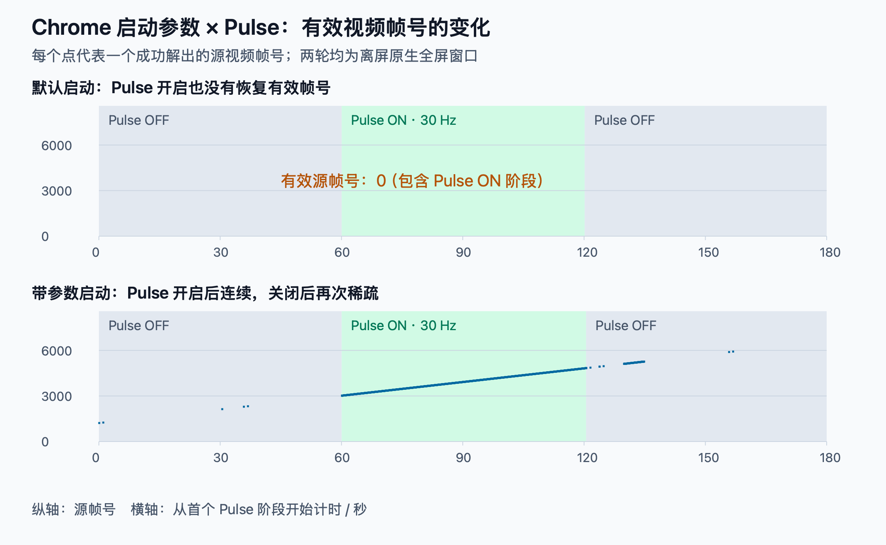
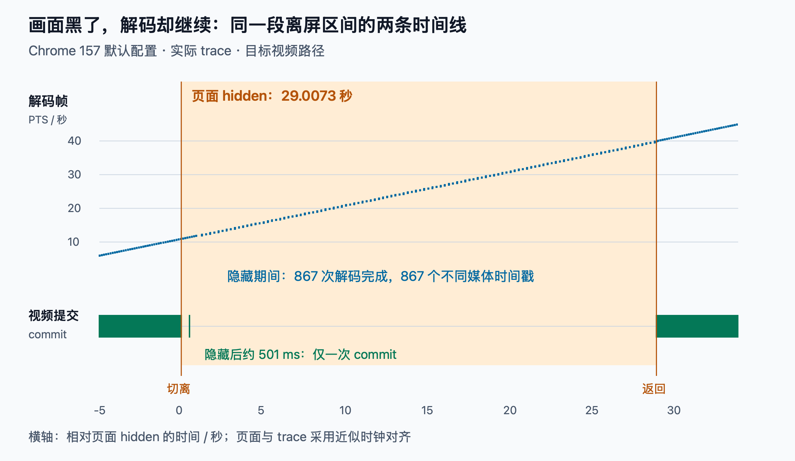
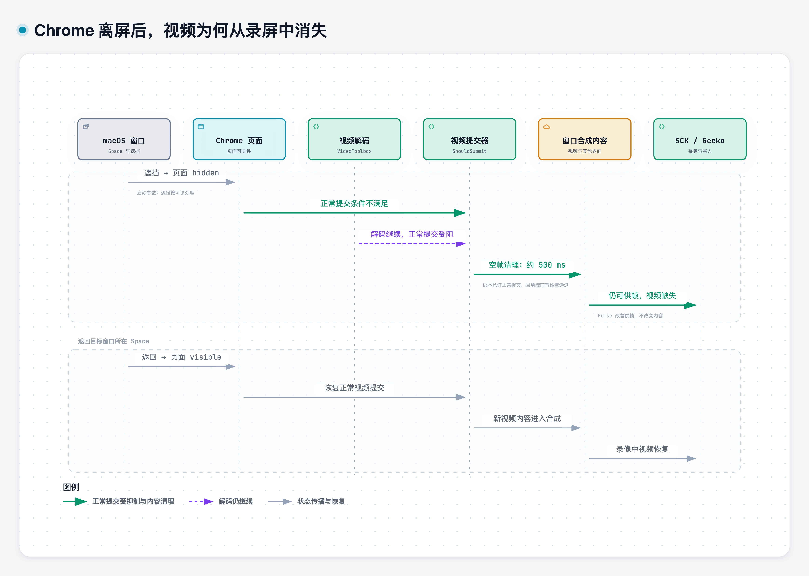

在 [Safari 篇](/posts/safari-offscreen-video-black/)里，提到了一条来自 Chrome 的线索。要讲清楚这条线索，还得回到 Gecko 早期的跨桌面录制测试。

当时，Chrome 窗口切到其他 Space 后，主要表现是画面更新稀疏。引入 [Pulse](/posts/gecko-adaptive-pulse-design/) 后，已经能够采集到连续变化的视频帧。

后来做兼容性测试，先发现 Safari 离屏视频黑屏。因为记得 Chrome 没有这个问题，我又回头拿 Chrome 做对照，结果它居然也出现了黑屏现象。

录制没有停止，声音继续，返回原桌面后画面恢复。此前“开启 Pulse 后持续更新”的结果，却怎么也复现不出来了。



*录制的异常视频，在 00:08 到 00:24 秒为切离桌面期间，视频区域变为黑色。*

同样是 Chrome，为什么前后表现不一样？是采集程序改坏了，Pulse 失效了，还是遗漏了什么测试条件？

## Safari 有效的 Canvas 绘制，Chrome 能否复用

最初还是围绕采集端排查：透明窗口有没有实际呈现，刷新频率是否一致，录制配置是否发生变化。但即便确认 Pulse 正在工作，视频内容依然没有恢复。

Safari 中，向隐藏 Canvas 绘制一次视频，就能让离屏后的原生视频恢复。于是我把同样的思路用到 Chrome，希望找到一个共同的突破口。

第一次直接沿用 Safari 的页面，却遇到了新的问题：Chrome 离屏后，`requestVideoFrameCallback`（rVFC）停止回调，原本安排在回调里的绘制没有执行。此时只能说明干预没有触发，还不能判断 Canvas 是否有效。

随后把触发方式改成定时心跳：页面进入 hidden 约 7 秒后，尝试向隐藏 Canvas 执行一次 `drawImage(video)`，rVFC 只保留作观测。以实际绘制完成事件为准，这次确认操作执行了：

| 观测项 | 结果 |
|---|---|
| 单次绘制完成 | 页面 hidden 后约 7.332 秒 |
| 绘制次数与异常 | 1 次，无绘制异常，没有像素读回 |
| 绘制后继续 hidden | 约 19.466 秒 |
| 录像中的原生视频 | 仍然黑屏，直到返回原桌面才恢复 |

这次排除了“绘制根本没有执行”的问题，但没有复现 Safari 的恢复效果。

Pulse 无法恢复内容，Safari 中有效的 Canvas 干预也没有奏效，而早期正常的测试结果又确实存在。整个开发周期很长，始终无法解释这个矛盾，一度认为是开发中间出了问题，也一度有了放弃推进的念头。

## 一条从终端 history 里翻出来的命令

排查一度停在这里。直到 11 月初，在偶然回查终端 history 时，发现一条奇怪的 Chrome 启动命令，后面多了一个参数：

```text
open -a "Google Chrome" --args --disable-backgrounding-occluded-windows
```

怀疑可能是早期启动携带了这个参数，后续 POC 就可能一直运行在这个条件下；重启电脑或浏览器以后，普通启动不再带参数，测试结果自然可能不同。

这时还只是一个猜测。要判断它是否真能影响结果，需要重新构造带参数与不带参数的对照。

先用 Gecko 人工比较，差异很明显：**带参数启动，离屏视频正常；普通启动，视频区域黑屏。**

## 回到原有 POC，能否重现历史表现

Gecko 的人工对照已经显示，Chrome 的启动参数会影响离屏录制。但它能否解释早期 POC 正常、后来却无法复现的矛盾？

为了验证这个猜测，我回到原有的最小采集程序，分别用带参数和不带参数的 Chrome，重新执行同一套 Pulse 对照：

```text
关闭 Pulse → 开启 Pulse（30 Hz）→ 再次关闭 Pulse
```

如果启动参数确实是关键条件，那么带参数后，应该能够重新观察到历史上的“开启 Pulse 后连续更新，关闭后再次稀疏”。

两轮使用相同的采集与 Pulse 实现，播放相同的帧号视频，改变 Chrome 的启动方式。此时 Chrome 版本为 **156.0.8078.81**。

视频素材沿用[录屏自动化测试](/posts/gecko-recording-test-automation/)中的参考视频，每一帧包含可解出的源帧号。这样判断的是“究竟拿到了哪些视频内容”，而不只是回调数量。

Pulse 是采集进程里的一个透明 Metal 小窗口，大小为 1×1 逻辑点。在开启阶段，以约 30 Hz 重绘相同像素；关闭阶段不持续重绘。采集目标位于另一个 Space，并处于 macOS 原生全屏状态。

### 1. 普通启动：Pulse 实际呈现，但内容没有恢复

先不带参数启动 Chrome。每段去掉头尾各 5 秒的过渡区后，得到：

| 阶段 | 稳定区时长 | SCK complete | SCK idle | 有效源帧号 |
|---|---:|---:|---:|---:|
| Pulse 关闭 | 50.041 秒 | 0 | 2906 | 0 |
| Pulse 开启，30 Hz | 50.107 秒 | 0 | 2880 | 0 |
| Pulse 再次关闭 | 49.895 秒 | 0 | 2899 | 0 |

Pulse 日志记录到 1803 次有效呈现，实际频率约为 30 Hz。**Pulse 按预期运行，但采集端仍未恢复有效视频内容。**

### 2. 带参数启动：稀疏、连续、再变稀疏

带上参数后，沿用同样的三段顺序：

| 阶段 | 稳定区时长 | 不同源帧号 / 秒 | 内容表现 |
|---|---:|---:|---|
| Pulse 关闭 | 50.037 秒 | 0.060 | 只有 3 个有效帧号 |
| Pulse 开启，30 Hz | 50.466 秒 | **30.001** | 1514 个帧号逐一递增 |
| Pulse 再次关闭 | 49.541 秒 | 2.705 | 稀疏更新，夹有长间断 |

中段解出的源帧号从 **3183 增加到 4696**，相邻差值全部为 1，没有重复或倒退。恢复的是连续的视频内容，不能只解释成 SCK 多发了一些相同画面。

最后一段虽然平均还有约 2.7 个不同帧号 / 秒，但其中出现了约 **21 秒**的相邻更新间断。把这个均值叫作“稳定的低帧率播放”，同样会误判。

把两轮原始日志中的有效帧号画出来，区别更直观：



*每个点对应一次成功解出的源帧号，断点保留，没有用连线填补无更新区间。图中展示完整阶段；上表统计去除了每段头尾各 5 秒。*

这组对照重现了早期的模式：带参数时，Pulse 开启后连续更新，关闭后再次稀疏；默认配置下，Pulse 没有恢复内容。

POC 的结果也说明，在这组配置下，并不是加上参数就能持续录制：**带参数但关闭 Pulse 时，更新仍然稀疏；参数与 Pulse 配合，才恢复了连续源帧号。**

这也让那条 history 命令成为历史差异的有力解释。接下来需要追问的是：参数究竟改变了什么，为什么它会影响 Pulse 能否恢复画面？

## 参数究竟改了什么

参数名里的 `occluded` 是接下来最重要的线索：它指向窗口遮挡状态，而不是某个视频解码选项。

在匹配 Chrome 156 的 [WebContentsImpl 源码](https://chromium.googlesource.com/chromium/src/+/refs/tags/156.0.8078.81/content/browser/web_contents/web_contents_impl.cc)中，`UpdateWebContentsVisibility` 会检查这个参数。关键处理可简化为：

```cpp
if (occlusion_is_disabled && visibility == Visibility::OCCLUDED) {
  visibility = Visibility::VISIBLE;
}
```

这里的 `VISIBLE` 是 Chrome 交给后续逻辑的可见性状态，不意味着 macOS 真的把窗口搬回了当前桌面。

窗口仍然离屏，但 Chrome 不再按同样的遮挡状态处理它。这就解释了为什么一个启动参数能够改变跨 Space 的录制结果。

它也没有关闭全部后台策略。代码针对的是 `OCCLUDED`，不能由此把切换 Space、最小化、隐藏 App、切换浏览器标签页全部当成同一个操作。

接下来需要沿着这个状态向下追：**页面变为不可见以后，视频管线具体停在了哪里？**

## 从页面不可见，追到视频提交条件

匹配版本的源码中，可以串起下面这条路径：

```text
WebMediaPlayerImpl::OnPageHidden
    ↓ 设置页面可见性
VideoFrameCompositor::SetIsPageVisible
    ↓ 转交给视频提交器
VideoFrameSubmitter::SetIsPageVisible
    ↓ 保存状态并重新计算提交条件
UpdateSubmissionState
```

[WebMediaPlayerImpl](https://chromium.googlesource.com/chromium/src/+/refs/tags/156.0.8078.81/third_party/blink/renderer/platform/media/web_media_player_impl.cc)处理页面隐藏，再跨线程通知 [VideoFrameCompositor](https://chromium.googlesource.com/chromium/src/+/refs/tags/156.0.8078.81/third_party/blink/renderer/platform/media/video_frame_compositor.cc)。后者把状态交给 `VideoFrameSubmitter`。

提交器的职责，是把视频帧交给后面的合成路径。它的核心判断为：

```cpp
bool VideoFrameSubmitter::ShouldSubmit() const {
  return (is_surface_visible_ && is_page_visible_) || force_submit_;
}
```

普通路径下，视频 surface 与页面都需要满足可见条件；`force_submit_` 则是一条豁免路径，后面再来讲它的机制。

在 [SubmitFrame](https://chromium.googlesource.com/chromium/src/+/refs/tags/156.0.8078.81/third_party/blink/renderer/platform/graphics/video_frame_submitter.cc)中，只要提交条件不满足，就会返回 `false`。

到这里，已经不能再笼统地说“浏览器离屏后不生产视频了”。**解码器产出视频帧，与把视频帧提交给合成器，是不同步骤。** 页面可见性直接影响的是这段提交路径；解码是否停止，还需要现场证据。

但停止提交似乎只能解释画面不再更新。为什么最后一帧也没有保留下来，而是整块视频变成背景色？

## 为什么是黑屏，而不是停在最后一帧

继续看 `UpdateSubmissionState`，还有一段不那么显眼的资源清理逻辑。

当 `ShouldSubmit()` 为真时，它会尝试提交当前帧；为假时，则安排一个 **500 毫秒**的延迟任务，执行 `SubmitEmptyFrameIfNeeded`。

源码注释交代了两个考虑：离屏时停止提交，可以避免远端继续创建和积累 GPU 资源；再发送一个空合成帧，可以释放上一次视频帧占用的资源。

延迟也有原因：页面隐藏和自动画中画启动之间可能存在时序差。如果立刻清空，可能在画中画进入强制提交状态之前产生闪烁，所以稍后再检查是否仍需清理。

`SubmitEmptyFrameIfNeeded` 会重新判断提交条件、合成 sink 和画面尺寸。满足清理条件后，进入 `SubmitEmptyFrame`，其核心动作可概括为：

```cpp
// 简化示意：省略线程检查、元数据及通知等代码。
if (!compositor_frame_sink_ || !last_frame_id_.has_value())
  return;

last_frame_id_.reset();
auto frame = CreateCompositorFrame(/* ... */, nullptr, /* ... */);
compositor_frame_sink_->SubmitCompositorFrame(/* ... */, std::move(frame), /* ... */);
```

这里传入的 `nullptr` 是关键：构造合成帧时，没有传入实际视频帧。

在 `CreateCompositorFrame` 中，只有 `video_frame` 非空，才会调用 `AppendQuads` 添加视频绘制图元。quad 可以理解为合成器用于绘制内容的图元。因此这条路径提交的是**不含视频绘制图元的合成帧**，并不是解码器生成了一张黑色图片。

这样，“不再更新”与“旧画面也消失”就有了不同的解释位置：正常提交被可见性条件挡住，旧视频内容又被空帧清理。最终窗口还在，其他界面也在，只有视频区域缺少内容。

不过，代码里存在这条路径，还不等于这次录制实际经过了它。下一步需要运行态证据。

## 现场取证：定位视频消失的环节

做这一步时，Chrome 已经更新到 **157.0.8103.40**。核对了[新版本对应源码](https://chromium.googlesource.com/chromium/src/+/refs/tags/157.0.8103.40/third_party/blink/renderer/platform/graphics/video_frame_submitter.cc)，确认视频提交器与此前 156 的文件一致，再针对当前版本采集 trace。

### 1. 复现黑屏，同步记录浏览器内部事件

继续使用 Safari 篇里的本地测试页面，播放本地的机器码视频，不执行 Canvas 绘制。

页面负责记录实际 `visibilitychange` 与视频指标；Gecko 负责从外部录制窗口；Chrome trace 则记录媒体线程和合成链路事件。

为避免已有标签页和配置干扰，Chrome 使用新的独立 profile 启动。trace 中的命令行元数据确认，这轮没有携带关闭遮挡后台化的参数。

这轮在普通 Chrome 窗口中再次复现了同样的现象：离屏后，录像中的视频区域持续为深色，返回后恢复。它与前面的原生全屏帧号对照分别记录，用于把实际黑屏时段与浏览器内部事件对应起来。

对这轮成品中 16–39 秒的纯视频区域，按每秒 2 帧抽取，共得到 46 个灰度样本，全部相同，亮度大于 180 的像素均为 0。这说明这段录像缺少动态视频内容。

整个会话中，Gecko 收到的 **1491 个 complete 帧全部写入，Writer 丢帧为 0**，Pulse 的实际平均频率约为 **59.77 Hz**。所以这次也不是 Pulse 没在工作，或 Writer 把收到的画面丢掉了。

### 2. 先确认解码有没有停

从 trace 里找到目标页面的 renderer，再筛选它的 `MojoVideoDecoder::OnVideoFrameDecoded` 事件，避免把其他页面或扩展的活动混进来。

页面实际 hidden 的区间为 **29.0073 秒**。对应时间段中：

| 观测项 | 结果 |
|---|---:|
| 解码完成事件 | 867 次 |
| 不同媒体时间戳 | 867 个 |
| 首尾媒体时间 | 11.033333 → 39.900000 秒 |
| 解码后端 | VideoToolboxVideoDecoder |
| 帧格式与尺寸 | NV12，1280×720 |

解码事件中的帧描述包含媒体时间戳，可以看出它们确实在推进，并非同一帧反复通知。

**这轮黑屏不是由视频解码停止造成的：867 个不同时间戳说明，解码仍在继续。**

### 3. 再看解码后的帧有没有真正提交

trace 里依然能看到 `VideoFrameSubmitter::SubmitFrame`。如果只按名字统计，就很容易得出“视频一直在提交”的结论。

但读过代码就会发现，trace 事件写在提交条件检查之前：

```cpp
// 顺序摘录：进入函数，先记 trace，再判断是否允许提交。
TRACE_EVENT1("media", "VideoFrameSubmitter::SubmitFrame", "frame",
             video_frame->AsHumanReadableString());

if (!compositor_frame_sink_ || !ShouldSubmit()) {
  return false;
}
```

因此，**进入 `SubmitFrame`，不等于成功提交了视频帧。**

`SubmitEmptyFrame` 也有同样的问题：trace 在检查旧帧 ID 之前，函数可能记录事件后直接返回。单独看到函数名，还不足以确认空帧已送出去。

这一步需要向后关联：找到目标视频的 FrameSink，再检查 GPU 接收与对应 surface 的 `CommitFrame`。FrameSink 标识合成帧的提交通道，surface 则承载该通道提交的内容；不能把整个浏览器窗口的其他提交都算成视频提交。

按页面时间与 trace 导航时标近似对齐后，得到下面这段时序：

| 相对页面隐藏的时间 | 目标视频路径的事件 |
|---|---|
| 约 501 毫秒 | 进入 `SubmitEmptyFrame` |
| 该次入口后约 355 微秒 | GPU 收到目标视频 sink 的合成帧 |
| 该次入口后约 381 微秒 | 同一 sink 对应 surface 出现 `CommitFrame` |
| 后续离屏区间 | 目标视频 surface 不再持续 commit |
| 返回原桌面后 | 同一视频 surface 恢复连续 commit |

两个微秒间隔均以那次 `SubmitEmptyFrame` 入口为起点。页面与 trace 的时钟映射存在误差，这些数据用于核对顺序和时间邻近关系，不应当作精确的端到端延迟。

**整个约 29 秒的 hidden 区间，这个视频 surface 只有前面那一次 commit。**

把同一区间的解码帧与视频提交画在一起，矛盾就很清楚了：



*上轨每个点是一条解码完成事件，纵轴为帧的媒体时间；下轨每条竖线是目标视频 surface 的一次 commit。仅统计目标页面和目标视频通道，未混入浏览器其他 surface。*

蓝色的解码轨迹没有停，绿色的视频提交却在一次清理后消失，返回时再恢复。这与源码中的正常提交门控、约 500 毫秒的空帧清理，以及录像里的视频缺失相互对应。

trace 没有直接记录该合成帧完整的 quad 载荷，这里对空帧清理的判断，来自目标身份、时序、接收与 commit、匹配源码和成品的共同印证。

## 结论：Chrome 抑制视频提交，并清理旧帧内容

**在本次已测的非 DRM 视频场景中，Chrome 离屏黑屏的原因是：窗口遮挡触发页面可见性变化，视频提交器不再满足正常提交条件；随后通过空合成帧清理旧视频内容，外部窗口录制因此缺少视频画面。解码可以仍在继续。**

切离与返回时的变化，可以用下图概括：



*箭头表示状态传播与内容变化，不表示精确调用耗时。解码可以继续，但正常视频提交受到抑制；启动参数与 Pulse 分别作用于浏览器可见性处理和后续离屏供帧。*

各层的表现可以放回同一张表：

| 环节 | 切离后 | 返回后 |
|---|---|---|
| 页面可见性 | 进入 hidden | 恢复 visible |
| 视频解码 | 本轮仍持续产出不同时间戳的帧 | 继续 |
| 正常视频提交 | 受可见性条件抑制 | 恢复 |
| 旧视频内容 | 进入空合成帧清理路径 | 新视频帧重新提交 |
| 外部录制 | 界面和声音可以继续，视频区域缺失 | 视频画面恢复 |

这也解释了为什么 Pulse 单独不起作用：它可以改善离屏供帧，但不能替 Chrome 越过内部的视频提交条件。即便外部录制器持续拿到 complete 帧，也无法从缺少视频内容的窗口合成结果里还原视频。

Chrome 参数的价值，在于干预可见性入口；Pulse 的价值，在于改善后续的离屏供帧。两者作用不同，才会出现“参数开启但 Pulse 关闭时仍稀疏，两个都开启后连续”的结果。

这条结论与 [Safari 篇](/posts/safari-offscreen-video-black/)有共同的上游线索，但后端动作不同：

| 浏览器 | 本次对应版本的视频呈现动作 | 有效的诊断干预 |
|---|---|---|
| Safari | 媒体不可见传到 AVFoundation 后端，隐藏视频层 | 单次 Canvas 绘制；自建 WKWebView 关闭遮挡检测 |
| Chrome | 正常视频提交受抑制，并清理旧视频帧内容 | 特定启动参数与 Pulse 配合 |

因此不能把 Safari 的 `setHidden:` 套到 Chrome，也不能把 Chrome 的空合成帧当作 Safari 的实现。真正把两次调查联系起来的，是“窗口不可见之后，浏览器如何改变视频呈现”。

参数对照来自 Chrome 156，默认配置 trace 来自 Chrome 157，运行于 macOS 26.6.2。它们分别回答干预效果与实际呈现行为；结论不扩展成所有 Chrome 版本、网站或受保护视频都已验证。

## Gecko 能控制到哪一步

定位原因以后，接下来要判断的是：Gecko 能否在这条链路中的某个位置干预，让原 Chrome 窗口在离屏后继续提供视频内容？

沿着已经查清的机制，有两个直接方向：在上游让页面保持可见，或者在下游允许隐藏页面继续提交视频。此外，还需要解释前面尝试过的 Canvas 绘制，是否能触发浏览器内部的采集保活机制。

### 1. 从上游入手：能否让页面保持可见

这条路径已经有正向结果：`--disable-backgrounding-occluded-windows` 将 Chrome 收到的 `OCCLUDED` 按 `VISIBLE` 处理。前面的 POC 也验证了，在带参数的条件下，Pulse 能恢复连续源帧号。

因此，上游的可见性路径可以干预。限制在于，参数属于浏览器启动条件，需要重新启动 Chrome；它不是 Gecko 选中某个已运行窗口后，就能为该窗口即时设置的选项。

Chromium 自己的内部采集，也会在可见性层进行协作。[WebContentsFrameTracker](https://chromium.googlesource.com/chromium/src/+/refs/tags/157.0.8103.40/content/browser/media/capture/web_contents_frame_tracker.cc) 在内部采集实际开始后增加 capturer count，结束时释放。[WebContentsImpl](https://chromium.googlesource.com/chromium/src/+/refs/tags/157.0.8103.40/content/browser/web_contents/web_contents_impl.cc) 计算页面可见性时，如果可见采集计数大于 0，会把页面按 `kVisible` 处理。

这说明浏览器本身已有“正在被采集时保持页面可见”的逻辑。但外部 Gecko 建立 SCK 窗口采集会话，并不会自动登记这项内部计数；本次调查也没有找到仅凭 SCK 窗口 ID 就能登记它的公开入口。

扩展的 `tabCapture` 可以走向浏览器内部采集路径，但需要权限、用户触发和真正开始的采集生命周期。它属于需要浏览器配合的另一种方案，本次没有验证它能否同时恢复外部 SCK 对原窗口的录制。

### 2. 从下游入手：能否绕过视频提交条件

如果页面仍然 hidden，是否也能继续提交视频？前面的 `ShouldSubmit()` 给出了另一条线索：即使可见性条件不满足，只要 `force_submit_` 为真，仍然允许提交。

因此才继续追查这个变量：它可能揭示浏览器为特殊场景保留的豁免入口。问题是，谁能设置它，又是在什么条件下设置？

沿 Chrome 157 的 [WebMediaPlayerImpl](https://chromium.googlesource.com/chromium/src/+/refs/tags/157.0.8103.40/third_party/blink/renderer/platform/media/web_media_player_impl.cc) 调用方查下去，普通视频播放器的一条直接来源是视频画中画。显示类型变为视频 PiP 时，播放器通知 compositor 设置强制提交。

但已核对的普通视频 PiP 路径还会移除原网页里的视频合成层，强制提交服务的是画中画呈现。它不能直接实现“原 Chrome 窗口保持原样，离屏后继续录其中的视频”。

所以，`force_submit_` 是解释内部豁免机制的线索，并不是一个已经对 Gecko 开放的开关。本次也没有找到可由外部 Gecko 直接设置它的公开入口。

### 3. 回看 Canvas：取过视频帧，是否就会保持呈现

前面的单次 Canvas 绘制未能恢复 Chrome 黑屏，源码调查也提供了理解这一结果的线索。

普通播放器中有一个名为 `IsVideoBeingCaptured` 的判断，会检查近期是否发生过取帧。Canvas 绘制等内部取帧活动可能更新相关时间，从而影响部分后台媒体优化。

但这种“近期取过帧”的状态，不等于前面的可见采集计数，也不会自动把 `force_submit_` 设为真。取得视频帧与允许视频继续提交，仍然是不同的条件。

这解释了为什么不能把 Safari 的恢复办法直接套到 Chrome：一次绘制并不保证绕过 Chrome 的视频提交门控。这里也不把 Canvas 调用无异常当成已经取得有效动态像素的证明。

回到 Gecko，目前有实测支持的路径仍是按特定参数启动 Chrome，再配合 Pulse；它需要改变浏览器启动条件。内部采集保活与强制提交各有真实的适用场景，但尚未找到无需 Chrome 配合、可对任意已运行窗口直接启用的通用修复入口。

相关复现、录像、页面数据和 trace 已提交到 [Chromium #584503585](https://issues.chromium.org/issues/584503585)，并补充关联 Apple Feedback **FB25368989**。

## 兜了一圈，终于找到原因

回头看，最费时间的不只是黑屏本身，而是“之前正常、现在不正常”的矛盾。它把注意力反复拉回采集端，让一个浏览器启动条件的差异，看起来像是 Pulse 或录制实现的回归。

那条 history 命令让我们发现了关键差异，也把调查从“为什么采集端拿不到画面”，推进到“浏览器究竟有没有继续提交视频”。Safari 与 Chrome 的两次排查最终在可见性策略处交汇。

Gecko 开发过程中最难的黑屏问题，终于把原因搞清楚了。虽然目前还没有能由 Gecko 直接启用的通用规避方案，但整个排查过程可谓是峰回路转、柳暗花明。

最重要的，遇到问题，不要轻易放弃，没有思路了就休息。多回顾历史，没准就能有新发现。 😁
