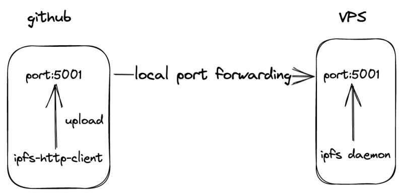
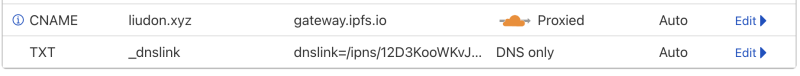
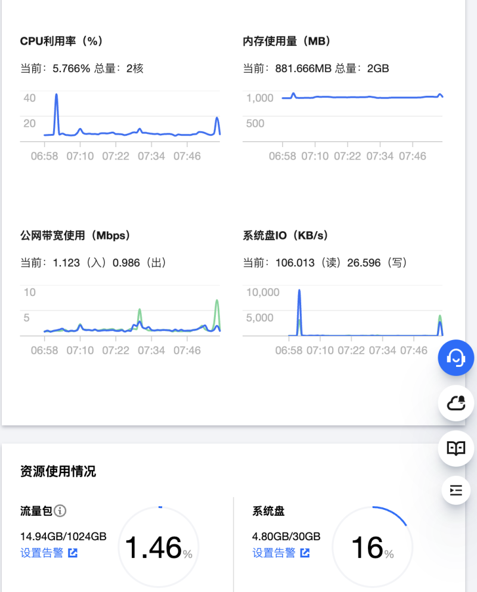

在这篇文章，我将会介绍如何利用`Github Actions`将`hugo`博客自动部署到`IPFS`上，并通过自定义域名访问`IPFS`上的文件。

> IPFS（InterPlanetary File System）中文称为星际文件系统，是一个旨在实现文件的分布式存储、共享和持久化的网络传输协议。

照惯例,先上演示.[访问我的IPFS博客](https://liudon.xyz)

欢迎各位pin我的博客， `ipfs pin add /ipns/liudon.xyz`

```
curl 'https://liudon.xyz' -I
HTTP/2 200 
date: Tue, 21 Feb 2023 23:59:18 GMT
content-type: text/html
vary: Accept-Encoding
access-control-allow-methods: GET
access-control-allow-methods: GET, POST, OPTIONS
last-modified: Tue, 21 Feb 2023 23:59:18 GMT
x-ipfs-gateway-host: ipfs-bank1-sv15
x-ipfs-path: /ipns/liudon.xyz/
x-ipfs-roots: Qmd4pnpUj8CaLKoVMJNHJyrqwWVa4wvz1qKxZsU9vKgErL
x-ipfs-pop: ipfs-bank1-sv15
timing-allow-origin: *
access-control-allow-origin: *
access-control-allow-headers: X-Requested-With, Range, Content-Range, X-Chunked-Output, X-Stream-Output
access-control-expose-headers: Content-Range, X-Chunked-Output, X-Stream-Output
x-ipfs-lb-pop: gateway-bank1-sv15
x-proxy-cache: MISS
cf-cache-status: DYNAMIC
report-to: {"endpoints":[{"url":"https:\/\/a.nel.cloudflare.com\/report\/v3?s=FLcvWgtngoLuGZkl9jYsviSoOlSoE2Y0rKxI3bgNaKRxhNOrIm6nozqVzndav3%2B9QrvvcJ5GNmC11JBlN8tiigbF9CWPW33TbnLKyfdeblOcEhmZINTcC%2BJ6xhKs"}],"group":"cf-nel","max_age":604800}
nel: {"success_fraction":0,"report_to":"cf-nel","max_age":604800}
server: cloudflare
cf-ray: 79d36f598970531f-LAX
alt-svc: h3=":443"; ma=86400, h3-29=":443"; ma=86400
```

#### 准备工作:

1. Cloudflare帐号
2. 一台VPS主机,我用到腾讯云lighthouse主机2核2G
3. 一个域名

#### 方案介绍:



1. 在VPS主机上安装启动IPFS服务,通过端口5001在内网提供API服务.
2. 在GitHub上通过ssh建立端口转发,本地端口5001转发到VPS主机5001.
3. 在GitHub上利用ipfs-http-client上传文进到5001端口.
4. 绑定域名到IPNS地址,通过域名访问IPFS文件.

#### 1. 部署IPFS服务

- 安装kubo,详见[官方文档](https://docs.ipfs.tech/install/command-line/#install-official-binary-distributions)

    ```
    wget https://dist.ipfs.tech/kubo/v0.18.1/kubo_v0.18.1_linux-amd64.tar.gz

    tar -xvzf kubo_v0.18.1_linux-amd64.tar.gz

    > x kubo/install.sh
    > x kubo/ipfs
    > x kubo/LICENSE
    > x kubo/LICENSE-APACHE
    > x kubo/LICENSE-MIT
    > x kubo/README.md

    cd kubo
    sudo bash install.sh

    > Moved ./ipfs to /usr/local/bin

    ipfs --version

    > ipfs version 0.18.1
    ```

- 初始化IPFS

    ```
    ipfs init --profile=server
    ```

- 添加到开机启动

    ```
    [Unit]

    Description=IPFS Daemon
    After=syslog.target network.target remote-fs.target nss-lookup.target

    [Service]
    Type=simple
    ExecStart=/usr/local/bin/ipfs daemon --enable-namesys-pubsub
    User=root

    [Install]
    WantedBy=multi-user.target
    ```

    注意打开`--enable-namesys-pubsub`参数，不然IPNS更新生效很慢。

    将上述代码保存到`/usr/lib/systemd/system/ipfs.service`文件.

    启动进程.

    ```
    systemctl start ipfs.service
    ```

- 开放端口
   
   IPFS默认通过4001端口跟DHT网络通信,需要放开4001端口访问.

#### 2. GitHub Actions配置

博客我使用的`Hugo`，原有的工作流方案见[将博客部署到Cloudflare Pages](https://liudon.com/posts/deploy-blog-to-cloudflare-pages/)。

完整的工作流配置见[main.yml](https://github.com/Liudon/liudon.github.io/blob/code/.github/workflows/main.yml)。

- 添加如下变量到Actions secrets

    ```
    SSHKEY VPS主机ssh登陆私钥
    SSHHOST ssh用户@VPS机器IP,类似root@127.0.0.1
    ```

- 更新yaml配置文件,添加如下任务.

    ```
       - name: Connect to ssh in BG
        timeout-minutes: 2
        run: | 
          echo "${{ secrets.SSHKEY }}" > ../privkey
          chmod 600 ../privkey
          ssh -o StrictHostKeyChecking=no ${{ secrets.SSHHOST }} -i ../privkey -L 5001:localhost:5001 -fTN

      - name: ipfs upload
        uses: aquiladev/ipfs-action@master
        id: deploy
        timeout-minutes: 2
        with:
          path: ./public
          service: ipfs
          verbose: true
          host: localhost
          port: 5001
          protocol: http
          key: self # 要配置key,这样才会生成IPNS地址
    ```

    测试执行action,[日志](https://github.com/Liudon/liudon.github.io/actions/runs/4230563492/jobs/7348031553)里会有类似如下输出.

    ```
    Upload to IPFS finished successfully {
    cid: 'QmST2Zqv8qffFTVuqfRX57uzqxsoQtTYinmHpyLh7padAD',
    ipfs: 'QmST2Zqv8qffFTVuqfRX57uzqxsoQtTYinmHpyLh7padAD',
    ipns: '12D3KooWKvJ9Y4D5X4R3ajuc7tVtQWXZMG4iiMCFtay8frM66o4c'
    }
    ```

    每次执行,ipfs地址不同,ipns地址不变.
    记住这里到ipns地址,下面会用到.

#### 3. 域名配置

在`Cloudflare`上添加解析:

- 添加DNS TXT记录,名称为`_dnslink`，值为`dnslink=/ipns/12D3KooWKvJ9Y4D5X4R3ajuc7tVtQWXZMG4iiMCFtay8frM66o4c`，将这里的`12D3KooWKvJ9Y4D5X4R3ajuc7tVtQWXZMG4iiMCFtay8frM66o4c`改为上一步日志里到ipns值。
- 添加DNS CNNANE记录,名称为`你的域名`，值为`gateway.ipfs.io`.



#### 4. 开启相对路径

经[Livid大佬](https://github.com/livid)提醒，[公共网关访问时存在相对路径问题](https://zu1k.com/posts/tutorials/p2p/ipfs-easy-use/)。

我用的`Hugo`，配置文件里打开`relativeURLs`配置。

```
relativeURLs: true
```

从年前开始想怎么做成自动化,到今天终于跑通搞定了.😁😁😁



两天跑了14G流量,每月的流量资源包基本够用了.

参考资料：

[IPFS 日用优化指南](https://zu1k.com/posts/tutorials/p2p/ipfs-easy-use/)

[参考配置](https://github.com/UnifiedPush/documentation/blob/karmanyaahm-patch-3/config.toml)
