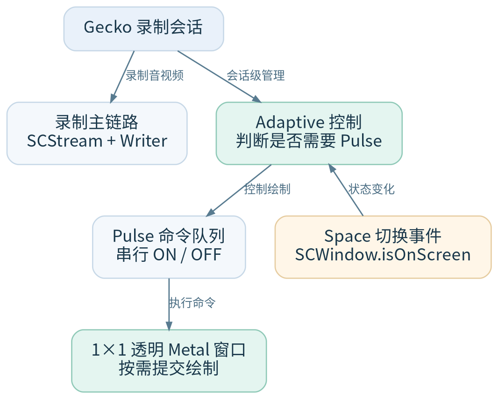
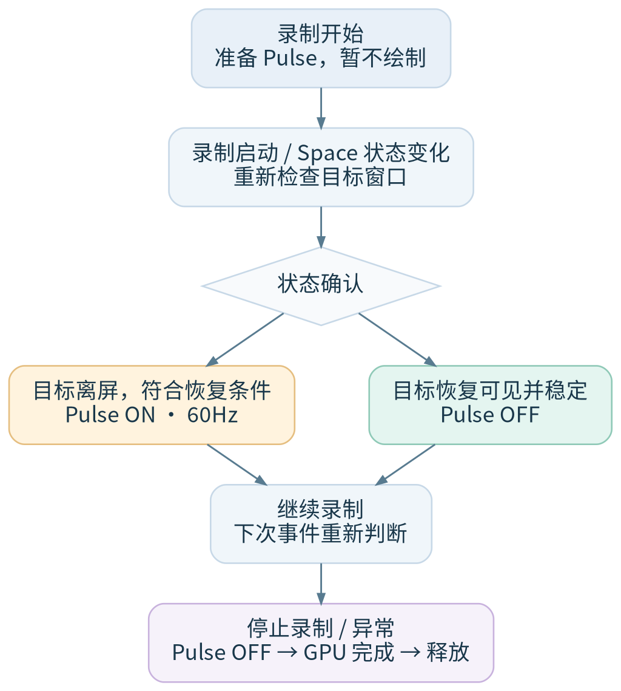

上一篇《[切换桌面后，录屏画面几乎冻结](/posts/screencapturekit-cross-space-freeze/)》记录了 Gecko 遇到的跨桌面供帧问题。一个原本用于倒计时的浮层带来了线索，后来通过 Pulse 的开关实验，发现持续绘制的独立窗口在特定场景下确实能让采集恢复正常。

实验里用的是一个 64×64、以 30Hz 黑白交替绘制的窗口。它让 30 FPS 的参考视频恢复了正常采集，但这个闪烁的方块总不能一直放在屏幕上。

接下来要解决如何把这个机制接入到实际产品中。

## 从闪烁方块到 1×1 透明窗口

### 窗口能不能缩小

把窗口从 64×64 逐步缩到 1×1。测试中让 Chrome 播放带连续帧号的 30 FPS 视频，统计离屏采集每秒得到多少个**不同的源画面**。

| Pulse 窗口尺寸 | 离屏真实源帧率 |
| --- | ---: |
| 64×64 | 约 30.0 帧/s |
| 16×16 | 29.998 帧/s |
| 8×8 | 29.876 帧/s |
| 4×4 | 29.770 帧/s |
| 1×1 | **29.895 帧/s** |

即使只剩 1×1，采集仍接近正常的 30 FPS。

这组结果说明：**窗口面积不是维持恢复效果的关键条件**。

### 固定颜色行不行

窗口虽然已经很小，但每次仍会在黑白之间切换。既然已经能缩到 1×1，下一步就想确认：**一定要让像素变色吗？**

我让它始终画黑色，仍以 30Hz 提交并呈现新的 Metal drawable。两轮独立测试分别得到 **29.957 和 29.988 个不同源帧/s**。

两次的 Pulse 绘制频率都保持在约 30Hz，源帧号也持续向前推进。

这说明在这组跨桌面实验里，**颜色不需要变化，持续提交绘制仍然有效**。

### 能不能做成透明

同色重绘不闪烁了，但窗口仍然可能留下一个小黑点。于是继续把 Metal 绘制内容的 alpha 改成 0。窗口本身还在，drawable 也照常提交，只是它对屏幕没有可见的颜色贡献。

两轮 30Hz 测试得到 **29.682 和 29.755 个不同源帧/s**。而关闭 Pulse 的对应稳定区间，只有约 **0.04 个不同源帧/s**。透明化后，开启与关闭之间的差异仍然很明显。

至此，原来的黑白方块经过三次调整，变成了 **1×1、持续同色重绘、像素完全透明** 的 Metal 窗口。

实验确认：**恢复采集不需要大面积窗口，也不需要可见的颜色变化。** 这样才有了能放进录屏工具、又不干扰屏幕的 Pulse 形式。

### 必须是独立进程吗

前面的实验中，Pulse 和采集程序分别运行。虽然效果已经验证，但如果实际使用时还需要额外启动一个辅助进程，管理起来会麻烦不少。

于是，我把 1×1 透明 Pulse 和 ScreenCaptureKit 采集放到**同一个进程**中，保持跨桌面测试条件不变。两轮测试分别得到 **29.996 和 29.993 个不同源帧/s**，仍然接近参考视频的 30 FPS。

结论很明确：**Pulse 不需要独立进程，和采集放在同一个进程里也能正常发挥作用。**

之后又在包含音视频写入的实际录制流程中验证了这一方案。普通桌面和原生全屏各做两轮，**4 轮全部通过**；Pulse 开启阶段实际得到 **27.396～29.116 个不同源画面/s**，Writer 丢帧数为 0，音视频同步通过测试。

通过前面这些 POC 阶段的测试，验证了 Pulse 的绘制方式、同进程运行和完整录制链路，说明这套方案可以用。

但 POC 测试是按实验步骤控制 Pulse，正式接入 Gecko 还要考虑它如何跟随录制启动和停止，以及失败、退出时怎样释放资源。

## Pulse 绘制机制

### 第一版：录制期间持续绘制

因此，正式接入 Gecko 时，我先设计了管理 Pulse 生命周期的组件——`PulseManager`。

它不是另一个采集器，只负责**创建透明窗口、启动或停止绘制，以及在录制结束时释放资源**。第一版采取最简单的策略：录制开始就启动 30Hz Pulse，录制结束再停。

20 次真实录制启停全部通过；每轮最多只有一个 Pulse 实例，结束后活动资源数都回到零。开始失败、录制中退出，以及收到采集错误后的资源清理也分别做了测试。

随后完成了一轮 3600 秒的正式长录，Pulse 实测绘制频率约 **30.00015Hz**，视频可完整解码，Writer 丢帧数为 0。

不过，即便窗口完全透明，录制期间持续以 30Hz 提交 Metal 绘制依然会唤醒 GPU。为了量化这笔开销，我用相同的 1/60 ScreenCaptureKit 采集间隔做了功耗对照：

| 状态 | CPU/GPU 合计功率指标 |
| --- | ---: |
| Pulse 关闭 | 738.352mW |
| Pulse 30Hz 持续运行 | 1069.321mW |

增加约 **44.8%**。这是同机 `powermetrics` 测到的 CPU/GPU 组件功耗，常开绘制明显带来了额外的开销。

所以绘制机制得改。

### Adaptive Pulse：只在需要时绘制

既然 Pulse 是为跨桌面供帧准备的，能不能等目标窗口离开当前桌面再开启绘制，切回来就停止绘制？于是我把第一版的常开策略改成了 **Adaptive Pulse**。

原来的 `PulseManager` 继续负责透明窗口和资源管理，Adaptive 只改变绘制时机。Gecko 的采集和写入链路保持不变，Pulse 作为一条辅助链路，根据目标窗口状态决定是否绘制：

**Pulse 不负责提供录制视频帧**。SCStream 和 Writer 仍走原来的采集、写入流程；这条旁路只负责根据窗口状态触发透明绘制。

启动流程也变了：录制成功开始后先准备资源，但默认不绘制；桌面切换时检查 `SCWindow.isOnScreen`，确认目标窗口进入符合条件的离屏状态才打开 Pulse。如果录制开始时目标已经离屏，也会经过状态确认后开启。切回来、窗口稳定可见一段时间（当时策略为约 **1.5 秒**）后再关掉。停止录制或发生异常时，先停止提交，等待最后的 GPU 工作结束，再释放资源。

Gecko 通过响应桌面切换等系统事件，再做短暂的状态确认，并设置可见稳定期、冷却和失败退避。

为了验证 Adaptive 策略是否可靠，我测试了窗口切走、切回过程中的 Pulse 启停时机与实际采集帧率：

| Adaptive 30Hz 场景 | 可见基线 | 离屏真实源帧率 | 恢复比例 |
| --- | ---: | ---: | ---: |
| 普通桌面之间切换 | 30.044 帧/s | **30.035 帧/s** | 99.97% |
| 原生全屏切换 | 30.020 帧/s | **29.993 帧/s** | 99.91% |

两组都通过了对应回归，Pulse 也能跟随窗口可见状态启动和关闭。

到这里，按需绘制其实已经可用了。

### 从 30Hz 到 60Hz：寻找更稳定的采集节奏

后续测试中，我发现 30Hz 虽然已经能恢复跨桌面采集，但实际源帧率偶尔会有波动。于是尝试把 Pulse 的绘制频率提高到 60Hz，看看能否让采集帧率更稳定。

#### 先各跑五轮连续切换

我把桌面切换操作自动化，先用 30Hz 连续测试五轮，再只调整 Pulse 绘制频率，用 60Hz 重复同样的流程。两组的离屏真实源帧率如下（帧/s）：

| 切换轮次 | Pulse 30Hz | Pulse 60Hz |
| --- | ---: | ---: |
| 1 | 29.978 | 30.023 |
| 2 | 29.990 | 30.027 |
| 3 | 28.952 | 30.024 |
| 4 | 28.833 | 29.994 |
| 5 | 30.019 | 30.043 |

30Hz 的五轮在 **28.833～30.019 帧/s** 之间，其中两轮略低于 29 帧/s；60Hz 的五轮则都接近 30 帧/s。两组的 Writer 丢帧数均为 0。

#### 交错跑二十轮

为了排除测试顺序带来的影响，又按 `30Hz → 60Hz → 30Hz → 60Hz` 做了一次交错对照。每种频率各两组、每组五轮。以下是四组完整的离屏真实源帧率（帧/s）：

| 轮次 | 第 1 组 30Hz | 第 2 组 60Hz | 第 3 组 30Hz | 第 4 组 60Hz |
| --- | ---: | ---: | ---: | ---: |
| 1 | 28.331 | 30.018 | 29.982 | 30.048 |
| 2 | 29.990 | 30.040 | 28.186 | 30.004 |
| 3 | 29.990 | 29.969 | 30.037 | 29.999 |
| 4 | 28.521 | 30.013 | 29.977 | 30.016 |
| 5 | 30.038 | 30.043 | 29.996 | 30.000 |

30Hz 的十轮中，有三轮降至 **28.186～28.521 帧/s**，其余七轮接近 30 帧/s；60Hz 的十轮则全部保持在 **29.969～30.048 帧/s**。四组测试的 Writer 丢帧数均为 0。

加上前面各五轮的连续切换测试，30Hz 共十五轮，其中五轮低于 29 帧/s；60Hz 的十五轮都接近 30 帧/s，进一步证实了 **60Hz Pulse 能让实际采集的源帧率更稳定地保持在 30 帧/s 左右。**

### 再看一下 Adaptive 模式下的功耗

前面的功耗结果已经说明，真正需要避免的是 Pulse 不分场景地持续绘制。最后选择 60Hz 后，我又做了一轮**同频率**对照：采集配置均为 `1/60`，Pulse 都使用 60Hz，每组正式测量 10 分钟。

| 场景 | CPU/GPU 合计平均功率指标 |
| --- | ---: |
| Pulse 关闭 | 891.262mW |
| Adaptive 已准备、当前可见且不绘制 | 880.135mW |
| Adaptive 60Hz，反复切走与切回 | **945.215mW** |
| 60Hz 持续绘制 | **1420.058mW** |

Adaptive 那组测试中，Pulse 实际绘制时间约占 **42.9%**。相比同频持续绘制，平均 CPU/GPU 合计功率指标降低了约 **33.4%**。

这足以证明，在相同的 60Hz 绘制频率下，**按需绘制比始终绘制更省资源**。

另外，Adaptive 已准备但没有绘制的那组，与完全关闭 Pulse 的结果接近，没有观察到明显的常驻功耗负担。

## Gecko 最终采用的配置

经过这些测试，Gecko 在普通手动选窗的音视频录制中采用了以下默认配置：

- 使用 **1×1 透明 `NSPanel`**，设置 `.canJoinAllSpaces`、`.stationary` 和 `.fullScreenAuxiliary`，不接收鼠标事件；实际透明内容由 `CAMetalLayer` 绘制。
- ScreenCaptureKit 采集间隔设为 **`1/60`**，Pulse 绘制频率设为 **60Hz**。这是两项独立设置，不代表录制内容每秒一定有 60 个不同的源画面。
- 采用 **Adaptive 按需绘制**：目标窗口进入符合条件的离屏状态时开启 Pulse，恢复可见后停止绘制。
- Pulse 随录制会话管理资源，停止或发生异常时清理；保留内部关闭开关，方便兼容性回退。

## 最后

最初做 Pulse，只是想知道一个持续绘制的小窗口能不能影响跨桌面的采集。后面经过尺寸、同色、透明、同进程和真实录制对照，才确定它可以缩成不影响屏幕的辅助资源。

真正接入 Gecko 后，又经历了常开方案的生命周期测试、功耗测量、Adaptive 按需启停，以及额外的频率稳定性对照，最终采用了**只在符合条件时才让它绘制**的方案。

Pulse 解决了这次排查出的稀疏供帧问题，但跨桌面录制的问题还远没有结束。
