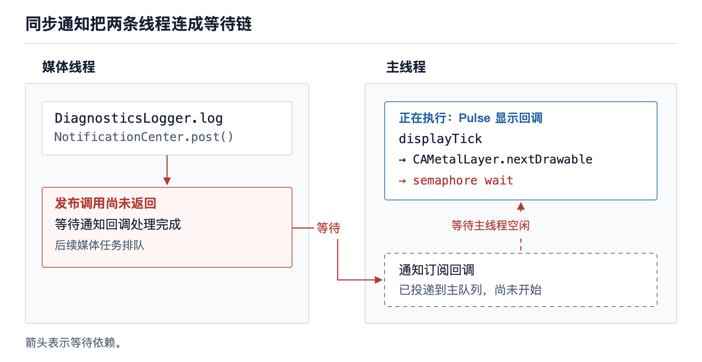
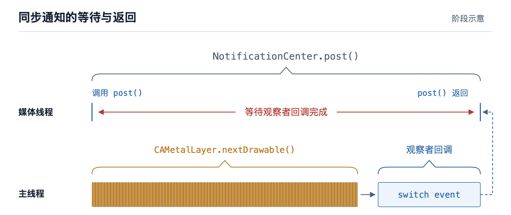
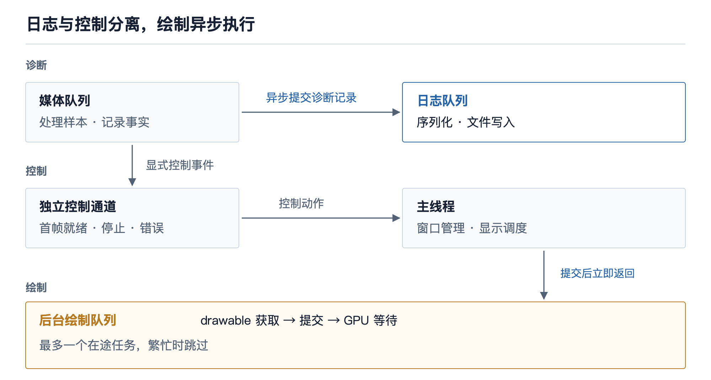

为了排查 Gecko 的 [Safari 离屏黑屏问题](/posts/safari-offscreen-video-black/)，当时在采集路径上加了很多诊断日志，以便定位问题。

排查过程中还发现了一个新问题：**切回录制窗口所在的桌面后，录像会停在原来的画面上，过了很久才恢复。**



*约 01:11 返回 Safari 所在桌面，此后至 01:37 期间，录制画面一直处于卡顿、冻结状态。*

排查中发现，在浏览器内部向隐藏 Canvas 绘制一次视频，能让离屏视频恢复，但还没有找到外部录制器可以直接使用的通用办法，黑屏问题的排查一时卡住了。

于是我决定先来看这个返回桌面后的卡顿问题。

## 采集后的处理，哪里卡住了

通过日志分析发现：Writer 曾暂时不能接收新样本，部分视频帧因此被拒收。

Writer 负责把样本交给编码和文件封装，得先弄清楚是哪个步骤卡住了。

于是我给采集后的各个处理步骤分别加上计时。一次分段测量得到：

| 操作 | 单次最大耗时 |
|---|---:|
| 向 Writer 追加视频样本 | 3.55 毫秒 |
| 复制像素缓冲 | 11.97 毫秒 |
| 记录视频帧间隔异常 | **3018 毫秒** |
| 记录视频周期摘要 | **4977 毫秒** |
| 记录视频丢帧 | **2391 毫秒** |

复制缓冲和追加样本都是毫秒级，几种日志调用却等了数秒。

**日志已经是异步写入了，为什么会这么慢？**

## 一次日志写入，时间花在哪里

日志入口 `DiagnosticsLogger.log` 的简化实现如下：

```swift
// DiagnosticsLogger.log：保留关键执行顺序。
func log(_ event: Event) {
    let record = makeRecord(event)

    NotificationCenter.default.post(
        name: .captureEvent,
        object: self,
        userInfo: ["event": event]
    )

    logQueue.async {
        writeJSONLine(record)
    }
}
```

增加计时统计进行复测，在一轮录制中，共统计了 202 次日志调用：

| 日志内部步骤 | 单次最大耗时 | 202 次日志中的累计耗时 |
|---|---:|---:|
| 构造记录及通知字段 | 7.485 毫秒 | 0.157239 秒 |
| **发布诊断通知** | **5338 毫秒** | **73.913 秒** |
| 提交后台写盘任务 | 0.422 毫秒 | 0.005128 秒 |
| 后台任务排队 | 24.698 毫秒 | 0.091834 秒 |
| JSON 序列化 | 24.665 毫秒 | 0.081707 秒 |
| 写入及文件同步 | 2.139 毫秒 | 0.126847 秒 |

文件写入及同步的单次最大耗时只有 2.139 毫秒，通知投递却达到 5.338 秒。**长等待集中在日志函数里的通知投递阶段。**

诊断通知用于把首帧到达、桌面变化和采集错误传给控制模块，驱动自动录制计时与资源收尾。

**落盘是异步的，但前面的通知投递仍是同步的。**

## 通知为什么迟迟不返回

接收端的代码：

```swift
NotificationCenter.default.addObserver(
    forName: .captureEvent,
    object: logger,
    queue: .main
) { notification in
    guard let event = eventFrom(notification) else { return }
    switch event {
    case .captureStarted: startController()
    case .spaceChanged: checkVisibility()
    default: break
    }
}
```

`queue: .main` 指定回调在主队列执行，根据事件类型进行不同处理。

现场线程取样显示，媒体线程停在等待通知处理完成的位置；同一时刻，主线程正在等待绘制资源：

```text
媒体线程
appendVideo
  → DiagnosticsLogger.log
    → NSNotificationCenter
      → NSOperation.waitUntilFinished

主线程
CADisplayLink 回调
  → displayTick
    → submitTransparentFrame
      → CAMetalLayer.nextDrawable
        → semaphore wait
```

主线程此时正在执行 [Pulse](/posts/gecko-adaptive-pulse-design/) 的辅助绘制：通过显示回调提交透明画面，提交前需要向 Metal 图层获取 drawable，也就是本次绘制使用的可呈现缓冲。这一步进入了等待。



媒体线程没有调用 Metal，但它发布的通知需要主线程处理；主线程又正在等待绘制资源。于是，**一个日志调用，把原本不相邻的媒体处理与绘制等待连到了一起。**

## 如何证实这条链路

线程栈显示了两条线程的等待关系，接下来需要用数据证实这个结论。

进一步带线程取样复现时，捕获到一次持续约十五秒的通知调用。将它的完整区间与主线程 drawable 调用对齐，可以看到：

**通知等待期间，主线程几乎一直耗在 drawable 获取上。** 主线程在这段时间内反复获取 drawable，累计耗时约 **15.325 秒，占等待时间的 96.57%**。共观察到 **952 次**获取调用，单次最大 **23.541 毫秒**，中位数 **16.114 毫秒**。



*阶段示意：黄色条带为 drawable 获取，蓝色区块为观察者回调。*

这不是一次持续十五秒的 drawable 获取，而是主线程反复进入绘制调用，通知回调迟迟不能开始，媒体线程一直等着通知返回，队列中的后续任务也无法开始。

**回调执行得很快，但开始得很晚。**

为了验证同步通知是否导致了媒体队列的长等待，这次将通知改为异步投递，文件记录和接收端保持不变。同时向媒体队列提交轻量任务，用任务从入队到开始执行的时间衡量队列等待。

改为异步投递后，**媒体队列最大等待从 15.487 秒降到 6.537 毫秒**，视频输入间隔超过 150 毫秒的异常从 **14 次降到 0 次**，音频时间轴超过 50 毫秒的缺口从 **6 次降到 0 次**。

这组对照证实了线程栈分析的结论：**同步通知把主线程上的绘制等待传回了媒体队列，造成了长时间卡顿。**

## 日志与控制分离，绘制移到后台

最终将日志记录与控制事件拆开，并把可能阻塞的绘制工作移到独立后台队列。后台绘制最多保留一个在途任务，避免显示回调持续追加任务造成积压。



**日志与控制事件分开。** 日志负责记录事实；首帧就绪、停止和错误等事件通过明确的控制接口传递，控制流程自行承担事件顺序、截止时间和完成确认。

**可能等待的绘制工作移出主线程。** 主线程保留窗口管理和显示调度，drawable 获取、绘制提交及 GPU 等待交给后台。这样，控制回调就不必与绘制资源等待挤在一起。

**绘制不积压，停止有收尾。** 每次显示回调都追加后台任务，会把阻塞变成积压。绘制最多保留一个在途任务，繁忙时跳过新的绘制机会；停止时先禁止后台任务继续提交新的绘制工作，再等待已提交的 GPU 工作完成，最后释放资源。

## 总结

本来是为了帮助诊断异常的日志，却影响了采集流程。

这次排查从诊断日志入手，最终发现了一条跨线程的等待链：媒体线程等待主线程处理通知，主线程又在等待绘制资源。同步通知把绘制侧的延迟传进了实时采集路径，造成录屏卡顿。

**任务分布在不同线程上，仍可能因为同步等待而相互阻塞。** 排查卡顿时，除了看函数执行了多久，还要看任务何时才能开始、调用者在等谁。设计并发流程时，则需要明确哪些操作必须等待完成，哪些可以独立推进，避免不必要的依赖拖住关键路径。
