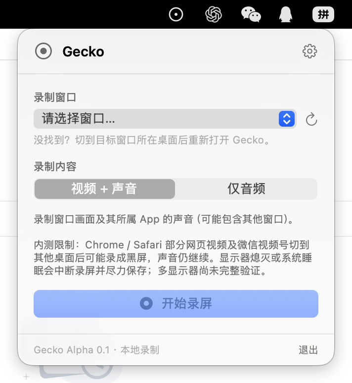

## 起因

9月底的时候，媳妇想把微信的来电铃声设置到手机电话铃声上。

微信里的来电铃声其实就是视频号里的一个视频，因为微信的这个音质更好，所以想着直接把它的音频弄出来。

本以为是个很简单的事情，折腾一番，最后还是让 AI 写了个本地的音频采集程序，把铃声导出来了。

十一假期的时候，跟媳妇录了个好玩的短视频，视频的开头想放一段新闻联播片头。

央视频做了加密限制，试了 `yt-dlp`、第三方平台工具，都只能拿到 420P 规格的视频。

我想用个更高清的片头，从晚上 10 点折腾到 12 点，实在搞不定，最后只能用 420P 的片头。

这两个事情折腾下来，我发现，与其想办法直接下载视频，不如试试把应用正在播放的内容录下来。

于是决定自己做一个简单的录制工具。

## 一个尽量简单的菜单栏工具

Gecko 是一个 macOS 原生菜单栏应用，没有复杂的主窗口。

它想做的事情很简单：**把指定应用正在播放的内容保存到本地**。

技术上使用 Swift、AppKit/SwiftUI、ScreenCaptureKit 和 AVFoundation。ScreenCaptureKit 负责获取画面和应用音频，AVFoundation 负责写入媒体文件。

实际操作也尽量简单：

1. 点击菜单栏中的 Gecko 图标，选择目标窗口。
2. 选择录制视频或仅录音。
3. 点击开始录制。

录制过程中不必一直打开 Gecko 的控制界面，点击菜单栏图标就能重新查看状态、停止录制，录制结束文件直接保存在本机。

目前已经实现的主要功能包括：

- 指定 App 录音：只想要声音时，可以直接录成 M4A 或 WAV。
- 单窗口音视频录制：画面固定在明确选择的窗口上，声音来自它所属的 App，不会随着鼠标焦点自动切换窗口。
- 本地文件保存：停止录制后完成媒体文件写入，并提供在 Finder 中查看的入口。
- 录制状态与异常提示：录制中、保存中、成功或失败都有对应状态；目标窗口关闭、App 退出等情况也有相应处理。

## 最折腾的跨桌面录制

在开发启动前，做了一轮竞品分析。单纯的采集录制，市面上已经大把 App 了。再做一个，单纯就是重复造轮子了。

考虑如何做出一些区别，我的场景更偏后台录制，希望录制期间还能切换到其他桌面继续工作。

于是，**跨桌面录制逐渐成了 Gecko 最想实现的能力**。

但实际做下来，发现难度还是非常大的。

不同应用在切换桌面后的行为差别很大，有些场景能正常录制，有些则会出现画面冻结或视频区域黑屏。

经过多轮对照测试，部分场景下的离屏冻结问题有了明显改善，但 Chrome、Safari 离屏后的视频区域黑屏仍未解决。

我也已经向 Apple 提交了 Feedback，目前还没有找到有效的解决办法。

## 当前的状态

经过一个多月的开发，不知道多少轮 POC 测试，中间几度想要放弃，Gecko 的基础录制流程总算跑通了。

目前已经能够完成指定应用录音、单窗口音视频录制、文件保存，以及部分异常情况下的录制收尾。

遗憾的是，最希望实现的跨桌面录制，至今仍存在浏览器视频黑屏的问题。暂时还不能把 Gecko 当作一款稳定的日常录屏工具来推广。

后续如果这个问题有进一步进展，再考虑开放测试。

虽然 Gecko 还没有达到最初期待的效果，但开发过程中遇到了不少有意思的技术问题。

接下来会把过程中遇到的一些问题整理分享出来。
