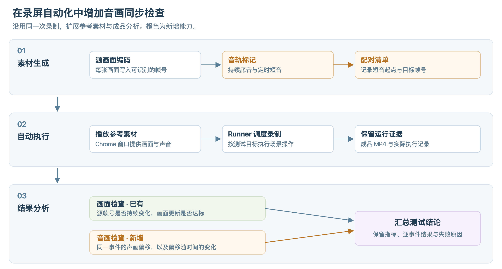
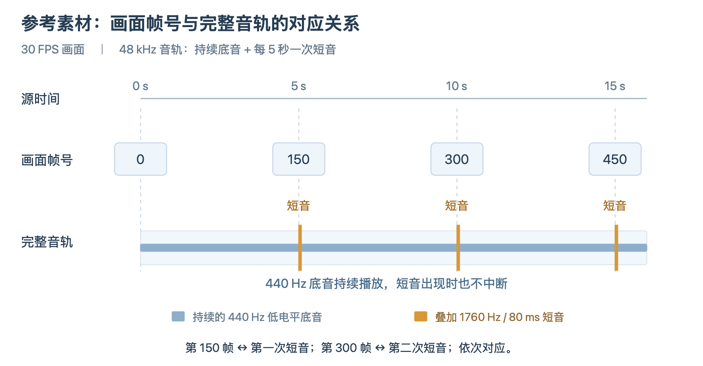
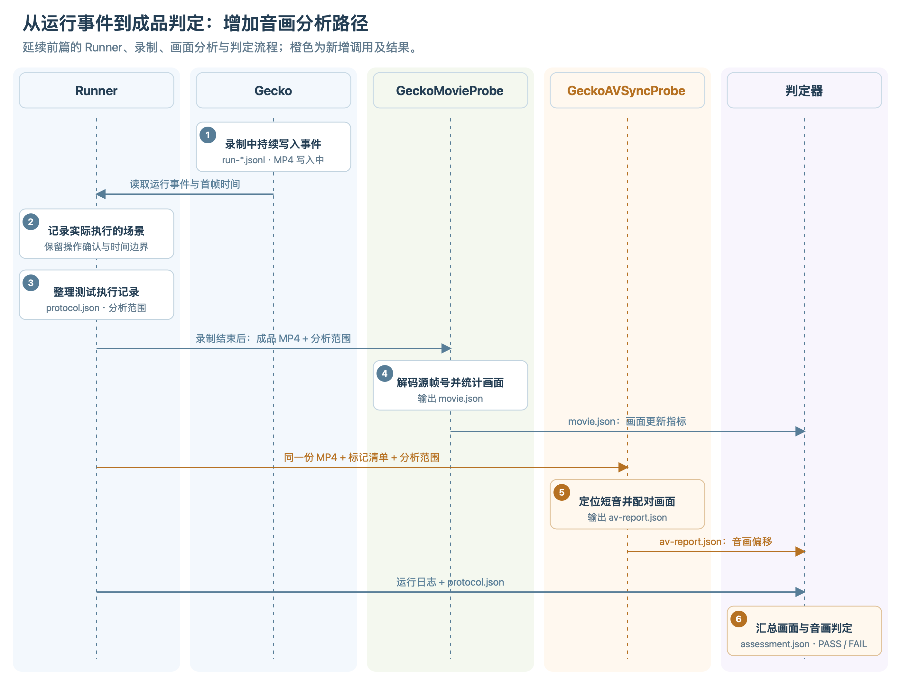
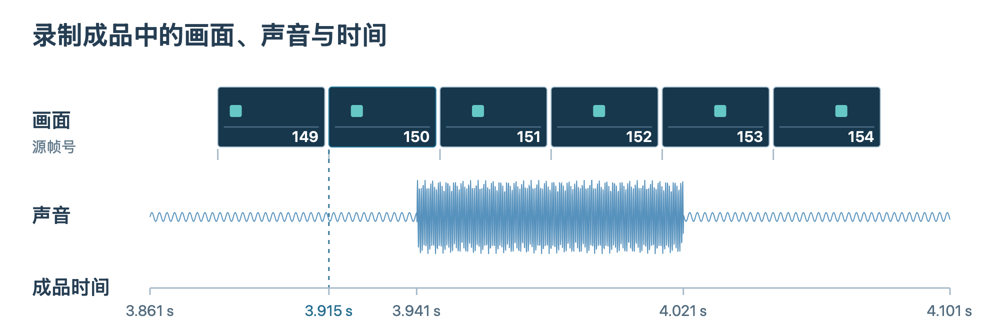
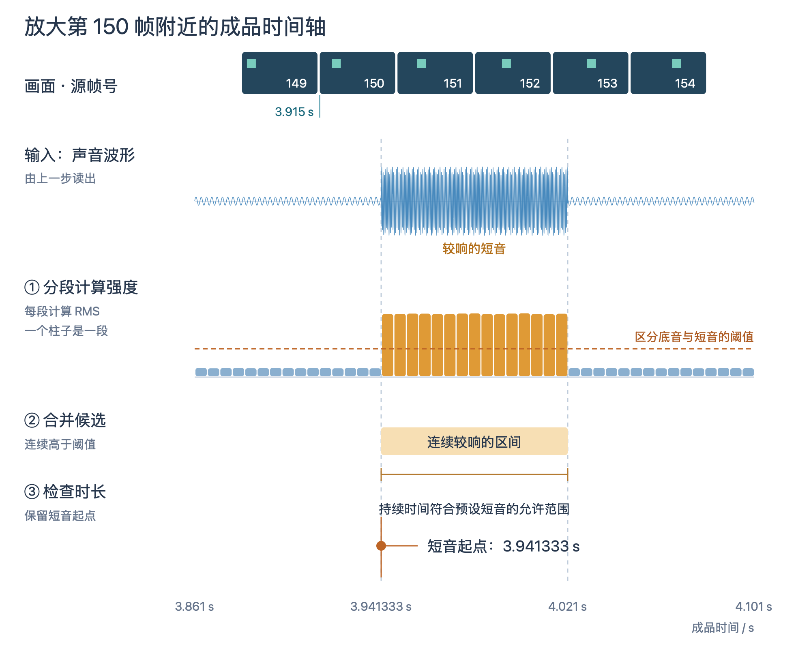
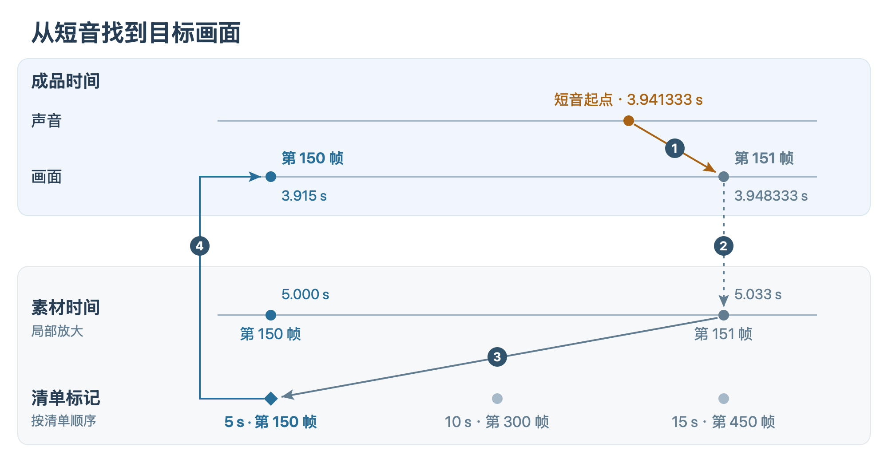
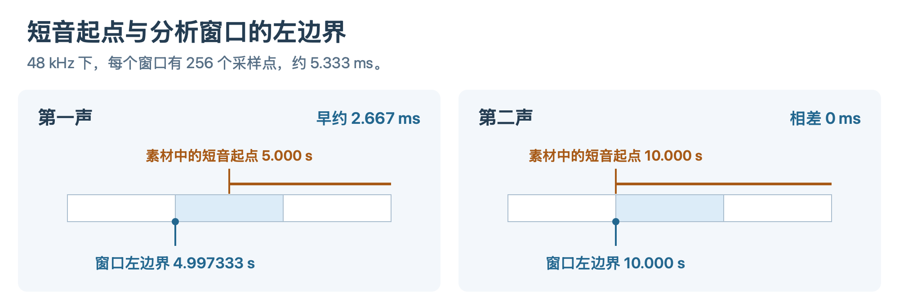
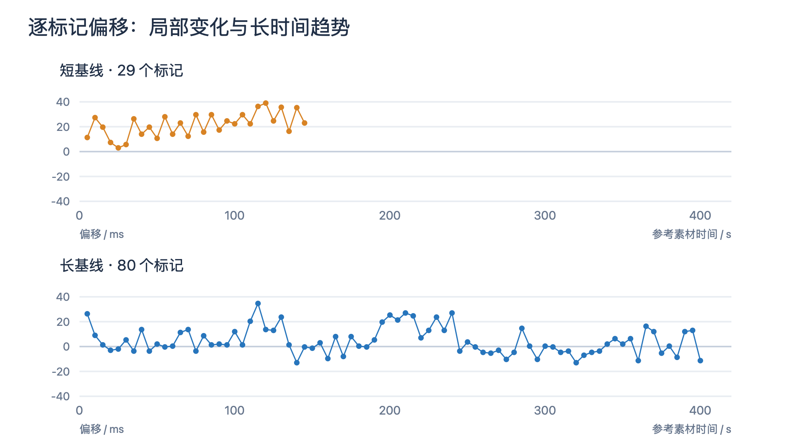
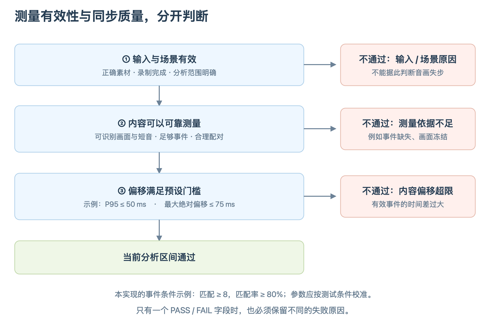

在上一篇[《录屏结束了，声音却少了三秒》](/posts/gecko-stop-audio-tail/)里我们遇到了音画不一致的问题，说明录屏的成功不能只检测画面变化，还需要考虑音频。

这里遇到的是音轨和视频轨时长不一致的情况，但即使时长一致，声音和画面也有可能是不同步的。要测出音画同步的问题，靠文件头尾的元数据不够，必须找到同一个事件在成品声音和画面中分别出现的时间。

在[《Gecko 录屏自动化测试设计》](/posts/gecko-recording-test-automation/)里我们实现了一套自动化测试，用来检测画面变化情况。本文沿用这套自动化框架，重点在素材生成和结果分析两段增加**音画标记**与**偏移测量**能力，随后再通过基线校准定出判定门槛，汇总进最终结论。。



*扩展后的三段链路：素材提供音画对应关系，Runner 复用原有流程完成录制，成品分别接受画面检查和音画检查。*

## 素材生成：把声音和画面联系起来

### 在指定画面加上声音

日常视频里，看见双手合上、听见掌声，人就知道该比较哪两个瞬间。要让程序做同样的事，可以利用前篇已经写进画面的 80-bit 帧号，在指定帧出现时叠加一个清晰的声音事件。

参考视频固定为 **30 FPS**，音轨采样率为 **48 kHz**。音轨中始终保留一层较轻的 **440 Hz 底音**；从第 5 秒开始，每隔 5 秒就在底音上叠加一声较响的 **1760 Hz 短音**，持续 **80 毫秒**。



**底音和短音承担不同的任务。** 底音让两次标记之间也有连续信号，便于检查音频是否中断；短音制造明显的能量跃升，用来定位声音事件。

### 同时生成参考视频和标记清单

生成器除了输出 `reference.mp4`，还会输出与它配套的标记清单 `reference.markers.json`。清单记录每次短音开始的素材时间，以及在同一时刻开始显示的源帧号：

```json
{
  "fps": 30,
  "markerIntervalSeconds": 5,
  "markerDurationSeconds": 0.08,
  "events": [
    {"seconds": 5, "frameID": 150},
    {"seconds": 10, "frameID": 300}
  ]
}
```

*按 30 FPS 编号，第 5 秒对应第 150 帧，所以清单把这声短音和帧号 150 记在一起。*

生成器用同一组参数写出 MP4 和清单。即使录制在播放中途才开始，画面里的帧号仍能告诉分析器，当前内容来自素材的哪个时间点。

## 结果分析：GeckoAVSyncProbe 如何测量偏移

录制结束后，Runner 复用前篇得到的成品 MP4、运行日志和 `protocol.json`，同时把 `reference.markers.json` 交给新增的独立命令行工具 **`GeckoAVSyncProbe`**，执行类似下面的 Shell 命令，将其一次性输出的完整 JSON 保存为 `av-report.json`：

```bash
swift run GeckoAVSyncProbe \
  /path/to/recording.mp4 \
  /path/to/reference.markers.json \
  > av-report.json
```

`GeckoAVSyncProbe` 不参与实时录制，直接解码成品 MP4，输出逐事件测量与统计；最后由判定器汇总运行记录、画面检查与音画报告，生成 `assessment.json`。



*Runner 录制结束后，分别调用 `GeckoMovieProbe` 和 `GeckoAVSyncProbe` 分析 MP4 得到 `movie.json` 和 `av-report.json`；最后汇总生成 `assessment.json`。*

### 1. 让画面和声音沿用同一条成品时间轴

分析器使用 `AVAssetReader` 读取成品 MP4：

- **视频轨**：解码为 BGRA 像素，识别每帧的源 `frameID`，保留样本的呈现时间（`CMSampleBufferGetPresentationTimeStamp`）；
- **音频轨**：解码为 48 kHz 单声道 32-bit 浮点 PCM，保留每个音频缓冲的时间戳 `pts`。



*每格是一帧，左边缘对应开始显示的时刻。第 150 帧的 3.915 秒取自录制记录，相邻帧按 30 FPS 示意，声音波形按参考素材合成。*

两路时间直接沿用 MP4 轨道自带的媒体时间轴，**不能把各自的首帧都当成零点**，否则音轨原本晚开始或早开始的时间差会被抹掉。对于音频缓冲内部第 `start` 个采样点，其对应的成品时间为：

```swift
let sampleTime = pts + Double(start) / 48_000.0
```

这一步在内存中留下两张表：一张是“源帧号 — 成品时间”，另一张是带精确成品时间刻度的 PCM 采样流。

### 2. 从声音强度变化中定位短音

接下来单独扫描音轨，找出所有短音的起点。检测器按**分段计算强度 → 合并候选 → 检查时长**三步处理：



*横轴沿用成品时间。波形为合成示意，标出的短音起点取自这次录制的检测结果。*

**① 分段计算强度。** 48 kHz 音轨每毫秒有 48 个采样点，检测器每攒够 **256 个点**（约 **5.33 毫秒**）计算一次 RMS（均方根）能量，把密集波形变成一排柱子。一声 80 毫秒的短音会横跨约 15 根柱子。

**② 合并候选。** 因为不同录制环境或播放器音量不同，检测器先用所有窗口能量的**中位数（P50）**估计底音强度，用 **99 分位数（P99）**估计短音强度，计算出自适应阈值，再将连续高于阈值的柱子合并为候选：

```swift
let baseline = percentile(rmsValues, fraction: 0.50)
let high = percentile(rmsValues, fraction: 0.99)
let threshold = baseline + max((high - baseline) * 0.35, baseline * 2.0)
```

正常带短音标记的素材，`high / baseline` 通常在 7 倍以上，`(high - baseline) * 0.35` 会自动适应整体音量变化；而如果测试意外播放了没有短音标记的纯底音视频，`high` 和 `baseline` 几乎相等（实测比值仅约 1.03），`baseline * 2.0`  的下限兜底会直接让检测器返回 `0` 个标记，而不会把底噪波动误当成短音。合并时允许跳过不超过 **2.5 个窗口**（约 13.3 毫秒）的短暂能量凹陷。

**③ 检查时长，保留短音起点。** 只保留持续时间落在合理范围内的候选（预设 80 毫秒时，允许范围为 **28～200 毫秒**），排除尖峰噪声或长段异常响声，取第一个超阈值窗口的左边界作为短音起点。

示例中的这声短音，起点测得为 **3.941333 秒**。

### 3. 先认出同一事件，再比较成品时间

找到了 **3.941333 秒**的短音起点，但每声短音听起来都一样，录制也可能从素材中途开始；如果按检测顺序硬配对，中间少录一声，后面就会全部错位。

所以配对必须分两步：**先借助附近画面认出“这是清单里的哪一次事件”，再回到成品读取该事件“目标帧”的时间。** 附近帧只用来定位事件，不能直接拿它算偏移——如果声音已经滞后，短音响起时画面可能已经推进到下一帧，拿附近帧相减会把真实偏移算小。



具体配对流程如图所示：

1. **读取附近帧号**：在短音起点 `3.941333 秒` 附近找到第 **151 帧**（成品时间 `3.948333 秒`）。这里找的是某一帧的起始时间。
2. **换算素材位置**：按 30 FPS 换算，第 151 帧位于素材 `151 / 30 ≈ 5.033 秒`。
3. **查清单确定事件**：清单中离 `5.033 秒` 最近的是 **5.000 秒**的**事件 1**，对应目标帧为第 **150 帧**。为防止跨周期误配，只接受距离清单事件不超过 **0.45 个标记周期**（5 秒间隔下即 ±2.25 秒）的匹配。
4. **读取目标帧时间**：回到成品读取第 **150 帧**的呈现时间 **3.915 秒**。如果录屏采样恰好漏掉了第 150 帧，允许在 **±3 帧** 范围内找最近的已解码帧，按源帧率外推估算目标帧时间，并要求估算结果落在短音起点 ±1.0 秒内。

最后用短音起点减去目标帧时间：`3.941333 - 3.915000 = +26.333 毫秒`。**正值表示声音晚于画面，负值表示声音早于画面。**

每次配对的依据都会记入 `av-report.json` 的 `markers` 数组，同时保留 `nearestDecodedFrameID` 和 `frameDelta`，方便回查时区分“直接读数”和“邻帧外推”：

```json
{
  "referenceSeconds": 5.0,
  "frameID": 150,
  "nearestDecodedFrameID": 150,
  "frameDelta": 0,
  "videoMarkerSeconds": 3.915000,
  "audioMarkerSeconds": 3.941333,
  "offsetMilliseconds": 26.333333
}
```

## 先校准基线，再冻结判定门槛

有了测量工具，不能直接拍脑袋定一个“偏移小于 X 毫秒就算通过”，而要先做两件事：**确认测量工具本身的误差量级**，以及**摸清正常录制下的基线分布**。

### 1. 用参考视频自检测量系统

先把生成的 420 秒参考视频直接交给 `GeckoAVSyncProbe`。因为它的画面和声音由同一组参数生成，真实偏移应当为零，这一步用来验证整条解码与配对链路的系统误差：

| 检查项 | 结果 |
|---|---:|
| 视频帧号解码 | 12600 / 12600 |
| 声音标记匹配 | 83 / 83 |
| 测得的偏移 | `0` 与 `-2.667 ms` 交替 |
| 最大绝对偏移 | **2.667 ms** |



出现 `0` 和 `-2.667 ms` 交替，是因为 48 kHz 下 256 采样点的窗口宽度约为 5.333 毫秒：第一声短音恰好从某个窗口中间开始，分析器把窗口左边界记为起点，早了半个窗口（约 2.667 ms）；第二声恰好对齐窗口左边界，测得偏移就是 0。

**83 个短音全部配对成功，最大绝对误差 2.667 ms**，这就是当前检测配置下的量化误差上限。

### 2. 用长基线区分“局部波动”和“持续漂移”

接下来对正常前台录制跑基线，观察统计指标和随时间的变化趋势。单看均值容易掩盖问题（正负偏移会抵消），因此 `av-report.json` 同时汇总以下指标：

| 指标 | 回答的问题 |
|---|---|
| `medianOffsetMilliseconds` | 整体上声音偏早还是偏晚（带正负号） |
| `p95AbsoluteOffsetMilliseconds` | 95% 的事件偏移控制在多少以内 |
| `maximumAbsoluteOffsetMilliseconds` | 最差的一次相差多少 |
| `markers` 逐事件序列 | 偏差是局部波动，还是随时间持续累积 |

下面是两轮同条件正常录制的实测基线：

| 录制时长 | 检测到 / 匹配的短音 | 偏移中位数 | P95 绝对偏移 | 最大绝对偏移 |
|---|---:|---:|---:|---:|
| 148.64 s | 29 / 29 | +22.333 ms | 36.067 ms | 39.000 ms |
| 399.54 s | 80 / 80 | +1.333 ms | 25.383 ms | 34.667 ms |

把逐事件偏移按时间顺序画出来，能看到单靠短录制很容易误判：



*上下两图来自两次独立录制，每个点是一组音画事件；横轴为事件在参考素材中的时间，纵轴为带正负号的偏移。*

148 秒的短录制中，前 10 个事件平均晚 **14.5 ms**，后 10 个平均晚 **28.5 ms**，看起来像在持续漂移；但在 400 秒长录制中，按每 20 个事件分段，平均偏移却是 **+4.60、+7.25、+6.67、-0.17 ms**，整体线性斜率仅 `-0.0189 ms/s`，后半段并没有继续扩大。

这说明**短时间内观察到的上升可能是局部波动，必须用更长的时间跨度才能确认是否存在真正的音画漂移**。

### 3. 依据基线分布冻结正式门槛

基于自检和两轮基线的最差实测值，我们在正式批量测试前冻结了判定门槛：

- **P95 绝对偏移 `<= 50 ms`**：高于两轮基线中最差的 P95（`36.067 ms`），给采集与窗口量化抖动留出合理余量；
- **最大绝对偏移 `<= 75 ms`**：高于基线最差最大值（`39.000 ms`），并额外覆盖约一个 30 FPS 源帧周期（`33.3 ms`）的保护空间；
- **证据充分性门槛**：稳定分析区间内要求短音**配对覆盖率 `>= 80%`**、**成功配对数 `>= 8`**，且 **`writerDroppedFrames = 0`**，防止样本过少或严重丢帧时误判通过。

## 接入自动判定：从 av-report.json 到 assessment.json

`av-report.json` 记录测量事实，涵盖能量阈值、检测与配对数、汇总分布以及逐事件 `markers`；判定器再结合运行记录、画面检查与前面冻结的门槛，生成最终的 `assessment.json`：



1. **输入与场景有效**：确认录制完成、操作协议有效，且分析区间边界完整。
2. **测量依据充分**：确认区间内能检测到足够多的短音并成功配对，同时检查音频轨连续性，防止某段声音根本没录进去却因为“没检测到标记”而漏过。
3. **偏移满足冻结门槛**：核对 P95 与最大绝对偏移是否落在 `50 ms` 和 `75 ms` 以内，无写入丢帧。

下面是一轮多阶段测试中，针对其中一段稳定恢复区间自动生成的 `assessment.json` 节选：

```json
{
  "assessment": "PASS",
  "recoveryAssessment": "PASS",
  "stableStartSeconds": 23.002111959,
  "stableEndSeconds": 88.323087375,
  "detectedMarkers": 13,
  "matchedMarkers": 13,
  "markerCoverage": 1.0,
  "medianOffsetMilliseconds": 0.3333333333337407,
  "p95AbsoluteOffsetMilliseconds": 2.999999999988745,
  "maximumAbsoluteOffsetMilliseconds": 2.9999999999930083,
  "failures": []
}
```

前序画面检查通过后，在 `23.002～88.323 秒` 的稳定区间内，**13 声短音全部配对成功**，P95 和最大绝对偏移均约为 **3 毫秒**，满足 `50 ms` 与 `75 ms` 门槛，最终判定 `PASS`。

如果某次测试出现 `FAIL`，`failures` 会直接指出卡在哪一层；需要深挖具体某一秒发生了什么，再按 `av-report.json` 里对应事件的 `frameID` 和 `audioMarkerSeconds` 回到成品 MP4 复核即可。

## 最后

在录屏自动化框架上补齐音画同步测量，核心依然是把“主观听感”拆成可复核的三步：

1. **让事件可识别**：用带 80-bit 帧号的画面和周期短音制造可配对的参照，把“过程偏移”和“轨道尾差”分开测量。
2. **让测量能抗干扰**：通过自适应能量阈值和周期/邻帧边界约束，在不依赖实时录制状态的前提下，从成品中稳定还原同一事件的声画时间差。
3. **先校准再定标准**：先用零偏移参考源摸清工具自身的量化误差，再用长基线区分局部波动与真实漂移，最后基于实测基线事前冻结门槛，让每一次 `PASS` / `FAIL` 都有据可查。

这下画面和声音都能自动检测了，终于不用再眼盯耳听了。 😂
