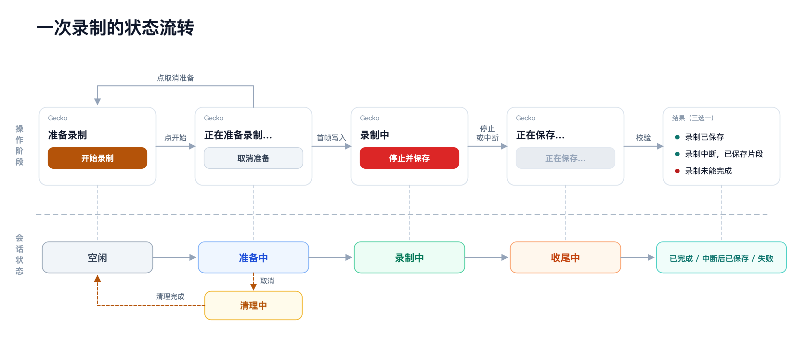
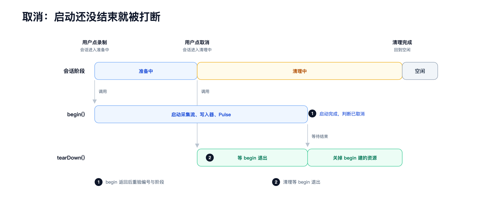
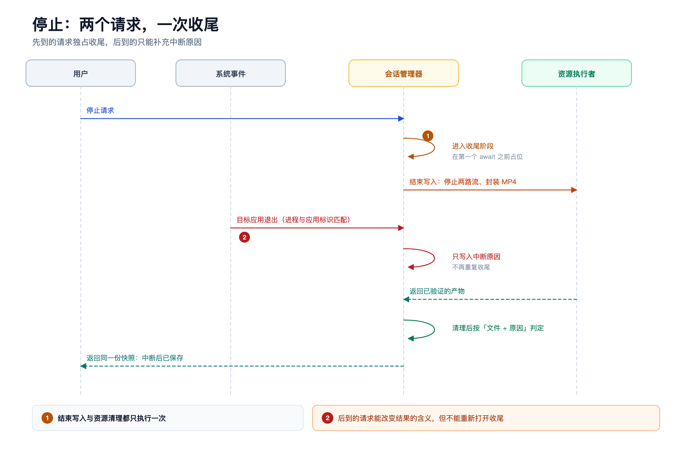
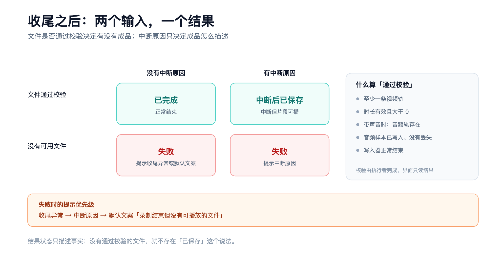

[Gecko](/posts/gecko-macos-app-recorder/) 是 macOS 上一款轻量录屏工具，界面上只有开始、取消、停止几个简单操作。

但在这几个按钮之下，每轮录制都同时运转着画面与声音两条采集流、一个 MP4 写入器、按需启停的 [Pulse](/posts/gecko-adaptive-pulse-design/)，以及一组盯着应用退出、窗口关闭、磁盘空间和系统休眠的守护任务。

实际开发时，真正棘手的往往不是“怎么把画面录下来”，而是跨异步边界的生命周期控制：准备阶段发出的系统调用没法中途撤回，用户操作随时可能和目标应用退出、流报错撞在一起，甚至写入器没报错也不代表文件真的能播。

**在异步调用不可撤销、外部事件随时并发的条件下，如何管好一轮录制的完整生命周期？**

下面从职责拆分、状态流转、并发控制与结果裁决四个方面，拆解 Gecko 的录制会话管理设计。

## 职责拆分：状态与资源分离

Gecko 把一轮录制的控制权拆成两个 `actor`：**会话管理器**负责状态仲裁，**资源执行者**负责底层操作。

- **会话管理器**为每轮录制分配唯一编号，维护当前阶段，决定何时允许开始、何时进入收尾，以及最终落入哪种结果。它不直接碰 ScreenCaptureKit 或 AVFoundation。
- **资源执行者**持有采集流、写入器、Pulse 和系统守护任务，通过一套标准协议向会话管理器提供原子化的生命周期操作：

```swift
protocol RecordingResources {
    func begin() async throws
    func finish(cause: StopCause) async throws -> Recording?
    func tearDown() async
}
```

这套协议有三条核心契约：

- `begin` 只调一次，返回意味着底层管线已就绪。
- `finish` 最多调一次，既负责停流封装，也负责成品校验，返回空值表示没有可用文件。
- `tearDown` 恰好调一次，并且必须能够等待仍在进行的 `begin` 落地后再回收资源。

这样拆分还有一个直接收益：**状态仲裁与硬件采集完全解耦**。所有复杂的取消、重入和并发竞态，都可以不依赖真实屏幕和权限，直接注入 Fake 资源在单元测试里做确定性验证。



*上面是界面操作阶段，下面是会话内部状态。*

在用户侧，整轮录制在菜单栏面板内流转：

1. **空闲**：打开面板显示「开始录制」，等待用户选定目标窗口与录制模式。
2. **准备中 / 清理中**：点击「开始录制」进入准备中，面板显示「正在准备录制…」并提供「取消准备」；若此时取消，会话进入清理中，等待底层回收完成后再回到空闲。
3. **录制中**：底层采集真正跑起来后进入录制中，面板提供「停止并保存」。
4. **收尾中**：点击停止或触发中断后进入收尾中，面板显示「正在保存…」且操作置灰，由后端完成停流、封装与校验。
5. **三种终态**：按实际结果分别落入「录制已保存」（已完成）、「录制中断，已保存片段」（中断后已保存）或「录制未能完成」（失败）。

## 状态流转：以真实媒体流为准

### 为什么不以系统返回作为录制起点

在 macOS 上通过 ScreenCaptureKit 进行采集时，如果目标应用正好被最小化或隐藏，系统接口依然会正常返回成功，但随后一帧画面都不会送过来。如果此时就把状态切到“录制中”，用户看到的将是正在计时、实则空转的假象。

Gecko 的定位是一个后台录制的 App，因此加了一个规则：**采集接口返回成功不代表录制开始，必须等到第一帧真实画面写入文件后，会话才切入录制中。** 如果 5 秒内收不到首帧，直接判定准备失败并回收资源。

### 准备阶段的取消与“清理中”状态

准备阶段由一串系统异步调用组成，一旦发出就无法在半途撤回。当用户点击「取消准备」时，底层的 `begin()` 可能正等待系统调用或首帧返回，随后仍会正常完成并退出。



*取消发生在准备阶段：阶段先切入清理中，tearDown 清理会等 begin 先退出。*

为了彻底堵住这个窗口期，Gecko 在会话层和资源层设了对称的两道防线：

1. **会话层标记取消并在 `await` 后重验**：用户点取消时，会话层同步记下当前会话的取消标记，并将阶段切入清理中。`begin()` 返回后，会话层会重新核对当前编号、阶段与取消标记，只要已经取消就直接走资源回收，不切入录制中。

```swift
try await resources.begin()

// 等待期间可能已经被取消，不能直接切入录制中
guard id == currentID, phase == .preparing, !isCanceled(id) else {
    return await tearDownIfCanceled(id: id)
}
phase = .recording
```

2. **资源层让清理等待 `begin()` 落地**：执行者把 `begin()` 保存为一个任务句柄。进入**清理中**后，`tearDown()` 会先等在途的 `begin()` 退出，再停掉刚建好的流、清理临时缓存，最后回到空闲。

只有两道防线同时在，取消才是真的取消——不会出现“面板已经回到空闲，后台采集流还在跑”的资源泄漏。

而如果准备阶段是被异常或系统中断事件打断（例如准备过程中报错、5 秒无首帧或目标应用提前退出），清理完成后会直接落入**失败**，而不是回到空闲。

## 并发控制：多源收敛与幂等收尾

进入录制中之后，控制权不再只属于用户。停止信号可能来自五个方向：用户手动停止、目标应用退出、目标窗口关闭、采集流或写入器运行期报错，以及息屏、系统休眠、磁盘空间不足等环境事件。

Gecko 将所有这些信号全部收敛到会话管理器的同一个 `stop(id:cause:)` 入口，但在进入状态机之前，必须先解决**身份误杀、状态误判和事件乱序**三个问题。

### 入场前的三道过滤

| 信号来源 | 误判风险 | 治理规则 |
| --- | --- | --- |
| 目标应用退出 | 同款应用存在多实例或辅助进程 | 要求进程号（PID）与应用标识（Bundle ID）**同时匹配** |
| 目标窗口关闭 | 切桌面、最小化或隐藏都会让窗口离开屏幕 | 对完整窗口目录连续多次核查确认缺失，才算关闭候选；**纯音频录制模式忽略单窗关闭** |
| 采集流报源丢失 | `Cmd+Q` 退出应用时，流回调往往比应用退出通知更早到达 | 对源丢失信号做短暂延迟，优先让位给核验后的应用退出通知 |

其中**乱序让位**尤为关键：如果不给“源丢失”留出宽限窗口，用户用 `Cmd+Q` 退出被录应用时，先到的流回调就会抢先把结束原因写成“采集中断”，掩盖真实的“目标应用已退出”。

### 收尾锁：先占位，再 await

信号通过过滤进入 `stop` 后，会话就会触发收尾流程：按顺序停止 Pulse、关闭音视频采集流、等待写入器封装成完整的 MP4/M4A 文件，并对产物做可读性校验，最后由 `tearDown()` 释放底层资源。

这是一串跨多个系统调用的耗时异步操作，不能被打断，更不能执行两次。麻烦在于，进入这一步的请求可能撞在一起：比如用户点击「停止并保存」的同时，目标应用恰好退出，两个停止请求几乎同时抵达。

Swift 的 `actor` 虽然保证同一时刻只有一段同步代码在执行，但一旦遇到 `await`，当前任务就会挂起，其他请求可以重入进来。如果先等停流再改状态，第二个请求就会跟着再跑一遍收尾，把文件彻底写坏。

Gecko 采用的规则是**先占位，再等待**——在第一个 `await` 之前，同步把阶段锁死为收尾中：

```swift
phase = .finishing               // 先同步占位，再挂起等待
let artifact = try await resources.finish(cause: cause)
await resources.tearDown()
```



*用户停止与应用退出的真实交错：进入收尾阶段是第一个请求的特权。*

从这一刻起，所有后到的请求看到状态已经是“收尾中”，都不会再触发第二次 `finish()` 或 `tearDown()`，而是遵循统一仲裁规则：

| 先进入收尾的请求 | 后到达的事件 | 最终记录的结束原因 | 最终结果 |
| --- | --- | --- | --- |
| 用户停止 | 无 | 用户停止 | 已完成 |
| 用户停止 | 目标应用退出 | 用户停止（补充中断标记） | 中断后已保存 |
| 目标应用退出 | 用户停止 | 目标应用退出 | 中断后已保存 |
| 用户停止 | 延迟到达的流故障回调 | 忽略流故障 | 已完成 |

**谁先拿到占位权，谁决定底层文件如何封装；后到的有效中断只能补充结果描述，而停止过程中陆续关流触发的迟到流报错则直接忽略**，避免把一次正常停止改写成失败。

### 跨轮次隔离

异步回调不仅会在同一轮内抢跑，还可能跨轮次“穿越”：即使上一轮已经收尾清理完毕，停止前一瞬间已发出的异步投递，以及带延迟窗口的在途检测任务，仍可能在用户紧接着开启新一轮之后才排队执行到。如果回调直接去读“当前会话”，就会把上一轮的中断记到新会话头上，甚至把新会话停掉。

解决办法很简单：所有回调在注册时就绑定那一轮的编号，执行时把编号带回来，在入口做第一道比对：

```swift
guard sessionID == currentID else { return snapshot }
```

编号对不上直接返回，连原因都不会写。这与准备阶段对过期的 `begin()` 做 `(id, phase)` 重验，本质上是同一套隔离思想：旧会话的回调被编号挡住，当前会话里过期的异步结果被阶段挡住。

## 收尾与裁决：以真实产物为唯一真相

### 按终止原因差异化封装

收尾不是简单地“把流关掉”。不同的停止原因，决定了写入器在最后几百毫秒内被允许做什么：

| 结束原因 | 封装与容错策略 |
| --- | --- |
| 用户停止 | 对齐音视频两路样本的共用截止点，正常封装 |
| 目标应用退出 | 容忍与“流已停止/源消失”精确对应的错误码，尽量封装已写入的样本 |
| 窗口消失 / 显示器熄灭 | 影片时长截断到最后一帧视频，避免画面定格后音频继续拖出长尾 |
| 采集流或写入器故障 | 不吞异常、不美化错误，按实际写入结果判定 |

对于关窗、息屏这类“源消失”场景，还有一道额外的**尾差保护**：封装完成后，如果文件总时长超出最后一帧视频 0.25 秒以上，直接拒绝发布。因为画面停止后，音频流往往还会继续产生样本，这种文件放出来结尾会是一段漫长的定格画面。宁可明确报失败，也不交付一份“看起来正常”的坏文件。

### 写入器成功不代表文件可用

在多媒体开发里，写入器（`AVAssetWriter`）结束回调没报错，只说明“封口操作没崩溃”，并不保证产物真的能播——它可能一帧视频都没有，可能缺了音轨，也可能轨道时长为 0。



*四个格子对应三种结果：没有通过校验的文件，不会出现在“已保存”这一列"。*

因此 Gecko 的最终裁决只看两项输入：**真实文件是否通过校验**，以及**本次录制是否发生过中断**：

- 校验环节直接检查落盘后的媒体文件：容器时长有效、至少包含一条视频轨；若开启了音频，音轨必须存在且确实写入了有效音频样本。
- 只要校验不通过，无论文件名或前期写入状态看起来多正常，一律判定为**失败**，清理无效文件并告知用户录制未能完成。

收尾与裁决全部落地、会话到达终态后，外层会按顺序完成退场：注销系统事件监听、停止磁盘空间轮询、释放防睡眠断言。如果用户是在录制过程中直接退出 Gecko 应用，应用层会先延迟终止流程，等这套收尾与断言释放全部跑完再真正退出。

## 小结

回到最初的问题：面对不可撤销的异步准备、随时并发的外部事件和不可靠的底层回调，怎么把录制会话的完整生命周期管住？

Gecko 这套方案可以归纳为四条设计原则：

1. **状态与资源解耦**：状态机只做纯逻辑仲裁，底层采集通过标准协议接入，让复杂的并发竞态可以脱离硬件做确定性单测。
2. **准备可取消、清理等准备落地**：每次 `await` 返回后都重验会话编号与当前阶段，清理流程必须等待在途的 `begin()` 落地，从根上杜绝资源泄漏。
3. **收尾权先到先得**：在首个 `await` 之前同步占位锁死状态，配合 `sessionID` 隔离跨轮次的迟到回调，保证收尾严格幂等。
4. **结果只认真实文件**：能不能算“已保存”，由落盘后的媒体轨与时长校验说了算，不由接口返回值或界面状态推断。

这四条并不局限于录屏或 ScreenCaptureKit。凡是需要协调多路异步资源、处理外部突发中断的后台任务，本质上都在做同一件事：**把并发下的“偶发竞态”，变成状态机里的“确定性裁决”。**

## 写在最后

这是 [Gecko 开发系列](/guides/gecko/)的最后一篇文章了，拖了快两周终于弄完了。

回想这一个多月的开发历程，还是蛮折腾的，几度想要弃坑了。

也见识了 GPT 新模型的降智、过度防御、容易跑偏的问题，以及 Claude 模型的专业，好几次都是通过它发现的一个点扩展出一条新思路。

虽然因为黑屏的问题不能对外推广，但至少把原因弄清楚了，也不算半途而废吧。😃
