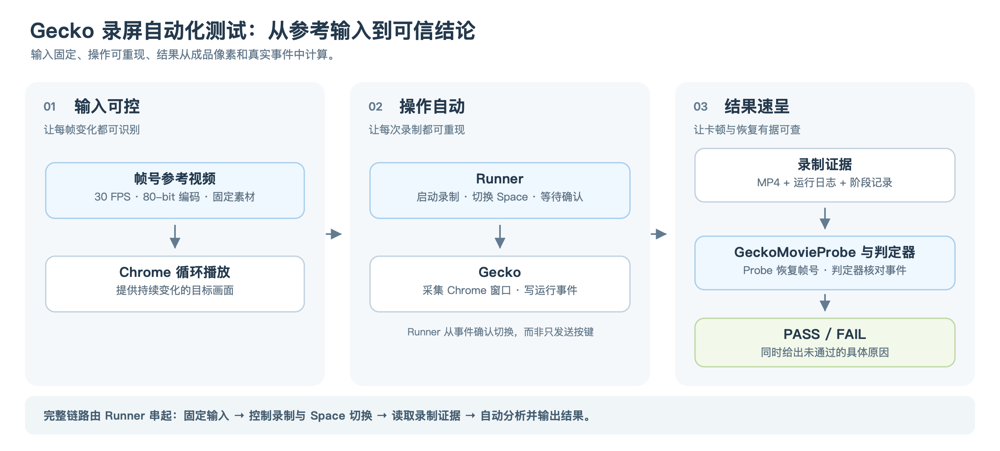
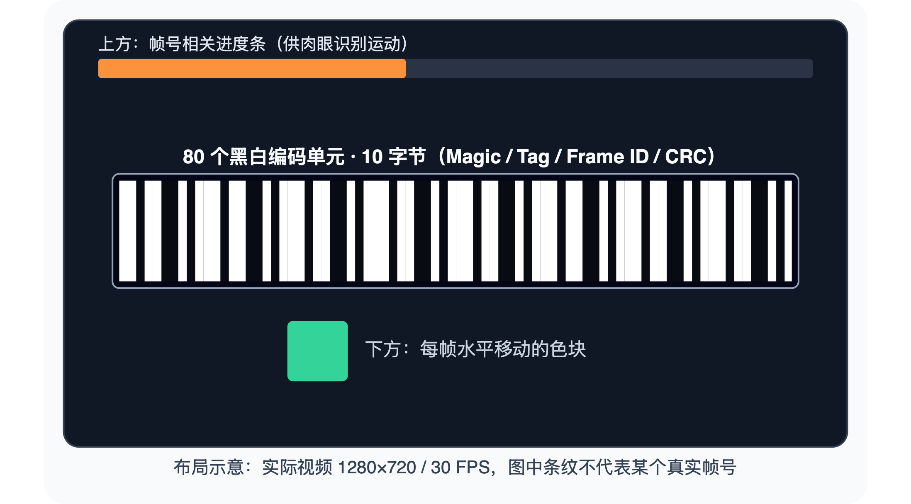
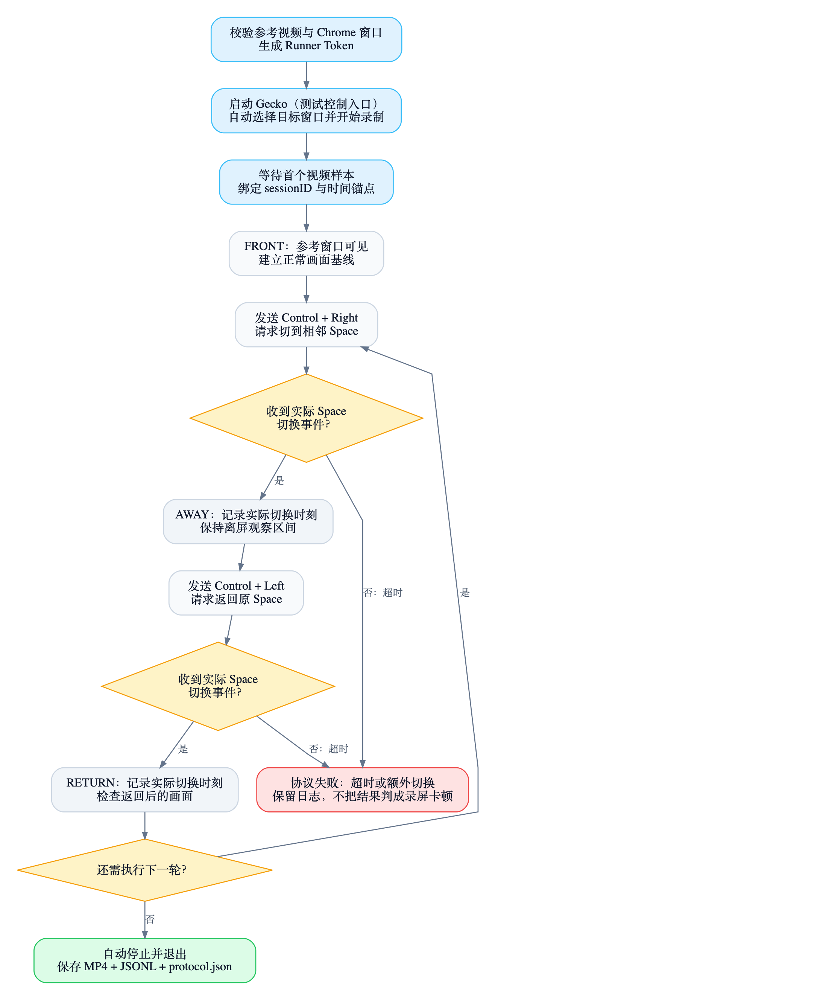
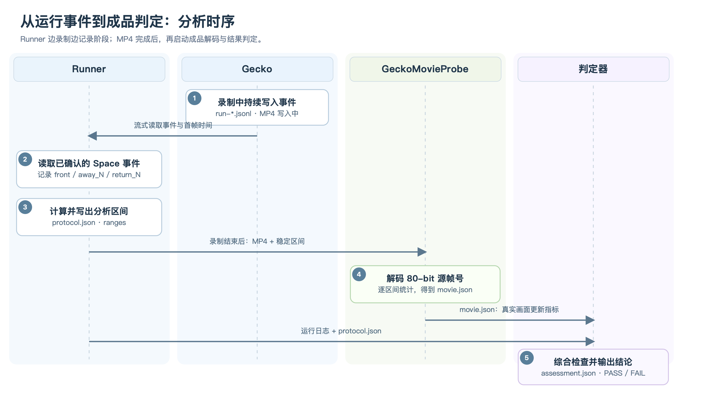
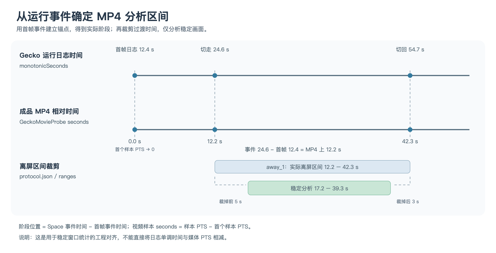
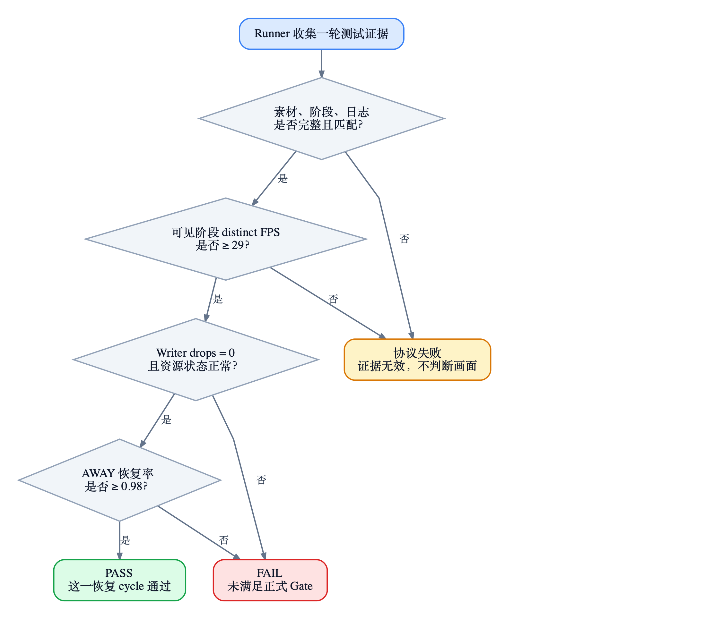

上一篇[《切换桌面后，录屏画面几乎冻结》](/posts/screencapturekit-cross-space-freeze/)中的 OBS 对照测试就发现：一段 20 秒的录像输出了 1200 个视频样本，实际却只有 39 个不同的源画面。虽然文件保持着 60 FPS，真正的画面更新率却只有 1.95 FPS。

这意味着，**要判断录屏是否真正捕获到了新的画面，就必须分析最终录制的视频内容，而不能只依赖回调数量或文件帧率**。

另一方面，手动测试也很难重复：切换的时机、停留时间、窗口状态稍有不同，得到的结果就可能不一样。

为了解决这些问题，我把测试串成了一条从输入到操作再到结果全自动执行的链路：



*三段自动化链路。参考视频提供可识别的输入，Runner 调度 Gecko 录制与 Space 切换，再利用成品视频和运行事件完成分析与判定。*

下面依次拆解这三段链路的实现：先构造能被客观识别的输入，再让录制操作自动执行，最后用成品视频和运行日志得到可复核的结果。

## 输入可控：生成每帧都能被识别的参考视频

### 参考视频是什么样的

假设录制文件里连续出现了 5 个视频样本，但其中的真实画面是这样的：

| 输出样本 | 1 | 2 | 3 | 4 | 5 |
|---|---:|---:|---:|---:|---:|
| 预期源帧号 | 100 | 101 | 102 | 103 | 104 |
| 实际录到的源帧号 | 100 | 100 | 103 | 103 | 104 |

虽然输出了 5 个样本，只有 3 个不同的源画面。若仅统计 MP4 帧数，很容易漏掉这种卡顿。普通影视片段又可能本来就包含静止镜头，简单比较相邻画面的像素也无法可靠判断。

所以测试输入不是任意一段视频，而是一段**每帧都有独立编号**的视频。画面本身由三个部分组成：



*参考视频画面示意。上方进度条和下方移动色块便于肉眼观察；中间的黑白码条供程序恢复帧号。*

| 画面部分 | 实现 | 作用 |
|---|---|---|
| 顶部橙色进度条 | 宽度随帧号周期性变化 | 用眼睛快速判断视频还在播放 |
| 中间黑白码条 | 每帧绘制 80 个黑白单元 | 程序可从录制结果中恢复源帧号 |
| 下方绿色移动色块 | 横向位置随帧号变化 | 便于观察重复与跳变 |

参考视频固定为 **30 FPS**。第 0 帧编码 `frameID=0`，第 1 帧编码 `frameID=1`，依次递增；即使进度条或色块的运动周期重复，帧号仍然唯一。

此外还有一条用于时间对照的音轨：持续的低电平 **440 Hz** 底音，以及按固定间隔叠加的 **1760 Hz、80 ms** 短音，为核对视频与音频的时间位置提供标记。

### 80 个黑白单元怎样表示一个帧号

这 80 个单元对应 **10 字节、80 bit** 的固定格式，不是肉眼可读的数字：

| 字节 | 长度 | 内容 | 用途 |
|---|---:|---|---|
| 0–1 | 16 bit | Magic：`D3 9A` | 确认读到的是本协议的码条 |
| 2–3 | 16 bit | Session Tag：`18251` | 区分当前参考源和其他内容 |
| 4–7 | 32 bit | `frameID`（大端序） | 当前源视频帧编号 |
| 8–9 | 16 bit | CRC-16 | 检查前 8 字节是否被读错 |

生成器先将 Magic、Tag、frameID 写成 8 字节，对其计算 CRC-16（初值 `0xFFFF`，多项式 `0x1021`），再追加 2 字节校验值。最后逐位展开为 80 个黑白单元，`1` 对应白色、`0` 对应黑色，每个字节高位先绘制。

例如 `frameID=150` 表示参考视频第 5 秒对应的源帧。分析录制成品时，程序必须同时通过 **Magic、Tag、CRC** 校验才接受这个编号；任何一项失败都标记为“无法解码”，而不是猜测相邻帧号。

黑白而不是灰阶编码，也有实际考虑：参考视频经过浏览器缩放、ScreenCaptureKit 采集和 H.264 再压缩后，像素值可能改变，但黑白区分仍然比较稳健。

### 视频如何生成：从逐帧绘制到 MP4

生成链路如下：

```text
framecode-reference-frames.mjs
   │ 每秒生成 30 帧，每帧绘制 320×180 RGB24 像素
   │ 更新 frameID、进度条、移动色块、80-bit 码条
   ▼
stdout：连续 rawvideo 字节流
   │
   ▼
FFmpeg
   ├─ 最近邻放大到 1280×720，保留码条的清晰边缘
   ├─ 编码 H.264 / yuv420p
   ├─ 合入 48 kHz AAC 音轨
   └─ 输出 MP4
```

**第一步：逐帧生成可识别的画面。** Node.js 程序按照 `320×180`、`30 FPS`、`sessionTag=18251` 生成像素。每一帧都会重新计算 `frameID` 和 CRC，将 80 个 bit 画成黑白码条，再更新上方进度条和下方色块的位置。它不是把一组图片循环播放，而是随着帧序号不断生成新像素。

核心绘制逻辑可以简化为：

```js
const width = 320, height = 180, fps = 30;

for (let frame = 0; frame < durationSeconds * fps; frame++) {
  const pixels = Buffer.alloc(width * height * 3, 18);
  const code = bits(frame); // 80-bit：Magic + Tag + frameID + CRC

  for (let i = 0; i < 80; i++) {
    const left = Math.floor(width / 12 + width * 5 / 6 * i / 80);
    const right = Math.ceil(width / 12 + width * 5 / 6 * (i + 1) / 80);
    const value = code[i] ? 255 : 0;
    box(left, 70, right - left, 40, value, value, value);
  }

  box(30 + frame % 220, 125, 24, 24, 30, 230, 170);
  box(0, 0, Math.floor(width * (frame % 300) / 300), 8, 250, 170, 30);
  if (!process.stdout.write(pixels)) await once(process.stdout, 'drain');
}
```

*示意摘录，`bits()`、`box()` 的定义已省略。画面是 RGB24 格式，所以每帧输出 `320 × 180 × 3` 字节。写入标准输出后由管道直接交给编码器；遇到背压则等待 `drain`，不需要事先保存成千上万张 PNG。*

**第二步：编码视频并合入音轨。** FFmpeg 从标准输入读取原始 RGB24 数据，并明确指定 `320×180` 和 `30 FPS`，否则 rawvideo 本身没有尺寸与帧率元数据。随后以最近邻算法放大到 `1280×720`，让码条保持清晰的黑白边界，再用 H.264 和 `yuv420p` 编码视频。

音频不依赖麦克风，而是直接由表达式生成：持续的 **440 Hz** 低电平底音，以及从第一个标记间隔开始、每隔固定秒数叠加的 **1760 Hz / 80 ms** 短音。最终以 **48 kHz AAC** 写入同一个 MP4。这样音频标记与源帧号有确定的时间关系，例如 30 FPS 下第 5 秒对应 `frameID=150`。

下面是 Shell 封装中视频编码部分的核心命令，`audio_expr` 是按参数生成的 440/1760 Hz 音频表达式：

```bash
node Scripts/framecode-reference-frames.mjs 420 | \
ffmpeg -f rawvideo -pixel_format rgb24 \
  -video_size 320x180 -framerate 30 -i pipe:0 \
  -f lavfi -i "aevalsrc=exprs='${audio_expr}':s=48000:d=420" \
  -vf 'scale=1280:720:flags=neighbor' -shortest \
  -c:v libx264 -preset veryfast -crf 16 -pix_fmt yuv420p \
  -c:a aac -b:a 192k -movflags +faststart \
  Artifacts/capture-framecode-av-tag18251-420s.mp4
```

其中 `pipe:0` 表示从标准输入消费原始视频流；`flags=neighbor` 负责最近邻放大；`-shortest` 保证输出在较短的输入结束时停止。真正的脚本还会检查参数、拒绝覆盖同名产物，并处理生成失败的退出状态。

**第三步：输出可校验的测试素材。** 除了 MP4，还按相同时长和标记间隔生成一份声音标记清单，写出每个标记的时间、对应帧号、频率和持续时间；再对最终 MP4 计算 SHA-256。后续运行器首先校验哈希，确保每次使用的是同一份输入。

## 操作自动：Runner 接管录制与桌面切换

参考视频准备好之后，测试需要自动完成 Chrome 播放、Gecko 录制、切换 Space、返回目标窗口和停止录制。整个过程由 Runner 调度：它向系统发送操作，也等待 Gecko 返回事件，确认操作真的发生，而不是只按预设时间盲目执行。



*Runner 在录制就绪后推进可见、离屏和返回阶段。发送快捷键只是操作请求，只有观察到 `active_space_changed` 才确认 Space 发生了变化。*

### Gecko 的自动录制与运行日志

#### 为自动化提供录制入口

正常使用 Gecko 时，需要用户选定窗口并手动开始、停止录制。为了配合 Runner，Gecko 提供了一组**仅在测试参数启用时生效的自动控制逻辑**，将这些界面操作变成脚本可以触发的动作。

```text
Runner 创建带唯一标题的 Chrome 参考窗口
    ↓
启动 Gecko，传入窗口标题和测试参数
    ↓
Gecko 查找并核对目标窗口
    ├─ 找不到 / 标题不符 → 记录失败，终止本轮
    └─ 找到目标 → 启动 ScreenCaptureKit
                        ↓
                   首个视频样本到达
                        ↓
                   写出就绪事件
                        ↓
             到达停止条件后保存 MP4、退出
```

相关控制项分别解决不同问题：

| 测试控制项 | 用途 |
|---|---|
| `GECKO_EXPECTED_WINDOW_TITLE`、`GECKO_TEST_AUTOSTART_WINDOW_TITLE` | 只选择当前 Runner 创建的 Chrome 参考窗口，防止录错对象 |
| `GECKO_RUNNER_TOKEN` | 让 Runner 从多个运行日志中识别本轮启动的 Gecko 进程 |
| `GECKO_TEST_AUTO_STOP_READY_MODE=video` | 等到视频就绪后才开始自动停止倒计时 |
| `GECKO_TEST_AUTO_STOP_SECONDS` | 设置自动录制停止条件，避免测试一直运行 |
| `GECKO_TEST_AUTO_QUIT_AFTER_STOP=1` | 停止并保存录制后自动退出，向 Runner 交还控制权 |

这些参数是自动测试入口，并不是普通用户需要配置的录屏选项。开始录制后，Gecko 会输出**最终 MP4**，同时把运行过程中发生的关键事件写入 `run-<runID>.jsonl`，本文统一称之为**运行日志**。

#### 运行日志解析

运行日志采用 JSON Lines（JSONL）：一行一条事件，Runner 可以在 Gecko 仍在录制时持续读取新增内容。下面是一组示例，字段名称来自实际实现，时间与 ID 为说明用途而设定：

```jsonl
{"event":"run_started","runID":"RUN-X","timestamp":"2026-11-11T10:00:00Z","monotonicSeconds":0.001,"runnerToken":"TOKEN-X","osBuild":"example"}
{"event":"video_recording_start_requested","runID":"RUN-X","sessionID":"SESSION-X","timestamp":"2026-11-11T10:00:05Z","monotonicSeconds":5.0,"windowTitle":"Gecko Reference","windowID":123}
{"event":"first_video_sample","runID":"RUN-X","sessionID":"SESSION-X","timestamp":"2026-11-11T10:00:12Z","monotonicSeconds":12.4,"ptsSeconds":1052.7}
{"event":"active_space_changed","runID":"RUN-X","sessionID":"SESSION-X","timestamp":"2026-11-11T10:00:24Z","monotonicSeconds":24.6}
{"event":"active_space_changed","runID":"RUN-X","sessionID":"SESSION-X","timestamp":"2026-11-11T10:00:54Z","monotonicSeconds":54.7}
{"event":"video_capture_diagnostics","runID":"RUN-X","sessionID":"SESSION-X","timestamp":"2026-11-11T10:01:06Z","monotonicSeconds":66.9,"screenCallbacks":1600,"completeScreenCallbacks":1500,"writtenFrames":1490,"droppedVideoFrames":0}
{"event":"video_recording_completed","runID":"RUN-X","sessionID":"SESSION-X","timestamp":"2026-11-11T10:01:07Z","monotonicSeconds":67.1,"outputPath":"/path/to/recording.mp4","videoFrames":1490,"droppedVideoFrames":0}
```

所有事件共用一组身份和时间字段，其余字段由事件类型决定：

| 事件 / 范围 | 关键字段 | 在自动测试中的作用 |
|---|---|---|
| **所有事件** | `event`：事件类型；`runID`：同一个日志记录器的 ID；`timestamp`：便于阅读的墙上时间；`monotonicSeconds`：日志记录器启动后的单调时间；`sessionID`：录制会话 ID（只在关联录制的事件中出现） | 先确定是哪轮、哪次录制，再按照单调时间关联事件；`runID` 与 `sessionID` 不是同一概念 |
| `run_started` | `runnerToken`：Runner 传入的匹配标记；`osVersion`、`osBuild`、`lowPowerModeEnabled`、`thermalState`：机器环境 | 从 `run-*.jsonl` 中定位本次进程并保留环境信息 |
| `video_recording_start_requested` | `windowTitle`、`windowID`、`processID`：录制目标；`minimumFrameIntervalSeconds`、`captureCadenceDenominator`：采集参数 | 确认目标和配置，**不代表此时已经收到视频帧** |
| `video_capture_started` / `first_video_sample` | 前者标记采集启动；后者的 `ptsSeconds` 是首个样本的媒体时间戳，事件的 `monotonicSeconds` 是 Runner 使用的首帧时间锚点 | 区分“采集已启动”和“首帧真正到达”；阶段计时以首帧就绪为前提 |
| `active_space_changed` | `monotonicSeconds`：Space 变化的日志时间 | Runner 用它确认发生了 Space 变化，并记录离屏、返回的实际边界 |
| `video_capture_diagnostics` | `screenCallbacks`：所有屏幕回调；`completeScreenCallbacks`：完整帧回调；`screenStates`：各状态计数；`writtenFrames`：已写入帧数；`droppedVideoFrames`：丢帧数 | 区分采集回调、可写样本和真正写入的数据量 |
| `video_recording_completed` | `outputPath`：最终 MP4 路径；`videoFrames`、`droppedVideoFrames`：写入统计；`firstVideoPTS`、`lastVideoEndPTS`、`firstAudioPTS`、`lastAudioEndPTS`：媒体时间范围 | 确认录制完成，并找到下一步需要分析的成品 |
| 失败事件 | `test_autostart_failed.reason`、`video_capture_start_failed.error`、`video_stream_stopped_with_error.error` | 说明本轮启动或采集异常，不能继续按正常录制判定 |
| 恢复绘制相关事件（特定场景） | `adaptive_pulse_state_changed.state` / `emissionEnabled`、`pulse_manager_emission_changed.reason` / `requestedHz`、`pulse_manager_stopped.resourcesReleased` / `activeResourceInstances` | 需要检查恢复机制时再关联；**不属于判断 Space 是否发生切换的必要信号** |

尤其要注意：`screenCallbacks`、`completeScreenCallbacks` 和 `writtenFrames` 只是不同环节的数量。**回调持续增长、MP4 持续写帧，都不能单独证明录到的画面仍在更新。** 所以第三节还需要对成品视频中的帧号进行分析。

### Runner 如何确认切换并生成阶段记录

Gecko 提供事件后，Runner 才能在不操作界面的情况下推进状态机。Runner 首先通过 `runnerToken` 找到本轮运行日志，再锁定 `sessionID`；收到 `first_video_sample` 和控制器就绪事件后，开始可见阶段计时。

需要切换 Space 时，Runner 使用 AppleScript 向 macOS 发送快捷键：

```applescript
tell application "System Events" to key code 124 using control down
-- Control + Right：切到右侧 Space

tell application "System Events" to key code 123 using control down
-- Control + Left：切回左侧 Space
```

**发送成功不等于已经切换。** Runner 继续监听 `active_space_changed`：只有观察到该事件，才把状态切换为离屏或返回，并记录事件的 `monotonicSeconds`。预期切换超过 **45 秒**仍未确认、稳定阶段出现额外切换，或 Gecko 提前退出，都会令本轮协议失败。前提条件是 Chrome 所在 Space 与切换目标位置固定，系统快捷键及辅助功能权限已正确配置。

Runner 对阶段使用统一命名：`front` 是切换前的可见基线，`away_N` 是第 N 次切走后的离屏阶段，`return_N` 是第 N 次返回后的可见阶段。例如 `away_1` 与 `return_1` 对应第一次切走和切回。重复次数与阶段持续时间是可配置的测试条件，不改变这套记录方式。

#### 从确认事件生成 protocol.json

Runner 一边监听事件一边保存阶段边界；等正式区间完成后，写出 `protocol.json`。它的作用是把**实际发生的操作时间**整理为后续视频分析能够直接使用的区间，而不是根据发送快捷键的预定时间猜测切换位置。Runner 的普通进度和错误消息仍打印到终端，`protocol.json` 才是持久化的结构化阶段记录。

下面是一组示例：

```json
{
  "protocolValid": true,
  "sessionID": "SESSION-X",
  "firstVideoMonotonicSeconds": 12.4,
  "cycles": [{
    "cycle": 1,
    "awayStartMonotonicSeconds": 24.6,
    "returnStartMonotonicSeconds": 54.7
  }],
  "ranges": {
    "front": {
      "phaseStart": 0.0, "phaseEnd": 12.2,
      "analysisStart": 3.0, "analysisEnd": 9.2
    },
    "away_1": {
      "phaseStart": 12.2, "phaseEnd": 42.3,
      "analysisStart": 17.2, "analysisEnd": 39.3
    },
    "return_1": {
      "phaseStart": 42.3, "phaseEnd": 54.3,
      "analysisStart": 47.3, "analysisEnd": 52.3
    }
  }
}
```

`cycles` 保存 Space 变化事件对应的日志时间；`ranges` 按 `front`、`away_N`、`return_N` 划分视频阶段。`phaseStart` / `phaseEnd` 是阶段在 MP4 内的相对时间，`analysisStart` / `analysisEnd` 则是在阶段内裁去切换动画及稳定等待时间后，用于统计真实画面更新的区间。`protocolValid` 表明 Runner 是否完整执行并确认协议；若为 `false`，本轮不能作为有效的录制质量测试。

这些时间字段怎样对应到 MP4，将在下一节**实际分析步骤**里结合图示说明。

## 结果速呈：从运行证据到自动判定

**同一个 Runner 负责整条流水线**：录制过程中先从运行日志确认 Space 变化、整理分析区间；等 Gecko 保存成品 MP4 后，再自动完成视频解码和结果判定。用户不需要另外执行分析命令。

### 从运行日志到成品判定：分析流程



*Runner 在录制过程中监听 Space 事件并生成 `protocol.json`；录制结束后，调用 `GeckoMovieProbe` 分析 MP4 得到 `movie.json`；最后汇总生成 `assessment.json`。*

这里的 **`GeckoMovieProbe` 是一个独立的 Swift 命令行程序**：它专门在录制结束后读取成品 MP4，从画面中恢复源帧号并计算各区间的统计数据。Runner 负责调用它、保存输出，再把结果交给最终判定器。

#### 先计算分析区间：日志事件怎样对应到 MP4

运行日志的 `monotonicSeconds` 是 Gecko 日志记录器的单调时间；`first_video_sample` 为视频开始提供锚点。Runner 用 Space 变化事件减去首帧事件时间，得到 `protocol.json` 中的阶段位置。例如：`24.6 − 12.4 = 12.2` 秒。



*阶段真实边界对应 `phaseStart` / `phaseEnd`；裁掉切换过渡后的绿色部分，才是 `analysisStart` / `analysisEnd`。*

`GeckoMovieProbe` 则使用视频样本的媒体 PTS 计算相对时间 `seconds = samplePTS − firstSamplePTS`，据此筛选落在分析区间内的帧。**媒体 PTS 不能直接与日志的 `monotonicSeconds` 相减**；图中是以首帧事件为锚点、用于稳定窗口统计的工程对齐方式，而非亚帧级同步校准。

### GeckoMovieProbe：从成品 MP4 恢复源帧号

Gecko 完成写入后，`GeckoMovieProbe` 才开始工作。它不参与录制，也不读取实时屏幕，而是直接对**最终交付的 MP4 文件**做逐样本检查。

```text
成品 MP4
   ↓
AVAssetReader 解码视频样本，得到 BGRA 像素与 PTS
   ↓
定位浏览器窗口中的参考视频区域（16:9）
   ↓
在编码行的 80 个位置采样黑白像素
   ↓
校验 Magic / Session Tag / CRC-16
   ├─ 通过：获得源 frameID
   └─ 失败：记录 null，不猜测帧号
   ↓
按 protocol.json 提供的稳定时间区间汇总统计
   ↓
一次性输出完整 JSON（由 Runner 保存为 movie.json）
```

Chrome 的标签栏和窗口留白会改变视频在 MP4 中的位置，所以程序会先尝试整张画面，再搜索候选的 16:9 内容矩形。确定位置后，每个黑白单元取中心附近 **3×3 像素**的平均亮度；亮度低于 `60` 视为黑，高于 `195` 视为白，中间值不予接受。Magic、Tag 和 CRC 全部通过，才记录一个有效帧号。定位成功的矩形会缓存供后续样本使用，必要时可以重新定位并校验。

Runner 从 `protocol.json` 的 `ranges` 中读取全部稳定区间，将其整理为 `front=开始:结束`、`away_1=开始:结束`、`return_1=开始:结束` 这样的命令行参数，再调用 `GeckoMovieProbe`，执行类似下面的 Shell 命令，将其一次性输出的完整 JSON 保存为 `movie.json`：

```bash
swift run GeckoMovieProbe \
  /path/to/gecko-recording.mp4 \
  --tag=18251 \
  --bucket-seconds=5 \
  front=3:9 away_1=17:39 return_1=47:52 \
  > movie.json
```

`movie.json` 中的 `summaries` 按稳定区间组织，每个区间包含以下统计指标：

| 指标 | 计算方式 / 含义 | 解决的问题 |
|---|---|---|
| `samples` | 区间内视频样本总数 | MP4 有没有持续产生样本 |
| `decoded` / `decodeSuccessRate` | 成功识别帧号的样本数及比例 | 数据能否可靠分析 |
| `distinctFrameIDs` | 区间内不同 `frameID` 的数量 | 真正录到了多少张不同的源画面 |
| `repeatedAdjacentIDs` | 相邻有效样本的帧号相同次数 | 是否有重复画面 |
| `regressingIDs` | 帧号向后倒退次数 | 是否存在源时间线异常 |
| `maxSourceFrameJump` | 相邻有效帧号的最大正向跳跃 | 是否跳过大量源画面 |
| `maxObservedChangeGapIncludingEdgesSeconds` | 含区间首尾的最长无新帧号时间 | 是否出现持续冻结 |
| `observedSourceFramesPerSecond` | 首尾源帧号跨度 / 时间跨度 | 源视频时间线推进速度，**不是**录到的不同画面 FPS |

其中最容易混淆的是样本帧率与真正的画面更新率：

```text
样本 FPS       = samples / 分析区间时长
不同源画面 FPS = distinctFrameIDs / 分析区间时长
```

假设 10 秒内输出了 300 个视频样本，却只能识别出 12 个不同源帧号，文件样本 FPS 仍为 30，但真正观察到的不同源画面 FPS 只有 **1.2**。这就是为什么只看 `ffprobe` 帧率或 ScreenCaptureKit 回调数不能判断录屏是否冻结。

### 汇总判定：生成 assessment.json

最后，Runner 调用 Python 判定器，传入三个输入：**Gecko 原始 JSONL 日志、`protocol.json` 和 `movie.json`**。判定器把“动作是否按协议执行”和“成品像素是否真的更新”放在一起检查。



*先确认测试证据完整、可见基线正常，再检查 MP4 实际画面和录制状态，最终输出可复核的判断。*

判断过程分为三层：

**证据有效性。** 检查是否是本轮的 `sessionID`，是否存在首帧和 `video_recording_completed`，Space 变化事件与阶段边界是否完整，目标窗口和采集参数是否符合预期。可见阶段还要有足够的真实帧号更新，避免把“参考视频自己没播放”误判为录屏故障。

**录制质量。** 检查 `decoded`、`distinctFrameIDs`、`repeatedAdjacentIDs`、`regressingIDs`、最长无更新间隔，结合 `droppedVideoFrames` 分析是否为采集、写入或内容更新问题。写入丢帧数为零，也不代表画面一定连续。

**场景目标。** 对跨 Space 场景，用离屏区间的不同画面 FPS 与前后可见区间建立的基线比较，计算每次切换的恢复率：

```text
visibleBeforeFPS = 前一个可见区间的 distinctFrameIDs / 时长
awayFPS          = 当前离屏区间的 distinctFrameIDs / 时长
visibleAfterFPS  = 返回可见区间的 distinctFrameIDs / 时长

baselineFPS = (visibleBeforeFPS + visibleAfterFPS) / 2
recoveryRatio = awayFPS / baselineFPS
```

比如前后可见基线约为 `29.8` FPS，离屏阶段只有 `24.0` FPS，则恢复率为 `24.0 / 29.8 ≈ 0.805`。Gecko 的这套测试以 `0.98` 作为离屏恢复率门槛，并要求可见区间达到相应的参考源健康阈值。

`assessment.json` 会保留整体结论、每个区间的统计、逐次恢复率和失败原因。例如下面的精简示例表示：录制文件确实在写帧，但其中一个离屏阶段的真实画面更新率没有达到要求。

```json
{
  "assessment": "FAIL",
  "frontDistinctFPS": 29.8,
  "minimumRecoveryRatio": 0.805,
  "recoveryRatioThreshold": 0.98,
  "writerDroppedFrames": 0,
  "cycles": [{
    "cycle": 1,
    "previousVisibleDistinctFPS": 29.8,
    "awayDistinctFPS": 24.0,
    "returnedDistinctFPS": 29.8,
    "visibleBaselineDistinctFPS": 29.8,
    "awayRecoveryRatio": 0.805
  }],
  "failures": ["cycle 1 AWAY recovery ratio < 0.98 (0.805)"]
}
```

*示意数据，并非真实测试输出。现有判定器以 `PASS` / `FAIL` 和 `failures` 呈现结论；**协议无效造成的 FAIL，不能当成一次有效录制质量失败**，必须阅读失败原因。*

如果需要回查，可以按 `sessionID` 在原始日志里检索 `first_video_sample`、`active_space_changed`、`video_capture_diagnostics` 和 `video_recording_completed` 等事件，并与 `protocol.json` 的 `away_N` 时间窗口、`movie.json` 的同名区间摘要对应。这样能明确定位：哪一次切换、MP4 的哪段时间，究竟是测试没执行到位，还是文件持续输出样本却没有录到新的源画面。

## 最后

这是 Gecko 开发实践的第三篇，文章整理耗费近8个小时，希望能对你有所帮助。

因为太多次的手工测试，实在是太耗费精力了，折腾不起，一度测的都要放弃这个项目了。

现在有了这套自动化测试后，我终于可以摸鱼啦。 😄
