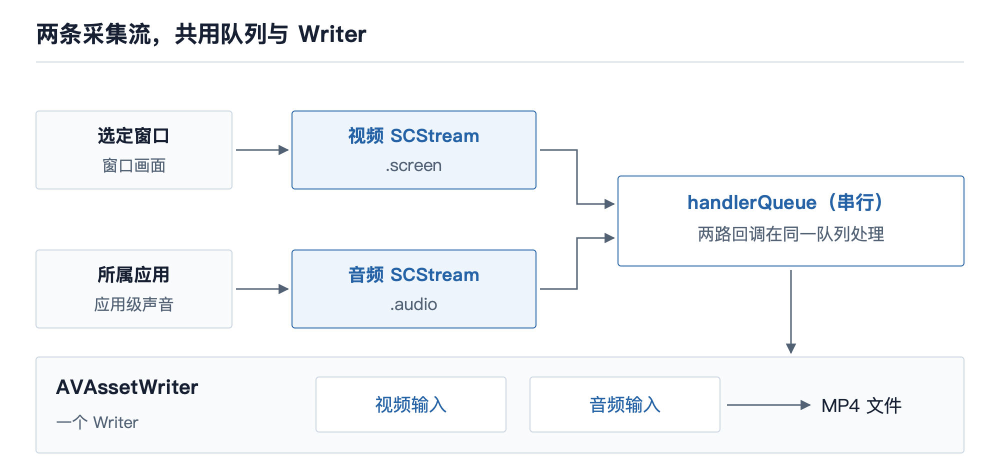
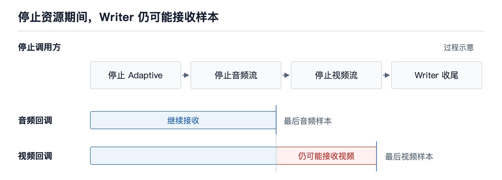
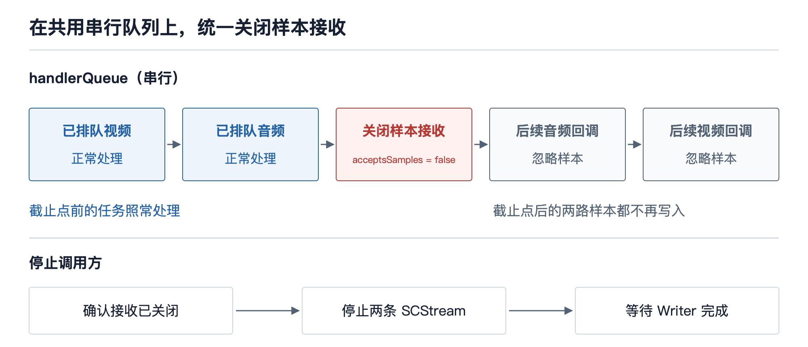

在给 [Gecko](/posts/gecko-macos-app-recorder/) 做产品回归时，发现了一个声音上的问题。

点击停止，文件正常保存，也能打开播放。但检查录制结果时，发现声音比画面提前结束了近三秒。

录制已经结束，日志里没有写入失败，为什么保存下来的视频还会少一截声音？

## 先看看音视频差了多少

先用 `ffprobe` 看了一下文件里的两条轨道：

| 项目 | 时间 |
|---|---:|
| 视频终点 | 41.658333 s |
| 音频终点 | 38.718583 s |
| 两条轨道相差 | **2.939750 s** |

也就是说，音频结束后，视频还多录了约 **2.94 秒**。

## 一个 MP4，背后是两条采集流

要解释这个尾差，先得说一下 Gecko 当时是怎么采集音视频的。

实现上，我用了两条独立的 `SCStream`：

- 视频流按选定窗口过滤，接收 `.screen` 样本。
- 音频流按所属应用过滤，只接收 `.audio` 样本。

两条流收到的样本，都通过同一条串行队列 `handlerQueue`，交给同一个 `AVAssetWriter`。Writer 内部分别有视频输入和音频输入，最后写进一个 MP4。



所以，界面上虽然只有一个“停止”按钮，背后却有两条独立运行的采集流。

**停止录制时，这两条流真的会一起停下来吗？**

## 两条采集流，是怎么停下来的

原来的收尾逻辑，简化后是这样：

```swift
// 仅保留执行顺序，省略可选对象及错误处理。
try await attachment.stop()          // Adaptive / Pulse
try await audioStream.stopCapture()  // 应用音频
try await stream.stopCapture()       // 窗口视频
try await writer.finish(stopCause: .user)
```

代码会先等待音频流停止，再停止视频流。等待音频流停止时，视频流还没有收到停止请求；随后停止视频流本身，也需要时间。

**而这期间，Writer 一直允许接收样本。** 视频仍可能继续写入，导致它比音频更晚结束。



## 先停止接收，再完成收尾

这里正好用到了前面那条共用队列。

既然音频和视频回调都在 `handlerQueue` 上处理，那么“关闭接收”也可以放到这条队列里。排在它前面的任务处理完以后，再让两路样本一起停止进入 Writer。

关键改动并不大：

```swift
// GeckoDiagnosticVideoWriter 中与接收截止点有关的代码。
// 从 handlerQueue 之外调用。
public func registerStopRequest(cause: GeckoStopCause) {
    handlerQueue.sync {
        stopAdmission.registerStop(cause: cause)
    }
}

public func stream(
    _ stream: SCStream,
    didOutputSampleBuffer sample: CMSampleBuffer,
    of type: SCStreamOutputType
) {
    guard stopAdmission.acceptsSamples else { return }

    // 继续原有的音频或视频样本处理。
}
```

`stopAdmission` 默认允许接收样本。用户停止时，把 `acceptsSamples` 改为 `false`，之后无论音频还是视频回调进来，都直接返回。



停止调用方在队列外，通过 `sync` 等到关闭接收这一步完成，再继续停止 Adaptive、音频流和视频流。

这样，**文件还接不接收新数据，就不必跟着底层资源的停止速度走了。** 后面的采集流即使还需要一点时间才能停完，也不会继续延长某一条轨道。

当然，Writer 这时还不能直接释放。已经接收的数据需要完成编码和封装，仍要在两条流停止后，标记输入完成，再等待 `finishWriting` 返回。

## 改完之后，再看音视频尾差

改完以后，重新用 Chrome 录制，再检查保存下来的 MP4：

| 指标 | 修正前 | 修正后 |
|---|---:|---:|
| 视频终点 | 41.658333 s | 41.171667 s |
| 音频终点 | 38.718583 s | 41.169979 s |
| 轨道尾差 | **2.939750 s** | **0.001688 s** |

这次两条轨道的终点只差 **1.688 毫秒**，实际回放的声音也正常了。

近三秒的尾差，在这轮录制里没有再出现。

## 总结

一个简单的停止按钮，背后却有音频、视频和 Writer 各自的收尾过程。

Gecko 这次的处理，是先在共用队列上统一关闭样本接收，再停止采集流，等待 Writer 完成编码和封装。

**停止接收数据和完成资源收尾，需要有各自明确的边界。** 前者决定哪些数据进入最终结果，后者保证已经接收的数据处理完毕。把这两件事分清楚，多路异步任务才能有序结束。
