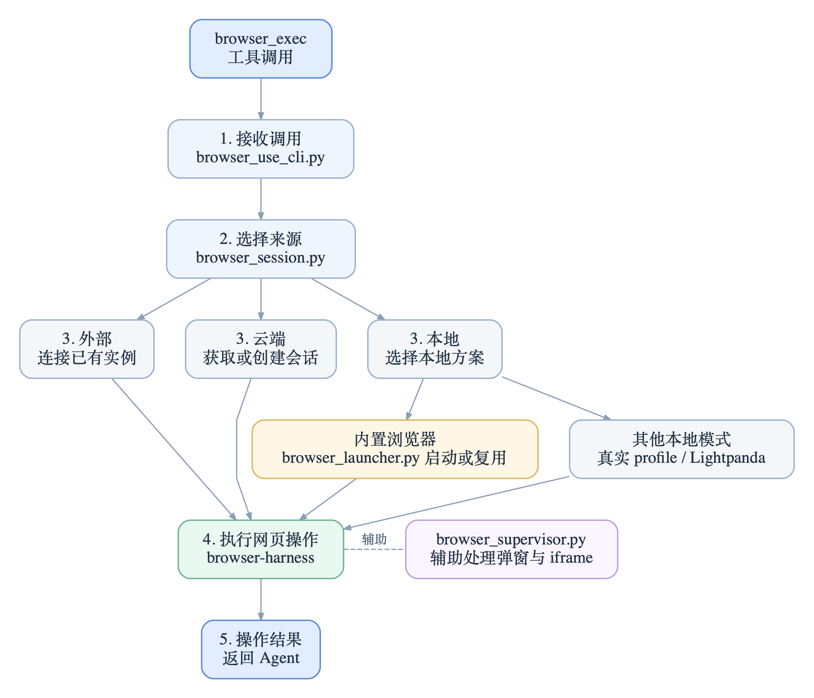

上一篇《[Hermes Agent v0.23.0 升级：一次安全修复，让我的 Chrome 无法启动](/posts/hermes-agent-v0-23-0-chrome-s6/)》讲了升级后 Chrome 无法启动的踩坑记录，今天来讲一下：当 Hermes 需要访问网页时，它究竟如何找到并管理浏览器？

Hermes 的网页操作主要通过 `browser_exec` 这个工具完成，比如打开网页、读取内容、点击页面元素等。

## 一次 browser_exec 背后发生了什么

整个流程可以概括为五步：接收调用、选择来源、准备连接或会话、执行网页操作、返回结果。



这里有两个容易混淆的地方。

一是 `browser_launcher.py` 并不参与所有浏览器调用。只有选择本地内置浏览器时，它才负责启动或复用进程；如果连接已有 CDP 端点或者使用云端会话，就不需要它。

二是 `browser-harness` 与 `browser_supervisor.py` 的职责不同。前者负责执行网页操作，后者在适用的 CDP 场景下维护持续连接，处理弹窗、iframe 等情况，并不负责浏览器的选择和启动。

### 浏览器从哪里来

来源主要有外部、云端、本地三类，但实际的判断要细得多。以 v0.23.0 为例，可以简化为：

```text
BU_CDP_* 运维级覆盖
    ↓
活跃的 /browser connect > BROWSER_CDP_URL > browser.cdp_url
    ↓
hybrid ::local（私有地址的本地旁路）
    ↓
云端 provider
    ↓
经授权的真实浏览器 profile
    ↓
Lightpanda
    ↓
内置本地浏览器
```

**第一，指定 CDP 地址意味着把启动责任交给外部。** `BU_CDP_URL`、`BU_CDP_WS` 是更高优先级的运维覆盖；普通配置则依次考虑当前 `/browser connect`、`BROWSER_CDP_URL` 和 `browser.cdp_url`。如果写了 `browser.cdp_url: http://127.0.0.1:9222`，Hermes 就按这个地址连接，而不会同时替你启动另一个浏览器。

**第二，云端失败和外部连接失败不是一回事。** 云端 provider 通常创建会话并提供连接信息，某些创建失败场景可以回退本地，并记录 `fallback_from_cloud`；Browser Use 直连则由 harness 处理创建。`::local` sidecar 是访问私有地址时的一条特殊本地路由，不等同于直接使用日常浏览器的真实 profile。

**第三，本地也不只一种方式。** 使用日常浏览器登录状态需要明确授权，Hermes 会处理 profile 快照；配置了 Lightpanda，则由对应引擎提供 CDP 端点。剩下的默认路径，才轮到 Hermes 管理的内置浏览器。

我之前在 Docker 里自己启动 Chrome，监听固定的 `9222`，让 Hermes 连接，实际是选择了第一种路径。升级后我撤掉了这项独立服务，转而使用最后一条路径。

下面重点看 **Docker 本地模式**。

## Docker 中的 Chromium 是怎么启动的

### 先找到浏览器在哪里

本地启动并不是简单地执行 `chromium`。`hermes_cli/browser_runtime.py` 会解析浏览器可执行文件：考虑显式指定的路径、由 Hermes 管理的安装，以及镜像中记录的路径等来源。

Hermes 的 Docker 镜像在构建阶段就准备了 Chromium，并把实际位置写入：

```text
/etc/hermes/chromium-executable-path
```

这是一个很实用的细节。不同 CPU 架构的 Chromium 目录布局并不一样；构建镜像时确认一次路径，就不需要在运行时硬猜 `chrome-linux64/chrome` 或其他文件名。启动阶段的检查也可以尽早发现自定义镜像删掉了浏览器文件的问题。

这里还有两个容易混淆的启动入口：`hermes_cli/browser_connect.py` 中用于 `/browser connect` 的 `launch_chrome_debug()`，主要面向宿主机的外部浏览器；Docker 内置浏览器走的是 `tools/browser_launcher.py`。

### 端口不是固定的 9222

启动时，一个关键参数是：

```text
--remote-debugging-port=0
```

这里没有固定使用 `9222`。Chromium 会选择一个可用端口，再把端口和调试地址写入 profile 目录中的 `DevToolsActivePort`。Hermes 读取这个文件，得到本次实例真正的 CDP 地址。

因此，**外部工具不能假设由 Hermes 启动的浏览器总在 `9222` 上**。需要连接时，要使用启动器返回的 `http_url`，或从 `DevToolsActivePort` 获取实际端口。

随机端口解决了调试端口冲突的问题，但还需要避免多个 Hermes 进程同时启动 Chromium、争用同一份 profile。

## 已有 Chromium，如何避免重复启动

`launch_chromium()` 返回的浏览器对象有几个值得注意的字段：`http_url` 是连接入口，`user_data_dir` 表示 profile 目录，`pid` 指向进程，`owned` 则区分“自己启动”还是“连接已有实例”。它还通过 `ephemeral` 区分临时与共享的生命周期。

| 模式 | 主要行为 |
|---|---|
| `ephemeral=True` | 使用进程私有的临时 profile；同一个运行中的会话可以复用自己的实例 |
| `ephemeral=False` + 持久 `user_data_dir` | 多个 Hermes 进程可以围绕同一份 profile 协调，先检查是否已有可用实例，再决定连接或启动 |

对于持久化的 `user_data_dir`，情况会复杂一些：多个 Hermes 进程可能同时使用同一个 profile，但这个目录只能由一个 Chromium 实例占用。因此，Hermes 需要先判断是否已有可用实例，再决定复用还是启动。

### 如何判断 profile 已被占用

Chromium 自身会在 profile 目录中维护 `SingletonLock`，其中可能包含主机名与 PID。容器重建后，主机名和 PID 命名空间都可能发生变化，不能简单地读取一个 PID、发现本进程看不到，就认定对方已经死亡。

Hermes 的处理思路是：**先判断已有浏览器是否仍然可用；能安全连接就复用，不能确认时宁愿拒绝覆盖。** 它会结合 `SingletonLock`、进程信息和 CDP 端点判断。对于有充分证据的陈旧锁，可以进行清理；对于无法验证归属的跨环境残留，则保持保守。

### 多个进程如何共享一个 Chromium

对于由 Hermes 启动的共享实例，还会留下两类记录：

- **launch record**：记录是谁启动的、如何确认还是原来的 Chromium 进程。
- **lease**：记录当前还有哪些 Hermes 进程持有使用权。

比如 gateway、CLI 和定时任务都需要同一份持久 profile：第一个进程负责启动，后来的进程连接它并登记持有关系。启动者先退出时，只要其他有效持有者还在，浏览器就可以继续运行；最后一个持有者退出时，再根据归属关系决定如何收尾。

为了避免 PID 重用带来的误判，持有者识别还要结合进程启动时间等信息，而不只保存一个 PID 数字。反过来，如果是用户自己启动、Hermes 只是附着上去的浏览器，`owned=False` 也意味着它不能随意接管关闭责任。

## 用完之后，如何回收

Hermes 设置了几道不同层次的回收机制：

1. **会话闲置超时。** `browser.inactivity_timeout` 默认约 120 秒，闲置会话会进入清理流程，但不意味着仍被其他进程使用的共享浏览器必然被杀掉。
2. **正常退出清理。** 进程退出时通过 `atexit` 等钩子释放自己负责的资源。启动器还特地提前导入相关进程管理模块，避免 Python 已进入解释器关闭阶段才第一次注册退出回调。
3. **孤儿进程回收。** `reap_orphaned_browsers()` 不只在启动时运行，长驻进程也会周期性检查遗留状态；否则进程启动后发生的泄漏可能一直得不到处理。

**Hermes 管理的不只是一个浏览器进程，而是它的归属、使用关系和生命周期。**

## launch_chromium 实测

```python
from tools.browser_launcher import launch_chromium

browser, err = launch_chromium(
    "my-task",
    user_data_dir="/opt/data/chrome-debug",
    ephemeral=False,
)
if err or browser is None:
    raise RuntimeError(err)

print(browser.http_url)
```

在同一个 Python 进程中，使用相同的 `key` 和 `user_data_dir` 连续调用两次，得到以下结果：

```text
首次启动：1.47s
CDP 地址：http://127.0.0.1:35069
PID：4545

再次调用：约 0.00s
CDP 地址、PID 均未变化
```

第二次调用没有启动新的 Chromium，而是直接复用了已有实例。

## 写在最后

梳理完这套机制后，我把原本自己维护的独立 Chrome 服务撤掉，彻底切换到了 Hermes 的内置实现。

从浏览器来源的优先级路由，到本地 Chromium 的动态端口分配、跨进程协调，再到基于 `launch record` 与 `lease` 的生命周期管理，Hermes 已经考虑了许多我之前需要自行处理的问题。

更重要的是，不再额外维护 Chrome 服务，也就不需要再处理对应的启动脚本和 s6 服务权限问题。

对我目前的 Docker 部署场景来说，直接把浏览器生命周期交给 Hermes 管理，确实省心不少。
