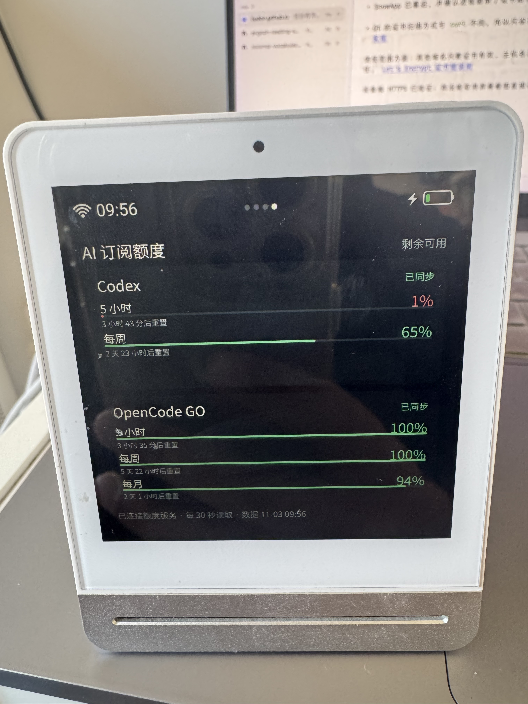

## 前言

上一篇[青萍空气检测仪改造记：用 AI 给它加个新页面](/posts/qingping-cgs1-custom-qml-page/)把改造流程跑通了，这一篇来讲讲具体的实践：展示 AI 订阅额度。

先上效果图：



## 额度如何获取

我订阅了 ChatGPT 和 OpenCode Go 两个服务：

- 通过 Codex 使用 ChatGPT；

- 通过 Pi 使用 OpenCode Go；

让 AI 分析了一下，可以通过如下方式获取额度信息：

**Codex**

本机已安装 codex-cli 0.166.0，支持 app-server。

复用本机 Codex 的登录状态，通过 app-server 的 stdio 协议获取额度信息。完成初始化后，调用：

```text
{"method":"account/rateLimits/read","id":1}
```

返回字段包含 usedPercent、windowDurationMins、resetsAt，可以计算对应时间窗口的剩余比例及重置时间。

**OpenCode Go**

本机 Pi 的默认 provider 是 opencode-go，认证类型为 API key，存放在 ~/.pi/agent/auth.json。

Mac 服务可读取该项凭据，在内存中用于请求：

```text
GET https://opencode.ai/inference/go/v1/usage
Authorization: Bearer <Pi 已配置的 GO API key>
```

这样 Pi 不需要运行，也无需改 Pi 或安装插件。以账户侧返回的额度为准，不累计 Pi 本地 token 或费用。

## 最初的方案：直接访问 Mac

一开始的想法，是通过 Mac 提供一个本地局域网的 HTTP 服务，让青萍 QML 页面定时查询额度数据。

```text
Codex ───────┐
              ├─ Mac ──> HTTP(IP方式) <── 青萍 QML 页面
OpenCode Go ─┘
```

这个方案里，青萍 QML 页面会写死一个局域网 IP 进行访问。

Mac 机器的 IP 并没有固定，这样会导致 QML 查询不到数据。

可以通过 DHCP 服务固定 Mac 机器 IP的方式解决，但家里有多个路由器，网络环境比较复杂，想保证始终能够访问也不太方便。

所以没有采用这个方式，于是就有了下面这个方案。

## 换个思路：通过 VPS 中转

我有一台 VPS 机器，直接走公网域名的方式访问，不就解决了？

但是这样的话，还需要在 VPS 机器上再维护一份凭证。

能不能还是 Mac 本机这一套授权，但是通过公网查询额度呢？

```text
Codex ───────┐
              ├─ Mac 定时采集 ──SSH──> VPS 静态 quota.json
OpenCode Go ─┘                            │
                                          └──HTTPS──> 青萍 QML 页面
```

于是就有了这套方案：

- Mac 每分钟采集订阅额度数据，并通过 SSH 将 quota.json 写入 VPS。

- VPS 通过 HTTPS 域名提供 quota.json。

- 青萍切换到额度页面时自动读取数据，并在页面显示期间每 5 分钟刷新一次。

quota.json 只放页面展示所需的数据，不包含账户凭据。结构大致如下：

```json
{
  "schema_version": 1,
  "generated_at": 1793674800,
  "stale_after_seconds": 180,
  "providers": [
    {
      "id": "codex",
      "name": "Codex",
      "status": "ok",
      "message": "",
      "updated_at": 1793674740,
      "attempted_at": 1793674740,
      "windows": [
        {
          "id": "codex:primary",
          "label": "5 小时",
          "used_percent": 27,
          "remaining_percent": 73,
          "resets_at": 1793689200,
          "window_minutes": 300,
          "limit_reached": false
        }
      ]
    }
  ]
}
```

| JSON 路径 | 含义 |
| --- | --- |
| `schema_version` | 文件格式版本。当前为 `1`。 |
| `generated_at` / `stale_after_seconds` | 文件生成时间 / 数据过期判定阈值。 |
| `providers[]` | 每项代表一个订阅：`id` / `name` 为标识 / 显示名；`status` / `message` 为状态 / 说明；`updated_at` / `attempted_at` 为最近成功 / 尝试读取时间；`windows[]` 为额度窗口列表。 |
| `providers[].status` | `ok` 已读取、`loading` 等待读取、`stale` 数据已旧、`error` 暂无可用额度。 |
| `providers[].windows[]` | 每项代表一个额度窗口：`id` / `label` 为标识 / 显示名；`used_percent` / `remaining_percent` 为已用 / 剩余比例；`resets_at` / `window_minutes` 为重置时间 / 窗口长度；`limit_reached` 表示是否达到上限。 |

所有时间均为 Unix 秒；未知时间或窗口长度为 `null`。

文件通过 SSH 原子替换，传输中断或校验失败不会留下半份 JSON。

QML 页面按 `providers` 和 `windows` 数组生成卡片与额度行，因此新增展示条目不需要改页面布局。

页面取数失败或额度数据过期时，会保留上次数据并将卡片灰显为“未同步 / 旧数据”；首次取数失败时显示连接状态。

当我以为大功告成时，又出现了新问题。

## 问题：HTTPS 连接失败

```sh
curl https://domain/quota.json
curl: (60) SSL certificate problem: unable to get local issuer certificate
```

排查后，发现设备上 `/etc/ssl/certs` 目录为空，系统根本没有可用的 CA 证书。

下载 ISRG Root X1 公共证书到设备的 `/data` 分区上，通过 `curl --cacert ...` 方式访问验证通过了。

但 QML 页面访问还是报这个错误，原来 Qt 网络模块使用的 TLS 后端，也需要能够找到可信任的 CA 证书。

在看门狗启动 SnowApp 前，增加下列处理：

```sh
export SSL_CERT_FILE=/data/custom/ai-quota-display/ISRG-Root-X1.pem
mount -o bind /data/custom/ai-quota-display/qt-certs /etc/ssl/certs
```

重启设备后，QML 页面终于可以正常通过 HTTPS 获取额度数据。

## 总结

通过增加 VPS 的这一层中转，既保证了账户凭据只保留在本地，也解决了青萍检测仪访问的问题。

把需求提给 Codex，Mac 连上青萍检测仪，看着它慢慢变成现实，太神奇了。

项目代码和配置说明放在 [qingping-cgs1-ai-quota-display](https://github.com/Liudon/qingping-cgs1-ai-quota-display)，上面提到的问题已放在脚本中统一处理。

如果想了解 CGS1 怎么获得外置 QML 页面入口，可以从[前一篇改造记录](/posts/qingping-cgs1-custom-qml-page/)开始。
