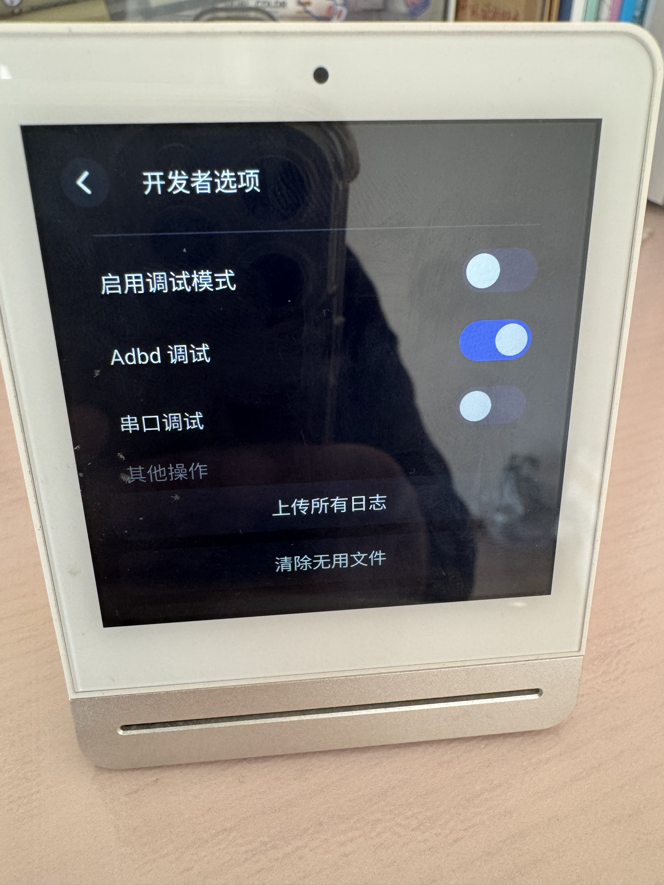
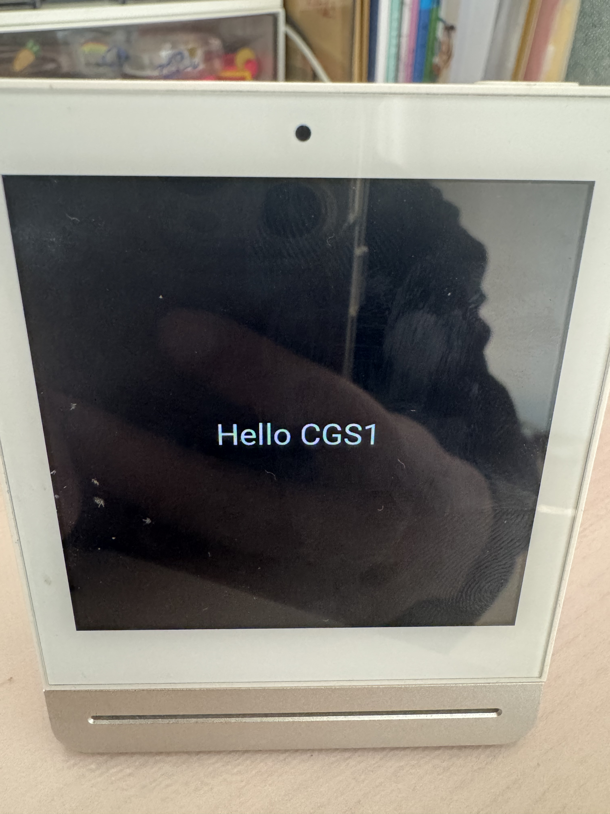
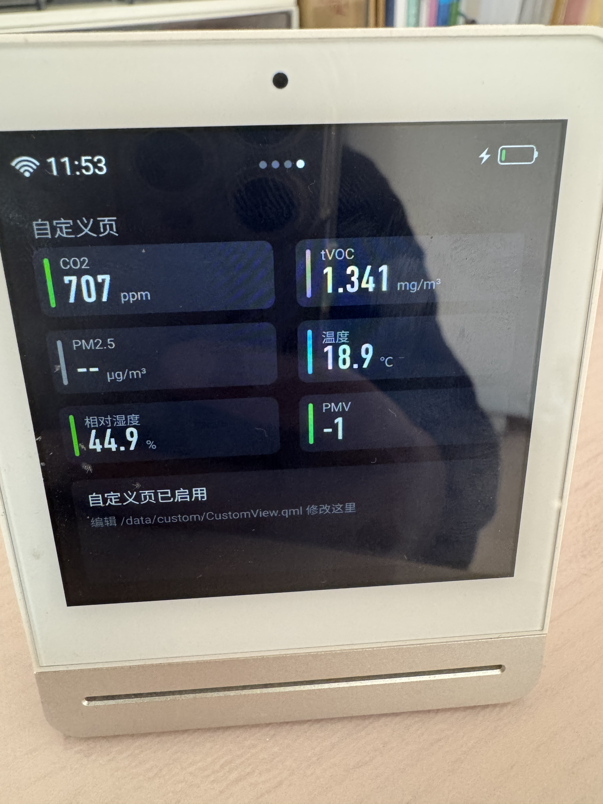

## 前言

最近看到不少人用 AI 折腾旧硬件，各种玩法看得我也有点手痒。

突然想到家里有一台闲置了好久的青萍空气检测仪，官方系统也很久没有更新过了，正好拿来折腾一下。

> **风险提示**：下面涉及 root 权限和修改设备上的程序。我只在自己的一台设备上做过，固件版本 `4.1.8_0287`。照做可能让设备异常，也可能影响保修。动手前先完整备份。

## 先进系统

网上查了一下，有个二代机器的改造方案，说是进入设置 → 关于里连点「设备名称」7 次，可以打开开发者选项。

试了一下，一代机器也可以，顺利开启 ADB 调试模式。



Mac 通过 USB 数据线连接设备，进入系统：

```bash
brew install android-platform-tools
adb devices
adb shell
```

没想到进去直接就是 root，不用再折腾提权：

```text
/ # id
uid=0(root) gid=0(root)
/ # uname -a
Linux rockchip 3.10.104 #12 SMP PREEMPT Fri Dec 24 11:00:23 CST 2021 armv7l GNU/Linux
/ # grep Hardware /proc/cpuinfo
Hardware        : Rockchip RK3128
```

从内核信息、目录和启动方式来看，它更像一个精简的嵌入式 Linux，而不是安卓。

再往下看，配置比我想象的有意思：

- 四核 Cortex-A7，内存约 225MB。
- `/` 是只读 squashfs（52MB，用满）；`/data` 是可写的 ext4，约 106MB，剩 75～80MB，重启数据不会丢；`/tmp` 是内存盘，重启数据就没了。
- 系统里有 BusyBox 1.25、`qmlscene`、`node`、`gdb`、`curl`、`wget`，没看到编译器。
- `/proc/asound/cards` 显示没有声卡。
- 安装了 Qt 5.9.4。

发现系统里已经内置了 `qmlscene`，有了现成的 QML 运行环境。

那是不是不需要重新编译固件，就能画自己的页面了？

环境信息拿到了，接下来准备动手改造。

## 动手前先备份

`/data` 是可写分区，官方程序、配置和设备数据都在这里。

在正式动手前，先做备份，以免有问题回滚。

```bash
# 设备上
tar cf /tmp/data_backup.tar -C / data
md5sum /tmp/data_backup.tar
# Mac 上
adb pull /tmp/data_backup.tar ~/qingping_data_backup.tar
md5 ~/qingping_data_backup.tar
```

*BusyBox 的 `tar` 不认 `-z`，只能打不压缩的包。*

备份里有云端凭据和 Wi-Fi 配置，千万别外传。

## 第一次尝试

先从最简单的开始：让屏幕显示一句「Hello CGS1」，点一下就退出。

设备运行 Qt 时要设置 EGLFS、触摸设备和库路径。

我把官方启动脚本里的环境变量整理到 `/data/custom/env.sh`，然后写了一个最小的 QML 页面：

```sh
mkdir -p /data/custom
cat > /data/custom/env.sh <<'EOF'
mkdir -p /tmp/runtime-root && chmod 700 /tmp/runtime-root
export XDG_RUNTIME_DIR=/tmp/runtime-root
export QT_QPA_PLATFORM_PLUGIN_PATH=/usr/lib/qt/plugins
export QT_QPA_PLATFORM=eglfs
export QT_QPA_FONTDIR=/usr/lib/fonts
export QT_QPA_GENERIC_PLUGINS=evdevtouch:/dev/input/event0
export QT_QPA_EGLFS_WIDTH=720
export QT_QPA_EGLFS_HEIGHT=720
export QT_QPA_EGLFS_PHYSICAL_WIDTH=720
export QT_QPA_EGLFS_PHYSICAL_HEIGHT=720
export LD_LIBRARY_PATH=/data/lib/:/usr/lib/:$QT_QPA_PLATFORM_PLUGIN_PATH:$QT_QPA_FONTDIR
export QML_IMPORT_PATH=/data/lib/:/usr/qml/
export QML2_IMPORT_PATH=/data/lib/:/usr/qml/
EOF
cat > /data/custom/test.qml <<'EOF'
import QtQuick 2.9
Rectangle {
    width: 720; height: 720; color: "#101820"
    Text { anchors.centerIn: parent; color: "white"; font.pixelSize: 48; text: "Hello CGS1" }
    MouseArea { anchors.fill: parent; onClicked: Qt.quit() }
}
EOF
sync
```

启动服务。

```sh
. /data/custom/env.sh
qmlscene -platform EGLFS /data/custom/test.qml &
```

屏幕上"Hello CGS1"闪了一下，立刻又恢复成官方界面。

原来是官方 `SnowApp` 还在跑，两个程序抢同一块屏幕，官方的盖了回来。

杀掉 `SnowApp`后再跑，发现还是不行。

原来是还有一个看门狗 `/data/bin/watchdog.sh`，每 5 秒检查一次，`SnowApp` 不在就拉起。

```sh
. /data/custom/env.sh
kill <看门狗进程号>
kill -9 <SnowApp 进程号>
qmlscene -platform EGLFS /data/custom/test.qml &
```

调整脚本执行顺序，这次终于成功了。



这次屏幕上稳定显示出 "Hello CGS1"，点一下屏幕退出，说明机器是可以改造的。

重启机器，就可以回到原来的官方界面了。

## 再进一步：能不能直接显示网页？

既然自己的 QML 能上屏，那能不能直接显示网页？这样后续的可玩性就更大了。

结果马上就被泼了一盆冷水：

**设备的 Qt 里没有 WebKit 和 WebEngine，系统里也没有浏览器。**

理论上可以交叉编译一份 QtWebKit 放进 `/data/lib`，但要有和设备 glibc、Qt 5.9.4 编译选项都匹配的工具链，还要补依赖库，而 `/data` 只剩 80MB、内存只有 225MB，这个工作量太大了。

看来就只能走 QML 这条路了。

## 另一条路：改造官方界面

官方界面展示了空气质量/设置等信息，如果用第一步的方案就会把官方的这些信息全丢掉，那有没有可能在官方的界面上进行改造呢？

### 解剖 SnowApp

从备份里拿到 `SnowApp` 文件。

```sh
tar xf qingping_data_backup.tar data/bin/SnowApp
```

它是一个 32 位 ARM 的 ELF 可执行文件，而且没有去掉符号表。

用 `nm -C` 查看，能直接找到 Qt 资源系统的数据结构：

```text
$ nm -C data/bin/SnowApp | grep qt_resource
002bea48 r qt_resource_struct
002c0060 r qt_resource_name
002c1ea8 r qt_resource_data
...（共 4 组）
```

Qt 使用资源系统（QRC）将 QML、图片等文件打包到可执行程序中，主要包含三部分：

- `qt_resource_struct`：资源目录树，记录文件的索引和偏移量。
- `qt_resource_name`：文件名信息，使用 UTF-16BE 编码。
- `qt_resource_data`：实际的文件内容，部分文件通过 `qCompress` 压缩。

其中，资源数据是连续存放的。每个文件前面有 4 字节的长度信息，后面紧跟文件内容。如果文件经过压缩，内容采用 `qCompress` 格式，即 4 字节原始长度加一段 zlib 数据。

目录树中记录着各个资源的偏移量，程序运行时根据这些偏移量查找文件。

以我们后面要修改的 `MainPage.qml` 为例，存储结构大致如下：

```text
qt_resource_struct（目录树，记录资源偏移量）
    MainPage.qml  → 偏移 0x1234
    其他页面.qml  → 偏移 0x1234 + 1781 + ...
    ...

qt_resource_data（数据区，首尾相接）
 ┌────────────┬──────────────────┬─────────────┐
 │ 前面的资源 │ MainPage.qml     │ 下一个资源  │
 │            │ 4 字节长度 + 1777│             │
 └────────────┴──────────────────┴─────────────┘
```

*偏移量 `0x1234` 仅为示意。*

了解资源结构之后，就可以尝试把文件提取出来。

我借助 AI 写了一个 QRC 解包脚本：

```bash
python3 qrc_dump.py data/bin/SnowApp out/
```

结果比预想的顺利。

QML 资源包中一共有 197 个文件，其中 120 个未压缩、77 个使用 zlib 压缩。

官方界面的 QML 文件都能完整提取出来，而且是可以直接阅读的源码，并没有被编译成机器码。

这意味着，我们不光能看到官方界面的实现，还有机会直接修改它。

### 分析官方主页

主页是 `Main/MainPage.qml`：

```qml
                model: ListModel {
                    id: model
                    ListElement {
                        name: "airDatasView"
                        source: "qrc:/Main/Views/AirDatas/AirDatasView2.qml"
                    }
                    ListElement {
                        name: "settingView"
                        source: "qrc:/Main/Views/Setting/SettingView.qml"
                    }
                    ListElement {
                        name: "airmxView"
                        source: "qrc:/Main/Views/AirMX/AirmxView.qml"
                    }
                    ListElement {
                        name: "appView"
                        source: "qrc:/Main/Views/App/AppView.qml"
                    }
                    Component.onCompleted: {
                        // 已绑定Eagle，则显示AIRMX界面
                        if (!appController.airmxApp.isPaired) {
                            removePage("airmxView");
                        }
                        if (!global.isShowAppView || (global.product === Global.PROD_HAIER)) {
                            removePage("appView");
                        }
                        // 时间已初始化，则显示汇总界面
                        if (datetimeManager.isInitialized) {
                            insertPage("airDatasView", "summaryView", "qrc:/Main/Views/Summary/SummaryView.qml");
                        }
                    }
                }
```

几个关键发现：

- 页面是 `PathView`，由 `ListModel` 驱动，每项有 `name` 和 `source`，用 `Loader` 加载。
- 已经有 `insertPage()` 和 `removePage()`，官方用它们按条件增减页面。
- 页码圆点的数量绑定 `view.count`，页数变了会自动跟着变。
- 每次滑动结束，主页会对每个页面调用 `restore()`，所以新页面必须定义这个函数，哪怕是空的。
- 官方页面的读数是绑定在 C++ 暴露的对象上的，比如 `airdataController.airCO2`，带 `name`、`valueString`、`unitString`、`evalutionColor`。**新页面可以直接用，不用自己读传感器。**

**改动思路**：往列表末尾加一个 `ListElement`，让它去加载设备上的外置文件 `/data/custom/CustomView.qml`。

页面内容全放在这个外置文件里，`MainPage.qml` 里只留几行这个文件的引用，这样以后改页面就不用再动二进制里。

接下来的问题就是：如何把这几行改动写进 `SnowApp`。

### 问题：空间不够怎么办？

由于没有官方源码和对应的完整构建环境，我不准备重新编译整个程序，而是直接修改二进制中的 QML 资源。

前面分析 Qt 资源结构时已经发现，文件在 qt_resource_data 中是连续存放的。

如果修改后的 MainPage.qml 压缩数据变长，就可能覆盖后面的资源。

要解决这个问题，需要重新安排后续资源的位置，更新目录树中的偏移量，甚至可能涉及 ELF 段布局的调整。

理论上可以实现，但修改范围就比较大了。

既然只是增加一个页面入口，我觉得没必要这么折腾。

因此决定采用原位替换的方案：

- 不改变 ELF 文件的整体大小。

- 不移动其他资源的位置。

- 只修改 MainPage.qml 对应的资源数据。

- 新内容不能超过原来的空间，剩余部分补零。

原来的 MainPage.qml 压缩流为 1777 字节，加上 4 字节长度字段，整个资源槽位为 1781 字节。

也就是说，新的压缩数据必须能放进这个空间里。

先验证一点：用 zlib level 6 压缩原来的 `MainPage.qml`，得到的字节和二进制里**完全一致**，说明重新压缩是可控的。

然后试了两种改法（原压缩流 1777 字节）：

| 改法 | 压缩后（level 6 / 9） | 结果 |
| --- | --- | --- |
| 只加 `ListElement` | 1805 / 1784 | 超出 28 / 7 字节，放不下 |
| 加 `ListElement`，并删掉 5 行纯注释 | 1657 / 1637 | 剩 120 / 140 字节 |

通过删掉 5 行只有注释的行，不动任何逻辑，就放得下了。

`MainPage.qml` 只留引用，空间就不会再成问题。

```diff
--- a/Main/MainPage.qml
+++ b/Main/MainPage.qml
@@ -34,7 +34,6 @@
                 onConfirmed: openPage("qrc:/Modules/SystemUpdate/SystemUpdatePage.qml")
             }
 
-            // 顶栏提示器
             HeaderBar {
                 id: headerBar
                 anchors.top: parent.top
@@ -43,7 +42,6 @@
                 height: 72
                 timeVisible: !control.isSummary && datetimeManager.isInitialized ? true : false
             }
-            // 页面指示器
             PageIndicator {
                 id: indicator
                 count: view.count
@@ -89,15 +87,17 @@
                         name: "appView"
                         source: "qrc:/Main/Views/App/AppView.qml"
                     }
+                    ListElement {
+                        name: "customView"
+                        source: "file:///data/custom/CustomView.qml"
+                    }
                     Component.onCompleted: {
-                        // 已绑定Eagle，则显示AIRMX界面
                         if (!appController.airmxApp.isPaired) {
                             removePage("airmxView");
                         }
                         if (!global.isShowAppView || (global.product === Global.PROD_HAIER)) {
                             removePage("appView");
                         }
-                        // 时间已初始化，则显示汇总界面
                         if (datetimeManager.isInitialized) {
                             insertPage("airDatasView", "summaryView", "qrc:/Main/Views/Summary/SummaryView.qml");
                         }
@@ -136,7 +136,6 @@
             }
         }
     }
-    // 加载子界面
     Component {
         id: childPage
         Loader {
```

执行打补丁的脚本，生成新的 `SnowApp.patched` 文件。

```bash
python3 qrc_patch.py data/bin/SnowApp out/INDEX.tsv /Main/MainPage.qml MainPage.new.qml SnowApp.patched
# slot 1781 bytes, new payload 1641 bytes, spare 140
```

补丁生成后，我先在本地做了几项检查：文件大小没有变化，重新解包后，205 个资源中只有 MainPage.qml 发生了变化，其余资源的哈希均保持一致。

打包完之后，我没有急着替换官方的 `SnowApp`，而是把补丁版放在 `/data/custom/SnowApp.patched`。

手动跑一下看看效果：停看门狗、确认、`kill -9` 官方 `SnowApp`、确认、再启动补丁版。

结果比较顺利：官方界面正常启动，**多出了一页，一共四页**，滑动正常，读数实时刷新，日志里没有新页面的 QML 报错。

### 问题：WIFI 一直连不上

刚刚还沉浸在成功的喜悦中，突然发现左上角的 WIFI 标志一直在连接中，重新点击也连不上，感觉应该是哪里改坏了。

看日志，发现路由器其实已经连上了：

```text
wpa_state=COMPLETED
已连接 Wi-Fi ssid=*** 无IP SSID无变化
killall: udhcpc: no process killed
```

关联成功，但没拿到 IP。

根据日志和看门狗的代码分析，可能的机制是：

官方程序重连 Wi-Fi 时会先 `killall udhcpc`，再靠**看门狗**在下一个 5 秒周期里把它拉起。

而这次试跑为了不让官方界面被拉回来，把看门狗停了，导致没人重启 DHCP。

恢复很简单，手动做一遍看门狗该做的事：

```sh
sh /data/etc/wifi/udhcpc_wlan0 restart &
```

### 界面切换

执行安装脚本，用补丁版替换原来的 `/data/bin/SnowApp`，让看门狗照旧管理它：

```sh
sh install_patched.sh
```

- 先校验补丁版和当前程序的 SHA-256，当前程序如果不是已知原版（比如被官方升级覆盖），拒绝覆盖。
- 先备份原版到 `/data/custom/SnowApp.orig` 并校验。
- 先复制到同目录临时文件并校验，再用 `mv` 原子替换。
- 看门狗在运行时，杀掉旧进程，约 5 秒内由看门狗用新文件拉起，设备不用重启，Wi-Fi 也不受影响。

如果有问题，需要恢复时：

```sh
cp /data/custom/SnowApp.orig /data/bin/SnowApp.new && mv -f /data/bin/SnowApp.new /data/bin/SnowApp && reboot
```

装好之后，后续改页面只需要改 `/data/custom/CustomView.qml`，再重启一下机器即可。



## 总结

这就是我第一次的硬件折腾历程，让老的闲置硬件再次发挥作用。

借助 Claude，完成从进入系统、分析 Qt 资源，到修改 QML 和生成二进制补丁的整个过程，再次感受到 AI 的强大。

文中使用的相关文件都放在 [qingping-cgs1](https://github.com/Liudon/qingping-cgs1) 这个仓库下了。
