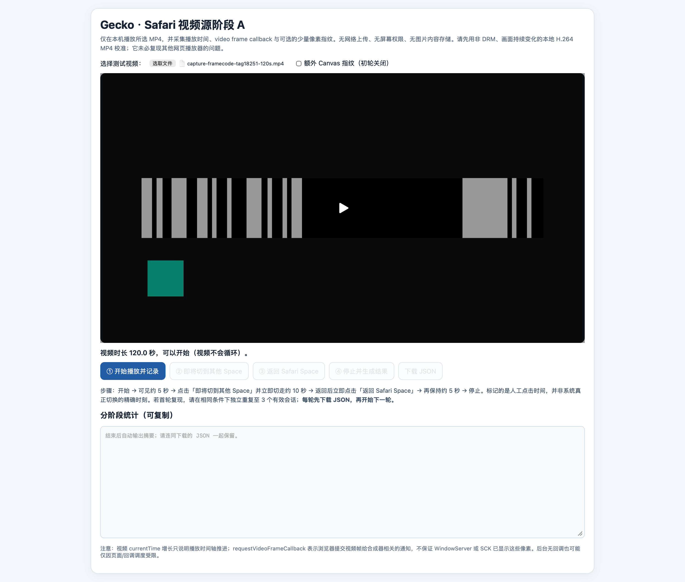
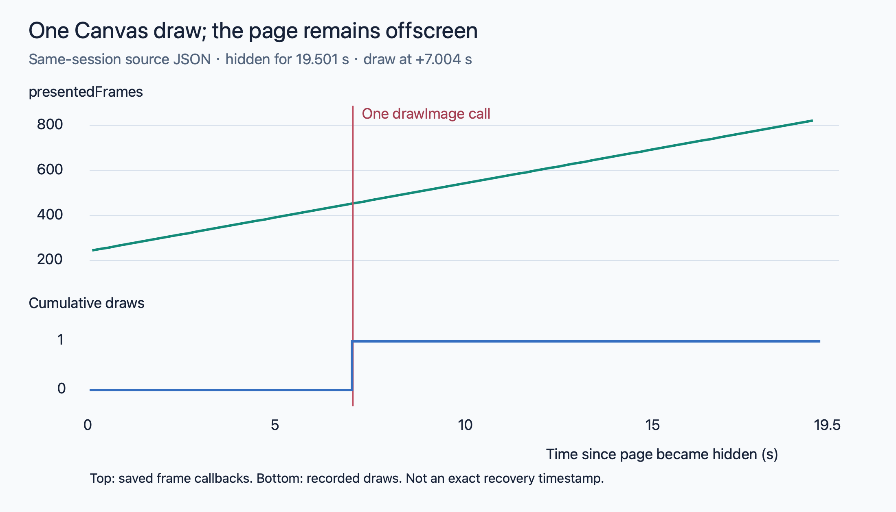
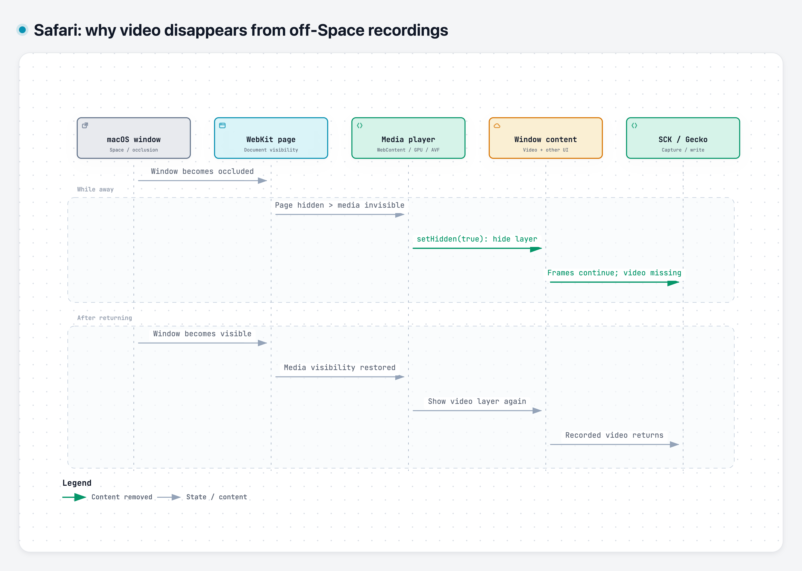

During application compatibility testing for [Gecko](/posts/gecko-macos-app-recorder/) (in Chinese), I ran into a Safari problem: recording worked while the window was on the current desktop, but switching to another macOS Space made the video region in the recording turn black. Audio continued, and recording did not stop. Returning to the original Space restored the picture.

I had already substantially improved QuickTime's offscreen freezes with [Pulse](/posts/gecko-adaptive-pulse-design/) (in Chinese). This time, Safari's video content disappeared altogether. Adjusting the refresh frequency did not bring it back.



*The original symptom: from 00:08 to 00:20, I am on another Space and the video region turns black. The recordings in this article retain their original interface language.*

Was the problem in Gecko, ScreenCaptureKit, or Safari? Why could I still record the browser interface while the video itself disappeared?

## Isolating the capture pipeline with a local video page

The compatibility test used an online video, with several factors outside my control: player scripts, network loading, cross-origin content, and potentially media protection. A black recording alone could not tell me which part had failed.

I built a local webpage that let Safari play a locally selected video, then recorded that window. The video did not go through a website, download service, or decryption step. I used the reference footage with encoded frame numbers from my [recording test automation work](/posts/gecko-recording-test-automation/) (in Chinese), so that static source content could be distinguished from missing captured content.

A local HTTP server served the page. A file picker supplied the local video, which the page passed to a `<video>` element using a Blob URL.

Safari still played the video, and Gecko still captured its window externally.

### What the test page does

The following experiments all used this local test page structure: a video input, a display area, phase controls, and event logging. I changed the display path or drawing behavior to answer each question.



*The original test page, shared with the Chinese article. Its controls are in Chinese: the input and video are at the top, playback and Space-switch markers are in the middle, and the summary appears below. A video is selected, but logging has not started.*

The page has four jobs:

- **Video input and display:** select a local MP4 and play it in a fixed area.
- **Phase markers:** mark playback start, departure, return, and finish. These buttons record the intended operation; `visibilitychange` records when the page actually becomes hidden or visible.
- **Source observation:** record playback and video-frame progression. I will explain the individual metrics when looking at Safari's state.
- **Result export:** save the events as JSON for comparison with the externally recorded MP4.

The procedure stayed the same: play the video on the current desktop, switch to a Space without Safari, wait, then return and stop.

The result: **a local page playing a local video also lost its video picture while offscreen.**

Here is one recording. Approximately 16–39 seconds is the stable offscreen interval: video content is missing, then returns when I switch back.



I also tried OBS window recording and saw the same offscreen black-video symptom. It was not unique to Gecko. Together with the pixel checks before file writing, this shifted attention toward the boundary between Safari's video presentation and window capture.

### At which stage does the picture go black?

The next distinction was whether the file was being written incorrectly or whether SCK was already returning incomplete content.

In the original video scenario, I sampled the pixel buffer received in SCK callbacks and the copied buffer passed to the writer, using the same whole-window and central-region measurements:

| Phase | SCK whole-window near-black ratio | Writer whole-window near-black ratio | SCK central-region near-black ratio | Writer central-region near-black ratio |
|---|---:|---:|---:|---:|
| Before switching away | 25% | 25% | 29% | 29% |
| While away | 40% | 40% | 87% | 87% |
| After returning | 25% | 25% | 29% | 29% |

The statistics matched at both points in all 27 once-per-second sample pairs. During the offscreen interval, the writer's written-frame count also increased from 230 to 505, so samples were still arriving.

The increase in near-black pixels in the central region was present **before the encoder**. The priority was therefore **Safari presentation → window composition → SCK content acquisition**, rather than MP4 muxing or finalization.

Local footage reproduced it, another recorder reproduced it, and content was already missing before Gecko wrote the file. I now needed to observe what Safari did while offscreen.

## Is playback still advancing behind the black picture?

This is where the page's individual metrics become useful. They observe different points in the pipeline:

| Metric | What it records | What it helps establish |
|---|---|---|
| `document.visibilityState` | Whether the browser considers the page visible or hidden | When the page actually becomes hidden and recovers |
| `video.currentTime` | The current playback position | Whether the playback timeline advances |
| `requestVideoFrameCallback` (rVFC) | Video-frame-related callbacks | Whether the browser still delivers frame notifications |
| Callback `mediaTime` | The media timestamp associated with the callback's frame | Whether the corresponding content position advances |
| Callback `presentedFrames` | The cumulative number of video frames submitted for composition | Whether the frame metric increases during playback |

With only state and callbacks being recorded, the actual hidden interval yielded:

| Metric | Observation |
|---|---:|
| Page hidden duration | 12.984 seconds |
| Saved rVFC samples | 62 |
| `mediaTime` | 7.300 → 19.967 seconds |
| `presentedFrames` | 219 → 599 |

Across those samples, the progression rate was approximately `(599-219)/(19.967-7.300) ≈ 30 FPS`.

That rules out the simplistic explanation that the video entirely stopped when I switched away. But rVFC is not a pixel-level check of WindowServer or SCK: continuing frame callbacks do not guarantee that the native video layer is present in the window's composited content.

The next question was more specific: **could Safari still supply usable video pixels, while the native `<video>` presentation path failed to appear in the external recording?**

## Using Canvas to separate frame access from presentation

When I gave the source logs and recordings to Claude, it suggested a comparison: draw the same video onto a Canvas, record that Canvas, and see whether it still went black offscreen.

This kept the playback source unchanged while changing how its pixels reached the displayed page. If Canvas could be recorded but native video could not, I could separate access to video frames from native video presentation.

### 1. Drawing the video onto a visible Canvas

I kept the video as the playback source, placed it underneath the Canvas, and made it almost transparent. What the user saw was the video drawn on the Canvas.

On each rVFC callback:

```javascript
function onFrame() {
  ctx.drawImage(video, 0, 0, canvas.width, canvas.height);
  video.requestVideoFrameCallback(onFrame);
}
video.requestVideoFrameCallback(onFrame);
```

The two paths were:

```text
Original: video playback → native video presentation → window capture
New:      video playback → drawImage → visible Canvas → window capture
```

The Canvas video remained recordable while offscreen.

The page also periodically computed an RGB fingerprint from a 16×9 Canvas thumbnail to check that it was obtaining different pixels. During 13.934 seconds of actual hidden time, all 34 saved fingerprints were different. The Canvas also visibly changed in the resulting recording.

Under these conditions, Safari could still supply video pixels, and SCK could capture dynamic content presented through Canvas. However, I had changed both the display layer and the active drawing behavior. I could not yet tell which mattered.

### 2. Keeping native video visible while hiding the Canvas

Next, I displayed the native video normally and set the Canvas to `display:none`. The rVFC loop and continuous `drawImage` calls remained.

```javascript
video.style.opacity = '1';
canvas.style.display = 'none';
// Continue calling drawImage(video) on each video-frame callback.
```

If the previous result only came from bypassing the native video layer with a visible Canvas, hiding the Canvas and displaying native video again should have brought the black picture back.

Instead, **the native video also remained visible in the recording while offscreen.** During 14.868 seconds of actual hidden time, all 37 Canvas fingerprints were different, and the recorded native video kept playing.

The Canvas itself was invisible, so the restored content was not the Canvas. **Actively drawing the video appeared to affect the native video's state.**

These first two experiments were separate sessions, though. They linked continuous drawing with avoiding black video, but a difference between sessions was not yet a strong causal test.

### 3. Starting continuous hidden-Canvas drawing after the picture goes black

This time, the intervention happened within one recording, keeping the same window, visible video, and hidden Canvas. Drawing started disabled. After the page became hidden, I waited about seven seconds before enabling continuous drawing.

No manual page interaction was needed while away. The hidden event started the wait, but drawing had to occur when a callback actually arrived. I logged the first completed draw rather than treating a scheduled operation as an executed one.

The data split into two intervals:

| Interval within the same hidden period | Duration | Drawing and pixel records | Recorded result |
|---|---:|---|---|
| Before enabling drawing | 7.054 seconds | Zero draws; frame callbacks continued | Black video |
| After enabling drawing, before returning | 14.130 seconds | Continuous drawing; 34 distinct fingerprints | Video recovered and kept moving |

Recovery happened while the page was still hidden, without returning to the original desktop. This was stronger evidence than a successful separate recording: the window and displayed content stayed the same; active drawing was what changed.

One question remained: did recovery require continuous refreshes, or could one operation change the subsequent state?

### 4. Drawing just once to the hidden Canvas after the picture goes black

I reduced the intervention to a single draw. The page first remained hidden without drawing, allowing the black picture to appear. Then it executed one `drawImage(video)` into the hidden Canvas, and I observed whether recovery persisted.

One draw, no pixel readback. The page still displayed native video, and the Canvas remained hidden.

Here is the simplified logic. The wait begins at actual hidden state; rVFC provides an observation and execution opportunity. A timer wakeup alone is not counted as a successful draw:

```javascript
let hiddenSince = null;
let drawn = false;
let draws = 0;

document.addEventListener('visibilitychange', () => {
  if (document.hidden) hiddenSince = performance.now();
  else hiddenSince = null;
});

function onFrame() {
  if (!drawn && hiddenSince !== null
      && performance.now() - hiddenSince >= 7000) {
    ctx.drawImage(video, 0, 0, 960, 540);
    drawn = true;
    draws++;
    record({ kind: 'one_shot_draw_completed', draws });
  }
  video.requestVideoFrameCallback(onFrame);
}
video.requestVideoFrameCallback(onFrame);
```

*Core logic for one offscreen interval. `record` is the page's event logger; there is no pixel readback and no second draw.*

The measured results, relative to the moment the page entered hidden state:

| Event or interval | Result |
|---|---|
| First and only draw | 7.004 seconds after hidden |
| Time still hidden after drawing | 12.497 seconds |
| Saved frame-callback samples before drawing | 33, with cumulative draw count 0 |
| Saved frame-callback samples after drawing | 59, with cumulative draw count remaining 1 |
| Heartbeats after drawing | 13, with cumulative draw count remaining 1 |
| CPU pixel readback | None |
| Recorded result | Black initially; sustained recovery after the single draw, without returning to the desktop |



*The upper track shows saved source-side frame metrics; the lower track shows the draw count. This is a webpage event timeline, not a millisecond-accurate boundary for recovery in the recording.*

To check whether the picture simply recovered on its own after enough time, I also interleaved no-draw and single-draw intervals. All three no-draw intervals stayed black until return; all three single-draw intervals recovered after drawing.

The four experiments narrowed the explanations step by step:

| Intervention | What the result established |
|---|---|
| Visible Canvas displaying the video | Video pixels remained accessible, and Canvas content could enter the recording |
| Continuous drawing into a hidden Canvas | The effect extended to native video, not just the Canvas |
| Starting continuous drawing during the same hidden interval | Drawing could change an existing black-video state without returning |
| Drawing only once after going hidden | Continuous refresh was unnecessary; recovery persisted after one draw |

The question was no longer “why can Canvas be recorded?” It was: **why would a single invisible draw affect the native video's behavior for more than ten seconds afterward?**

## Can an external screenshot reproduce the Canvas effect?

A single hidden-Canvas draw suggested a more direct possibility. Gecko could not directly operate an arbitrary Safari page, but could it request a window screenshot from the capture side and achieve something similar?

I used `SCScreenshotManager.captureSampleBuffer` to request a screenshot of the same Safari window after its video had gone black offscreen. I tried both a separate process and a call inside Gecko's recording process.

| Call location | Screenshot request | Did offscreen video recover? |
|---|---|---|
| Separate process | Successfully obtained a pixel buffer | No; recovery waited until return |
| Inside Gecko's recording process | Successfully obtained a pixel buffer | No; recovery waited until return |

Neither reproduced the Canvas effect. **Under these two tested arrangements, an external window screenshot could not substitute for `drawImage(video)` inside the webpage.** Obtaining a window buffer did not mean the browser would present the video again.

If one internal draw worked but one external screenshot did not, the next question was: what did `drawImage(video)` change besides obtaining the current frame?

## Source clue: page visibility and media visibility are not the same

To explain these observations, I turned to the source.

The local Safari WebKit build was `21624.5.1.11.3`, matching the public release tag `WebKit-7624.5.1.11.3` at commit [`26695efdefc6`](https://github.com/WebKit/WebKit/tree/26695efdefc6076049ec50713a2c4e54b90b4d47). All code below describing the tested implementation comes from that release commit.

### 1. A Canvas draw can change player state

After obtaining the player, [HTMLVideoElement::paintCurrentFrameInContext](https://github.com/WebKit/WebKit/blob/26695efdefc6076049ec50713a2c4e54b90b4d47/Source/WebCore/html/HTMLVideoElement.cpp#L380) does this:

```cpp
if (!player->isVisibleForCanvas()) {
    player->setVisibleForCanvas(true);
    visibilityStateChanged();
}
player->paintCurrentFrameInContext(context, destRect);
```

It first sets `visibleForCanvas`, then recalculates media visibility, and only afterward paints the current video frame.

The function does not immediately reset the flag when drawing finishes. A single draw can therefore have an effect beyond the duration of that call, consistent with native video remaining restored afterward.

### 2. A hidden document does not necessarily mean hidden media

After handling branches such as fullscreen, [HTMLMediaElement::elementIsHidden](https://github.com/WebKit/WebKit/blob/26695efdefc6076049ec50713a2c4e54b90b4d47/Source/WebCore/html/HTMLMediaElement.cpp#L6981) uses this condition for ordinary video:

```cpp
return protectedDocument()->hidden()
    && (!m_player || !m_player->isVisibleForCanvas());
```

For ordinary video with an existing player, that becomes:

| Document hidden | visibleForCanvas | Media hidden |
|---|---|---|
| false | false | false |
| true | false | **true** |
| true | true | **false** |

Page-hidden and media-hidden states can differ. Media kept visible for Canvas is no longer classified as hidden solely because its document is hidden.

### 3. The media-level result is passed to the player

In the same file, `visibilityStateChanged()` stores the new `m_elementIsHidden` value and, when it changes, calls:

```cpp
player->setPageIsVisible(!m_elementIsHidden);
```

The name can be misleading: the value passed down is not always equivalent to the page's `document.visibilityState`. Here it is the result of the media element's visibility rules.

The state then passes through the remote media player and GPU proxy to the AVFoundation backend. Source code established a propagation path; runtime logs would still be needed to check that actual Safari followed it.

### 4. The backend hides the video layer

In the matching release, [MediaPlayerPrivateAVFoundation::setPageIsVisible](https://github.com/WebKit/WebKit/blob/26695efdefc6076049ec50713a2c4e54b90b4d47/Source/WebCore/platform/graphics/avfoundation/MediaPlayerPrivateAVFoundation.cpp#L596) stores visibility, prepares video rendering when visibility returns, and invokes the platform implementation.

When a video layer exists, [platformSetVisible](https://github.com/WebKit/WebKit/blob/26695efdefc6076049ec50713a2c4e54b90b4d47/Source/WebCore/platform/graphics/avfoundation/objc/MediaPlayerPrivateAVFoundationObjC.mm#L1419) runs the following inside a transaction with implicit animations disabled:

```objc
[m_videoLayer setHidden:!isVisible];
```

This produced a testable explanation: going offscreen hides the page; ordinary media becomes invisible; the backend hides the video layer. A single Canvas draw could change the media-level decision through `visibleForCanvas`, keeping media visible even when the document is hidden.

Canvas intervenes at the media decision: the document remains hidden, but media stays visible.

That explained why a single operation could have a lasting effect, and led to two predictions:

1. If drawing changes state, drawing once **before** switching away could also work. There should be no need to wait for the picture to go black.
2. If window occlusion could be prevented from hiding the page farther upstream, video presentation might survive without any Canvas drawing.

I tested the predictions separately.

## Testing the first prediction: can one draw before departure prevent black video?

If a single draw changes player visibility, it need not wait for a hidden page. Drawing once in the foreground and then switching away might prevent the problem.

This differs from forcing a refresh after black video has already appeared, making it worth a separate A/B comparison.

### Controlling the experiment

The local page compared no drawing with one draw before switching away. Both conditions used the same foreground preparation; the intended difference was whether the draw actually executed.

The drawing gate checked that the page was `visible`, the video had a current frame, playback was active, and the video had not ended. It recorded attempts, successes, errors, and completion time. Once the gate ran, it closed: no retry and no extra draw.

rVFC and heartbeats remained for logging only, not as drawing triggers.

| Observation | No draw | One draw before departure |
|---|---:|---:|
| Successful Canvas draws | 0 | 1 |
| Pixel readback | None | None |
| Actual page-hidden duration | 27.476 seconds | 28.284 seconds |
| Draw relative to hidden state | None | Page became hidden about 439 ms after draw completion |
| Recorded native video | Blank while away | Kept updating while away |

Here is the original recording with the single draw. Approximately 11–35 seconds is the stable sampling interval used below; the barcode and moving color block keep changing:



### A page counter cannot stand in for video movement

A changing page counter does not establish that the video itself is correct. I cropped the same rectangle **inside the video** in both recordings, took two samples per second, and reduced them to grayscale, excluding browser UI, buttons, and counters:

| Check | A: no draw | B: one draw |
|---|---:|---:|
| MP4 interval analyzed | 16–39 seconds | 11–35 seconds |
| Sampled images | 46 | 48 |
| Distinct images | **1** | **48** |
| Bright pixels per image, grayscale >180 | 0 | 1232–1610 |

All 46 samples in A were identical. All 48 samples in B were different.

More importantly, the page that executed the draw still became hidden for 28 seconds. The draw did not bring the page to the foreground; it preserved video presentation.

This gave directly observable experimental support for separating page visibility from media visibility.

## Testing the second prediction: stop occlusion from hiding the page

Canvas changed the media-level decision. I also needed to investigate why the document became hidden in the first place.

Following WebKit's window-visibility implementation showed that macOS window occlusion contributes to whether a WebView is considered visible. The source's `windowOcclusionDetectionEnabled` setting defaults to enabled, with the private method:

```objc
_setWindowOcclusionDetectionEnabled:
```

This supplied a direct intervention point for the second prediction: leave the window offscreen, but stop WebKit from treating the page as invisible because of occlusion.

Gecko cannot directly obtain Safari's internal WKWebView object. I therefore wrote a minimal WKWebView host, loaded the same local video test page, and recorded it externally with Gecko. The target changed to a controllable WebKit host, while the video input, page observations, and external window-recording approach remained.

The setting appears in the matching release's [WebViewImpl.h](https://github.com/WebKit/WebKit/blob/26695efdefc6076049ec50713a2c4e54b90b4d47/Source/WebKit/UIProcess/mac/WebViewImpl.h) and [WKWebViewMac.mm](https://github.com/WebKit/WebKit/blob/26695efdefc6076049ec50713a2c4e54b90b4d47/Source/WebKit/UIProcess/API/mac/WKWebViewMac.mm).

Both runs used the same host program, each launched as a fresh process. Neither page performed Canvas drawing.

### Recording three different window states

The minimal host recorded not only the page's `visibilityState`, but also:

```swift
window.occlusionState.contains(.visible)
window.isVisible
window.isMiniaturized
```

These values answer different questions. `isVisible=true` does not mean the window is currently in front of the user. After switching Spaces, a window can still be shown and not minimized while its occlusion-state visible bit is gone.

The host also wrote page heartbeats, playback events, and visibility messages into the same native log. Combined with the window-state records, these showed both whether the window was actually offscreen and whether the page remained `visible` afterward.

Here is the key code that changed the setting in the custom host. `ObjCBool` makes the method's argument convention explicit, and a getter verifies the result. It does not use `perform(_:with:)` to pass a Boolean as an object:

```swift
let getter = NSSelectorFromString("_windowOcclusionDetectionEnabled")
let setter = NSSelectorFromString("_setWindowOcclusionDetectionEnabled:")
guard webView.responds(to: getter), webView.responds(to: setter) else {
    fatalError("This WebKit build does not support the diagnostic setting")
}
typealias Read = @convention(c) (AnyObject, Selector) -> ObjCBool
typealias Write = @convention(c) (AnyObject, Selector, ObjCBool) -> Void
let read = unsafeBitCast(webView.method(for: getter), to: Read.self)
let write = unsafeBitCast(webView.method(for: setter), to: Write.self)
write(webView, setter, false)
precondition(!read(webView, getter).boolValue)
```

*For the custom WKWebView diagnostic host only. This is a private API on an object inside the target process; it cannot configure Safari in another process.*

### Result: occlusion remained, but page hiding disappeared

| Condition | System window state | Page state | Recorded content |
|---|---|---|---|
| A: default detection | Occluded for about 28 seconds; not minimized | Hidden for 28.037 seconds | Blank video |
| B: detection disabled | Occluded for 38.082 seconds; not minimized | Remained visible during playback | Updating video |



*Default WKWebView detection: samples from inside the video stayed blank at approximately 16–39 seconds.*



*Detection disabled: the video region kept changing at approximately 12–45 seconds. Native window logs established that the window was offscreen; page-hidden state was not used as proof of departure.*

Again, I analyzed only the video's interior. A had one distinct image across 46 samples; B had 66 distinct images across 66 samples.

This showed that **under this WKWebView configuration, converting window occlusion into page-hidden state was an important upstream causal factor in the missing video.** Disabling that conversion left the system's occlusion judgment intact, yet the recorded video updated.

This experiment alone did not establish Safari's final backend action. The next step was to collect runtime evidence from Safari itself.

## Following visibility changes through Safari’s media processes

Both predictions matched the source-based explanation. I returned to Safari itself and inspected unified logs from the two recordings: did view invisibility become media invisibility for the same player and propagate to the GPU backend?

WebKit uses multiple processes, and media state can cross WebContent and GPU processes. Searching for `false` by time alone was insufficient: other windows, old pages, or other players could be active at the same time.

I correlated Safari/WebContent/GPU process ownership, page identity, and the player identifier for each run. Reloading between A and B changed the player identifier, so each had to be followed separately.

### Safari without drawing

Taking the view's transition to invisible as time zero, the actual log messages can be organized as follows:

```text
+0 ms   Safari / ViewState:
          view visibility state changed 1 -> 0
+1 ms   WebContent / HTMLMediaElement:
          visibilityStateChanged(ELEMENT_A) visible = 0
+1 ms   WebContent / MediaPlayerPrivateRemote:
          setPageIsVisible(PLAYER_A) false
+1 ms   GPU / RemoteMediaPlayerProxy:
          setPageIsVisible(PLAYER_A) false
+1 ms   GPU / MediaPlayerPrivateAVFoundation:
          setPageIsVisible(PLAYER_A) false
```

When I returned, the same player's state propagated back to true, and the picture returned in the recording.

This was no longer just an inference from a custom WKWebView: **actual Safari propagated media invisibility to its AVFoundation backend.**

### Safari with a single Canvas draw

In the other comparison, the single Canvas draw occurred first. Safari's view still subsequently became invisible, but the recorded video kept updating. During that offscreen interval, I did not observe the corresponding player becoming media-invisible or the backend receiving false.

Missing log messages cannot independently prove that a function never ran. Combined with the page remaining hidden, the single draw, and the changing recorded video, however, they supported the same distinction: **Canvas did not prevent the view from hiding; it changed the outcome of media-visibility propagation.**

## Verifying the layer-hiding behavior in the installed binary

Matching a public release version is more reliable than reading main, but it does not establish instruction-for-instruction equivalence with Apple's shipped binary.

I therefore made a read-only check: load the installed system WebCore in a temporary process of my own, then inspect `MediaPlayerPrivateAVFoundationObjC::platformSetVisible(bool)` with LLDB.

The loaded WebCore was inside WebKit.framework, with its image coming from the dyld shared cache.

The relevant disassembly, omitting absolute runtime addresses:

```text
ldr x8, [x0, #0x1a8]
cbz x8, ...                     // Return if no video layer exists
...
mov x19, x1                     // Save the visibility argument
...
ldr x0, [x20, #0x1a8]            // Video-layer object
eor w2, w19, #0x1                // Invert the Boolean
bl objc_msgSend$setHidden:        // Set the layer's hidden property
```

The installed function did set `hidden` according to visibility, matching the release source.

The evidence now covered four different kinds of observation:

| Evidence | Question answered |
|---|---|
| Original recordings and video-region samples | Was content actually missing, and did it update after intervention? |
| Canvas and WKWebView interventions | Did changing media state or upstream occlusion handling change the result? |
| Actual Safari cross-process logs | Did invisibility propagate to the player's backend? |
| Release source and installed machine code | What rule did the backend use to handle the video layer? |

The experiments showed that visibility interventions changed recording results. Runtime logs showed the invisible state reaching the media backend. Matching source and local machine code showed the backend hiding the video layer according to that state. Together, these established the mechanism in this case: Safari's visibility policy suppressed video-layer presentation.

## Conclusion: Safari's visibility policy hides the offscreen video layer

**For the tested non-DRM video scenario, the cause was this: switching the window to another Space made it occluded; WebKit hid the page; ordinary video became media-invisible; the AVFoundation backend hid its video layer; and external window capture consequently lacked the video content.**

The sequence can be summarized as follows:



*A mechanism diagram based on experiments, actual Safari logs, matching release source, and the installed implementation. Arrows show state propagation and content changes, not exact call latency. Video-layer actions come from source and machine-code checks, not a live property snapshot of the historical instance.*

SCK callbacks and file writing can continue, so an increasing frame count and a successfully saved file do not guarantee that the video region still contains video. Returning to the original Space restores visibility, the backend shows the video layer again, and the recording recovers.

A single Canvas draw and disabling WKWebView occlusion detection intervene at media visibility and page visibility respectively, preventing the hiding chain from continuing along its ordinary path. That is why both change the result.

This conclusion is limited to the Safari/WebKit version and local non-DRM footage examined here, not every Safari video source.

## What can Gecko control?

Finding an effective intervention does not mean Gecko can apply it to an arbitrary Safari window. These controls live inside the application being recorded.

`drawImage(video)` requires cooperation from the page or browser; it cannot be executed through an SCK window ID. Even with that cooperation, the experiments cover only the tested footage and hidden intervals lasting tens of seconds. Source changes, seeking, player recreation, and long recordings need separate validation.

The private occlusion setting belongs to a WKWebView object in the target process. A custom host can call it; Gecko cannot configure another process's Safari window the same way.

Pulse can improve offscreen frame supply, but it cannot change Safari's internal media visibility. The external screenshot experiments did not restore video either. The cause has been identified, but I have not found a general repair Gecko can enable directly without Safari's cooperation.

The reproduction materials have been submitted as [WebKit #331092](https://bugs.webkit.org/show_bug.cgi?id=331092) and added to Apple Feedback **FB25368989**.

## The clue came from another browser

The Safari investigation once stalled at “why does one Canvas draw restore the video?” Later, with Gecko's basic functionality complete, regression testing showed that Chrome also turned black offscreen—even though early tests had worked. A Chrome launch command recovered from terminal history eventually redirected the investigation toward window occlusion and suggested how to investigate Safari's source.

This was the issue that consumed the most time and was hardest to advance during Gecko's development. Several promising leads ended at another boundary. I could not find a complete explanation of this behavior in the public material I consulted, so I have documented the route from symptoms and controlled experiments to source verification in the hope that it gives others a useful starting point.

The next article, [the Chrome investigation](), follows that contradiction: why did offscreen recording work early on, only to turn black later?
