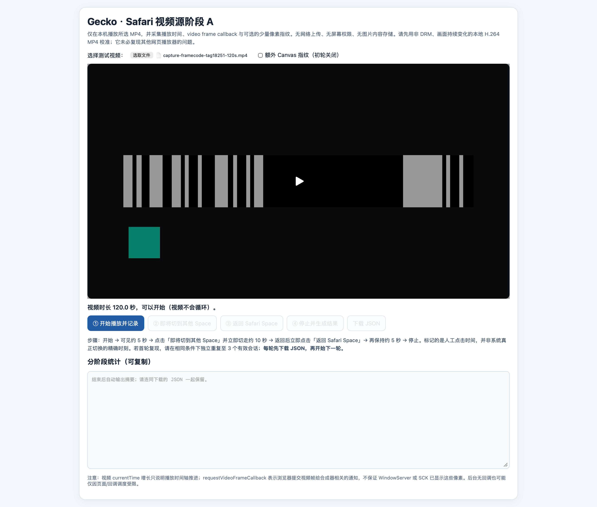
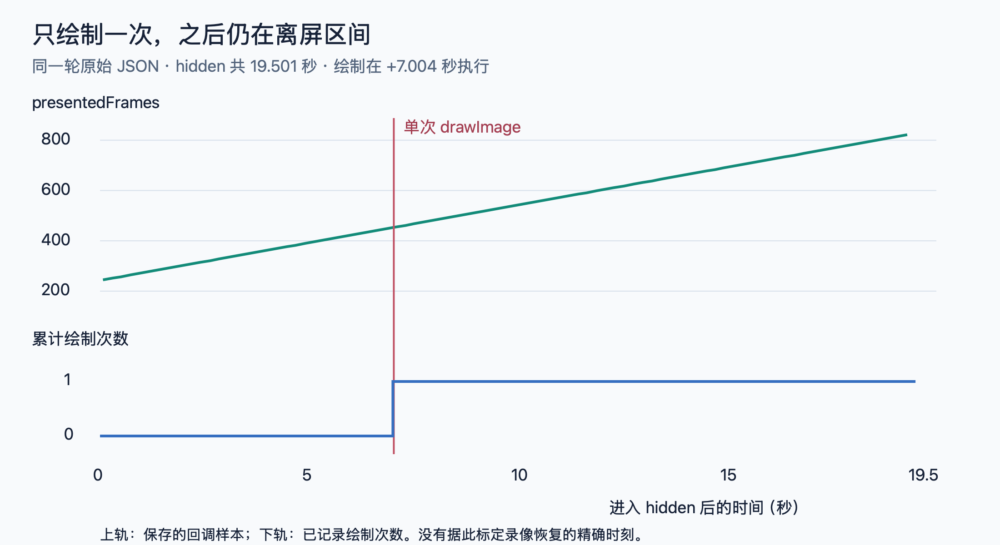
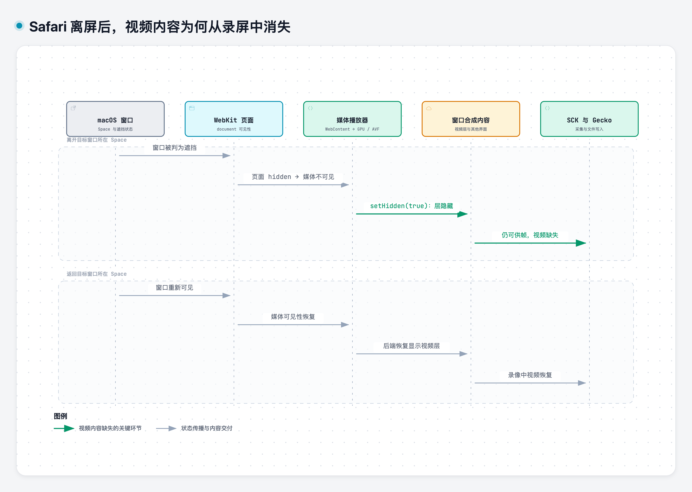

在 [Gecko](/posts/gecko-macos-app-recorder/) 的应用兼容性测试中，Safari 出现了一个问题：窗口在当前桌面时录制正常，切到另一个 Space，录像中的视频区域却变成了黑色。声音还在，录制也没有停止；切回原桌面，画面又恢复。

此前，QuickTime 的离屏冻结已经通过 [Pulse](/posts/gecko-adaptive-pulse-design/) 得到明显改善。Safari 这次消失的是整个视频内容，继续调整刷新频率并没有让它恢复。



*录制的异常视频，在 00:08 到 00:20 秒为切离桌面期间，视频区域变为黑色。*

问题出在 Gecko、ScreenCaptureKit，还是 Safari？为什么浏览器界面还能录到，只有视频部分消失了？

## 先检查采集链路：把视频放进本地网页

兼容性测试使用的是一个网络视频，存在一些不可控因素：播放器脚本、网络加载、跨域内容，以及可能的媒体保护。只看最终黑屏，很难知道是哪一段出了问题。

于是先构建一个本地网页，用 Safari 播放自己选择的本地视频，再录制这个窗口。视频不需要经过网站，也不需要下载或解密；选择[录屏自动化测试设计](/posts/gecko-recording-test-automation/)里产生的带帧号编码的参考视频素材，让“原本就静止”与“没有采到内容”更容易区分。

页面由本地 HTTP 服务提供，通过文件选择器取得本地视频，再用 Blob URL 交给 `<video>` 播放。

视频仍由 Safari 播放，Gecko 仍从外部采集窗口。

### 测试页面负责什么

后面的实验都围绕这套本地测试页展开：保留相同的“视频输入、显示区域、阶段控制、数据记录”结构，再按要验证的问题调整显示方式或绘制开关。



*实际测试页面，图中已选入视频但尚未开始记录。上方是视频选择和显示区，中间是播放与桌面切换标记，下方输出统计。*

页面有四类功能：

- **视频输入和显示**：选择本地 MP4，在固定区域播放。
- **阶段标记**：开始播放、即将切离、返回、结束。按钮只记录操作意图，真正的页面隐藏和恢复由 `visibilitychange` 记录。
- **源端观测**：记录视频的播放与帧推进状态；具体指标在分析 Safari 状态时介绍。
- **结果导出**：将事件保存为 JSON，与外部录制的 MP4 对照。

基本操作始终是：先在当前桌面播放，切到不包含 Safari 的另一个桌面，等待，再切回并停止。

结果是：**本地网页播放本地视频，同样会在离屏期间丢失视频画面。** 

下面是一个录制的结果视频，约 16–39 秒处于离屏稳定区间，视频内容缺失，返回后恢复：



同时用 OBS 做窗口录制对照，也出现了相同的离屏黑屏。这说明该现象并非 Gecko 独有；结合写入前的像素检查，排查重点应转向 Safari 的视频呈现与窗口采集之间。

### 黑屏发生在哪个阶段

接下来要区分文件写坏了，还是 SCK 返回的内容就有问题。

在原始视频场景中，对 SCK 回调取得的像素缓冲与交给 Writer 的拷贝后缓冲，使用相同的整窗及中央区域抽样。结果如下：

| 画面阶段 | SCK 整窗近黑比例 | Writer 整窗近黑比例 | SCK 中央区域近黑比例 | Writer 中央区域近黑比例 |
|---|---:|---:|---:|---:|
| 切离前 | 25% | 25% | 29% | 29% |
| 离屏中 | 40% | 40% | 87% | 87% |
| 返回后 | 25% | 25% | 29% | 29% |

27 组逐秒样本中，两端这些统计值全部相同。离屏期间 Writer 的已写入数也从 230 增加到 505，说明并非没有接收到样本。

中央区域近黑增加，在进入编码器之前已经出现，因此应优先把调查放在 **Safari 呈现 → 窗口合成 → SCK 获取内容** 这一段，而不是 MP4 封装或写入收尾。

本地素材也能复现，另一套录制实现也有相同现象，Gecko 文件写入之前就已缺少内容。接下来需要直接观察 Safari 在离屏期间做了什么。

## 画面黑了，视频是否还在播放

这时再展开页面中记录的几个指标。它们处于不同的观测位置，需要分别看：

| 指标 | 记录的是什么 | 用来回答什么 |
|---|---|---|
| `document.visibilityState` | 浏览器判定页面为 visible 或 hidden | 页面实际何时进入隐藏、何时恢复 |
| `video.currentTime` | 视频的当前播放位置 | 播放时间轴是否继续推进 |
| `requestVideoFrameCallback`（rVFC） | 视频帧相关回调 | 浏览器是否仍在投递帧通知 |
| 回调中的 `mediaTime` | 这次回调对应视频帧的媒体时间 | 帧所对应的内容位置是否前进 |
| 回调中的 `presentedFrames` | 累计提交给合成器的视频帧计数 | 帧指标是否随播放增加 |

这一步只记录状态和回调，实际 hidden 区间中得到的数据是：

| 指标 | 观测 |
|---|---:|
| 页面 hidden 时长 | 12.984 秒 |
| 保存的 rVFC 样本 | 62 条 |
| `mediaTime` | 7.300 → 19.967 秒 |
| `presentedFrames` | 219 → 599 |

在这些样本的跨度内，帧指标推进速率约为 `(599-219)/(19.967-7.300) ≈ 30 FPS`。

这说明不能把现象简单解释成“切走以后视频就彻底停了”。但 rVFC 不是 WindowServer 或 SCK 的像素验收：浏览器的视频帧回调继续，并不保证原生视频层已经出现在窗口合成结果里。

下一个问题因此更具体了：**Safari 是否仍能取得可用的视频像素，只是原生 video 的呈现路径没有进入外部录像？**

## 用 Canvas 逐步拆开：取得视频像素与呈现视频

到这里，把源端日志和录像结果交给 Claude 分析时，它建议做一个对照：把同一段视频画到 Canvas，再录制这个 Canvas，看看离屏后是否还会黑屏。

这个方向的价值在于，播放源不变，只改变视频像素进入页面显示的路径。若 Canvas 可以被录到，而原生 video 不行，就能继续区分“取得视频帧”和“原生视频呈现”的差异。

### 1. 把视频画到可见 Canvas

先保留 video 作为播放源，把它放在 Canvas 下方并设为接近透明，让用户看到的是 Canvas 绘制的视频。

每次 rVFC 到达时执行：

```javascript
function onFrame() {
  ctx.drawImage(video, 0, 0, canvas.width, canvas.height);
  video.requestVideoFrameCallback(onFrame);
}
video.requestVideoFrameCallback(onFrame);
```

两种路径的差别是：

```text
原来的路径：video 播放 → 原生 video 呈现 → 窗口采集
新的路径：  video 播放 → drawImage → 可见 Canvas → 窗口采集
```

离屏后，Canvas 内的视频仍可以正常录下来。

页面同时定期对 Canvas 的 16×9 缩图计算 RGB 指纹，检查是否真的取得了不同像素。在实际 hidden 的 13.934 秒中，保存了 34 个指纹，34 个各不相同；最终录像中的 Canvas 也在变化。

因此，Safari 在这组条件下仍能提供视频像素，SCK 也能取得通过 Canvas 呈现的动态内容。但这一次同时改变了显示层和主动绘制行为，还不能判断哪个变化起了作用。

### 2. 保留原生 video，把 Canvas 藏起来

接下来让原生 video 正常显示，Canvas 改成 `display:none`。rVFC 和连续 `drawImage` 保持不变。

```javascript
video.style.opacity = '1';
canvas.style.display = 'none';
// 仍然在每次视频帧回调中执行 drawImage(video)。
```

如果此前只是 Canvas 显示路径绕过了原生视频层的问题，那么隐藏 Canvas、重新显示 video 后，应该再次黑屏。

实测却是：**离屏时，原生 video 也正常了。** 实际 hidden 的 14.868 秒中，隐藏 Canvas 的 37 个指纹各不相同，成品中的原生视频持续播放。

由于 Canvas 不可见，录像里恢复的不是 Canvas 本身。这表明**主动绘制可能影响了原生视频的状态。**

但前面两个测试属于两个独立的会话，只能说持续绘制与避免黑屏有关，还不能把跨会话的差别当成严格因果关系。

### 3. 黑屏后，开启隐藏 Canvas 持续绘制

这次把干预放进同一次录制，保持同一个窗口、同一个可见 video 和同一个隐藏 Canvas。开始时完全不绘制，检测到页面 hidden 后等待约 7 秒，再开启连续绘制。

离屏期间不需要手动操作页面。隐藏事件只负责启动等待，真正绘制要等回调实际到达，并记录首个 draw 的执行时间，避免把“计划执行”误当成“已经执行”。

数据分成两个区间：

| 同一 hidden 区间 | 持续时间 | 绘制与像素记录 | 成品观察 |
|---|---:|---|---|
| 开启前 | 7.054 秒 | 0 次绘制，帧回调继续 | 视频黑屏 |
| 开启后，到返回前 | 14.130 秒 | 持续绘制，34 个不同指纹 | 视频恢复并持续运动 |

视频没有等待返回原桌面才恢复，而是在仍 hidden 时恢复了。这比“另一次录制正常”更有说服力：窗口和显示内容没有换，改变的是是否主动绘制视频。

现在还剩一个疑问：恢复需要持续刷新，还是一次操作就能改变后续状态？

### 4. 黑屏后，仅向隐藏 Canvas 绘制一次

持续绘制能让视频恢复，但恢复是否需要不断刷新？接下来把干预缩减为一次：页面离屏后先保持不绘制，等待黑屏出现，再向隐藏 Canvas 执行一次 `drawImage(video)`，观察后续画面是否持续恢复。

只绘制一次，不读取像素。页面仍然显示原生 video，Canvas 仍然隐藏。

下面是这项干预的简化逻辑。等待从实际 hidden 开始，rVFC 是观测和执行机会，不把一次定时器唤醒当作绘制成功：

```javascript
let hiddenSince = null;
let drawn = false;
let draws = 0;

document.addEventListener('visibilitychange', () => {
  if (document.hidden) hiddenSince = performance.now();
  else hiddenSince = null;
});

function onFrame() {
  if (!drawn && hiddenSince !== null
      && performance.now() - hiddenSince >= 7000) {
    ctx.drawImage(video, 0, 0, 960, 540);
    drawn = true;
    draws++;
    record({ kind: 'one_shot_draw_completed', draws });
  }
  video.requestVideoFrameCallback(onFrame);
}
video.requestVideoFrameCallback(onFrame);
```

*单次离屏实验的核心逻辑示意。`record` 是页面的事件记录函数；这里没有像素读回，也没有第二次绘制。*

实测数据如下，时间均相对于本次进入 hidden 的时刻：

| 事件或区间 | 数据 |
|---|---|
| 首次也是唯一一次绘制 | hidden 后 7.004 秒 |
| 绘制后仍然 hidden | 12.497 秒 |
| 绘制前保存的帧回调样本 | 33 条，累计绘制数为 0 |
| 绘制后保存的帧回调样本 | 59 条，累计绘制数保持 1 |
| 绘制后的心跳 | 13 条，累计绘制数保持 1 |
| CPU 像素读回 | 无 |
| 成品表现 | 离屏先黑，单次绘制后持续恢复，期间没有返回桌面 |



*上轨是源端保存的帧指标，下轨是绘制次数。这是网页事件时间轴，不代表已经定位录像恢复的毫秒级边界。*

为排除“离屏一段时间后本来就会自行恢复”，又交错比较了不绘制和单次绘制的情况。无干预的三个离屏区间都持续黑到返回，单次绘制的三个区间都在绘制后恢复。

四个实验逐步排除了不同解释：

| 干预 | 结果推动了什么判断 |
|---|---|
| 可见 Canvas 显示视频 | 视频像素可取得，Canvas 内容可进入窗口录像 |
| 隐藏 Canvas 持续绘制 | 恢复的不只是 Canvas，原生 video 也受影响 |
| 同次离屏后开启持续绘制 | 不必返回桌面，绘制能改变已发生的黑屏 |
| 离屏后仅单次绘制 | 持续刷新不是必要条件，一次绘制后视频仍持续恢复 |

这时需要解释的已经不是“Canvas 为什么可以录屏”，而是：**为什么一次不可见的绘制，会改变原生视频此后十余秒的表现？**

## 从录制端截一次图，能否获得同样的效果

一次隐藏 Canvas 绘制就能恢复视频，带来了一个更直接的想法：既然 Gecko 无法直接操作 Safari 网页，能不能从采集端请求一次窗口截图，达到类似效果？

为此，使用 `SCScreenshotManager.captureSampleBuffer` 对准同一个 Safari 窗口，在视频已经离屏黑屏后请求截图。分别试了独立进程调用，以及放进 Gecko 的录制进程中调用。

| 调用方式 | 截图请求 | 离屏视频是否恢复 |
|---|---|---|
| 独立进程请求窗口截图 | 成功取得像素缓冲 | 没有，直到返回原 Space 才恢复 |
| Gecko 录制进程内请求窗口截图 | 成功取得像素缓冲 | 没有，直到返回原 Space 才恢复 |

结果没有复现 Canvas 的效果。**在这两种测试方式下，外部窗口截图不能替代网页内部的 `drawImage(video)`。** 成功取得窗口缓冲，也不意味着浏览器会重新呈现其中的视频。

既然一次网页绘制有效，而一次外部截图无效，需要继续追查的就是：`drawImage(video)` 除了取得当前帧，还改变了什么状态？

## 源码线索：页面隐藏与媒体隐藏不是同一件事

要解释这些现象，只能从源码里来找了。

本机 Safari 构建号为 `21624.5.1.11.3`，匹配公开发布标签 `WebKit-7624.5.1.11.3`，固定提交为 [`26695efdefc6`](https://github.com/WebKit/WebKit/tree/26695efdefc6076049ec50713a2c4e54b90b4d47)。下文涉及现场实现的代码均来自这个发布提交。

### 1. Canvas 绘制可以改变播放器状态

[HTMLVideoElement::paintCurrentFrameInContext](https://github.com/WebKit/WebKit/blob/26695efdefc6076049ec50713a2c4e54b90b4d47/Source/WebCore/html/HTMLVideoElement.cpp#L380) 在取得播放器后执行：

```cpp
if (!player->isVisibleForCanvas()) {
    player->setVisibleForCanvas(true);
    visibilityStateChanged();
}
player->paintCurrentFrameInContext(context, destRect);
```

这段代码先设置 `visibleForCanvas`，再重新计算媒体可见性，最后才绘制当前视频帧。

该函数没有在绘制完成后立即把标志恢复。因此一次绘制可能产生超出本次 draw 调用时长的影响，这与“只画一次，后续原生视频仍恢复”的实验相符。

### 2. document hidden 不必等于媒体 hidden

[HTMLMediaElement::elementIsHidden](https://github.com/WebKit/WebKit/blob/26695efdefc6076049ec50713a2c4e54b90b4d47/Source/WebCore/html/HTMLMediaElement.cpp#L6981) 排除全屏等分支后，普通视频使用这个判断：

```cpp
return protectedDocument()->hidden()
    && (!m_player || !m_player->isVisibleForCanvas());
```

对已经有播放器的普通视频，可以把关系展开：

| document hidden | visibleForCanvas | 媒体 hidden |
|---|---|---|
| false | false | false |
| true | false | **true** |
| true | true | **false** |

由此可见，页面 hidden 与媒体 hidden 可以不同：为 Canvas 保持可见的媒体，不再仅因为 document 隐藏就被判为 hidden。

### 3. 媒体结果继续传给播放器

同文件的 `visibilityStateChanged()` 保存新的 `m_elementIsHidden`，发生变化时调用：

```cpp
player->setPageIsVisible(!m_elementIsHidden);
```

这个函数名容易造成误解：传下去的值并非始终等于网页 `document.visibilityState`。这里传递的是经过媒体元素规则计算后的结果。

接着，状态通过远程媒体播放器与 GPU 代理传入 AVFoundation 后端。源码给出了传播路径，但它是不是实际发生在 Safari 中，还需要后面的运行日志验证。

### 4. 后端隐藏视频层

匹配发布版本的 [MediaPlayerPrivateAVFoundation::setPageIsVisible](https://github.com/WebKit/WebKit/blob/26695efdefc6076049ec50713a2c4e54b90b4d47/Source/WebCore/platform/graphics/avfoundation/MediaPlayerPrivateAVFoundation.cpp#L596) 保存可见性，恢复可见时准备视频渲染，再调用平台实现。

[platformSetVisible](https://github.com/WebKit/WebKit/blob/26695efdefc6076049ec50713a2c4e54b90b4d47/Source/WebCore/platform/graphics/avfoundation/objc/MediaPlayerPrivateAVFoundationObjC.mm#L1419) 在视频层存在时，用禁用隐式动画的事务执行：

```objc
[m_videoLayer setHidden:!isVisible];
```

于是得到一个可以用实验验证的解释：窗口离屏后，页面进入隐藏；普通媒体随之变为不可见，后端隐藏视频层。单次 Canvas 绘制则可能通过 `visibleForCanvas` 改变媒体判断，让 document 隐藏时媒体仍保持可见。

而 Canvas 干预是在媒体判断处切开这条链：document 仍然 hidden，但媒体保持可见。

这解释了“单次操作的持续影响”，也带来两个新预测：

1. 如果绘制改变的是状态，那么切离前执行一次，也应该可能有效，无须等黑屏发生。
2. 如果在更上游阻止窗口遮挡变成页面隐藏，即使不绘制 Canvas，也可能保持视频呈现。

下面分别检验这两个预测。

## 验证第一个预测：切离前画一次，能否预防黑屏

如果单次绘制改变的是播放器可见性，那么无需等到页面隐藏才执行。先在前台画一次，随后切离，也可能避免黑屏。

这个预测与“黑屏以后强制刷新一下”不同，因此值得单独做 A/B 对照测试。

### 实验怎么控制

在本地测试页中比较两种条件：不执行绘制，以及切离前绘制一次。两边都执行相同的前台准备操作，唯一需要改变的是是否真正执行绘制。

绘制门控检查页面为 `visible`、视频已有当前帧、正在播放且没有结束；记录尝试数、成功数、错误和完成时刻。门控执行后关闭，不重试、不补画。

页面仍保留 rVFC 和心跳，但这些只负责记录，不承担绘制触发。

| 观测项 | 不绘制 | 切离前单次绘制 |
|---|---:|---:|
| Canvas 成功绘制次数 | 0 | 1 |
| 像素读回 | 无 | 无 |
| 页面实际隐藏时长 | 27.476 秒 | 28.284 秒 |
| 绘制与隐藏的关系 | 无 | 绘制完成后约 439 ms 进入隐藏 |
| 录像中的原生视频 | 离屏空白 | 离屏保持更新 |

单次绘制的原始录像如下。约 11–35 秒是本文抽样分析的稳定区间，能看到条码和运动色块继续变化：



### 不能让页面计数器替视频证明更新

页面上的计数器仍在变化，不能替视频证明画面正常。这里只裁取两段录像中视频内部的同一矩形，每秒取两张并缩为灰度图，避开浏览器 UI、网页按钮和计数器：

| 检查 | A：不绘制 | B：单次绘制 |
|---|---:|---:|
| MP4 分析区间 | 16–39 秒 | 11–35 秒 |
| 抽样图像数 | 46 | 48 |
| 不同图像数 | **1** | **48** |
| 每张图的亮像素数，灰度 >180 | 0 | 1232–1610 |

A 的 46 个样本完全相同；B 的 48 个样本各不相同。

更重要的是，执行绘制的页面仍然隐藏了 28 秒。单次绘制没有把页面搬回前台，却保住了视频呈现。

这使“页面可见性”和“媒体可见性”分离的假设，有了直接可观察的实验支持。

## 验证第二个预测：阻止遮挡状态变成页面隐藏

Canvas 干预改变的是媒体判断，还要继续查 document 为什么进入 hidden。

沿 WebKit 的窗口可见性实现查到：macOS 窗口的 occlusion 状态会参与 WebView 是否可见的判断。源码中的 `windowOcclusionDetectionEnabled` 默认开启，对应的私有方法是：

```objc
_setWindowOcclusionDetectionEnabled:
```

这个开关为第二个预测提供了直接的干预位置：保留窗口离屏，只让 WebKit 不再根据遮挡把页面判为不可见。

Gecko 无法直接拿到 Safari 内部的 WKWebView 对象。因此写了一个最小 WKWebView 宿主，加载同一套本地视频测试页，再由 Gecko 从外部录制。测试目标换成可控制的 WebKit 宿主，视频输入、页面观测和外部窗口录制方式继续沿用。

开关定义可见于对应发布源码的 [WebViewImpl.h](https://github.com/WebKit/WebKit/blob/26695efdefc6076049ec50713a2c4e54b90b4d47/Source/WebKit/UIProcess/mac/WebViewImpl.h) 和 [WKWebViewMac.mm](https://github.com/WebKit/WebKit/blob/26695efdefc6076049ec50713a2c4e54b90b4d47/Source/WebKit/UIProcess/API/mac/WKWebViewMac.mm)。

两轮使用同一宿主程序，分别用全新进程启动。页面均不执行 Canvas 绘制。

### 需要同时记录三种状态

最小宿主不只记录网页的 `visibilityState`，还记录：

```swift
window.occlusionState.contains(.visible)
window.isVisible
window.isMiniaturized
```

这三个值解决不同的问题。`isVisible=true` 不代表窗口当前在用户眼前；离开 Space 后，窗口可以仍处于显示状态、没有最小化，但 occlusion 的 visible 位已经消失。

宿主还把页面心跳、播放事件和可见性消息写入同一份原生日志。结合原生窗口日志，就能确认窗口是否确实离屏，以及离屏后页面是否仍保持 `visible`。

在自建宿主中，实际写入开关的关键代码如下。这里使用 `ObjCBool` 明确方法的参数约定，并通过 getter 读回，不使用把布尔值当对象传入的 `perform(_:with:)`：

```swift
let getter = NSSelectorFromString("_windowOcclusionDetectionEnabled")
let setter = NSSelectorFromString("_setWindowOcclusionDetectionEnabled:")
guard webView.responds(to: getter), webView.responds(to: setter) else {
    fatalError("当前 WebKit 不支持诊断开关")
}
typealias Read = @convention(c) (AnyObject, Selector) -> ObjCBool
typealias Write = @convention(c) (AnyObject, Selector, ObjCBool) -> Void
let read = unsafeBitCast(webView.method(for: getter), to: Read.self)
let write = unsafeBitCast(webView.method(for: setter), to: Write.self)
write(webView, setter, false)
precondition(!read(webView, getter).boolValue)
```

*仅用于自己的 WKWebView 诊断宿主。它是目标进程内的私有 API，不能用来设置另一个进程里的 Safari。*

### 结果：窗口遮挡没有消失，页面隐藏消失了

| 条件 | 系统窗口状态 | 网页状态 | 录像内容 |
|---|---|---|---|
| A：默认检测 | 遮挡约 28 秒，未最小化 | hidden 28.037 秒 | 视频空白 |
| B：关闭检测 | 遮挡 38.082 秒，未最小化 | 播放期间保持 visible | 视频更新 |



*WKWebView 默认检测：约 16–39 秒的视频内部区域在抽样中保持空白。*



*WKWebView 关闭检测：约 12–45 秒的视频内部区域持续变化。原生窗口日志确认离屏，不靠页面 hidden 来判断是否切走。*

同样只分析视频内部区域：A 的 46 个样本只有 1 种图像；B 的 66 个样本有 66 种不同图像。

这个实验说明：**在该 WKWebView 配置下，把窗口遮挡转换成页面隐藏，是导致视频内容缺失的重要上游因果因素。** 关闭这一转换，系统仍认为窗口被遮挡，录像却能更新。

它还不能独立证明 Safari 的最终后端动作。Safari 需要自己的运行态证据。

## 回到实际 Safari：不可见状态是否真的传到了后端

两个预测的结果都符合源码解释。接下来回到 Safari 本身，检查之前两段录像期间的 unified log：页面不可见是否真的变成了同一播放器的媒体不可见，并传到 GPU 后端？

WebKit 是多进程架构，媒体状态可能经过 WebContent 和 GPU 进程。按时间搜索 `false` 远远不够：同一时刻可能存在其他窗口、旧页面或其他播放器。

本次关联使用 Safari/WebContent/GPU 的进程归属、页面标识，以及每轮播放器的 identifier。A/B 重载后播放器标识发生变化，必须分别跟踪。

### 不执行绘制的 Safari

以视图变为不可见作为零点，真实日志中的消息可以整理为：

```text
+0 ms   Safari / ViewState:
          view visibility state changed 1 -> 0
+1 ms   WebContent / HTMLMediaElement:
          visibilityStateChanged(ELEMENT_A) visible = 0
+1 ms   WebContent / MediaPlayerPrivateRemote:
          setPageIsVisible(PLAYER_A) false
+1 ms   GPU / RemoteMediaPlayerProxy:
          setPageIsVisible(PLAYER_A) false
+1 ms   GPU / MediaPlayerPrivateAVFoundationObjC:
          setPageIsVisible(PLAYER_A) false
```

*摘录保留消息顺序及日志时间差，省略线程和地址，将长标识替换为 `ELEMENT_A`、`PLAYER_A`。毫秒级日志粒度不能当成精确的跨进程执行耗时。*

返回时，同一播放器的媒体可见性和后端状态恢复 true，录像画面也恢复。

页面记录与系统日志存在约 40 ms 的观察差异，但覆盖的是同一个离屏区间。分析时应按播放器标识关联，不应只搜索整个 GPU 进程里有没有 `false`：其他页面的播放器也可能正发生可见性变化。

### 单次绘制的 Safari

另一个对照里，单次 Canvas 绘制先发生，Safari 视图随后仍然进入不可见状态；录像中的视频保持更新。对应离屏区间内，没有观察到该播放器转为媒体不可见或后端收到 false 的消息。

“没有日志”不能独立证明函数绝对没有调用。但它与页面仍 hidden、单次绘制、最终画面更新互相支持：**Canvas 干预没有阻止视图隐藏，却改变了媒体可见性传播的结果。**

## 从源码到本机二进制：验证视频层的隐藏逻辑

公开源码的版本号匹配，比直接看 main 可靠，但仍不等于与 Apple 签发二进制逐指令一致。

因此又做了一次只读核对：在自建临时进程中加载系统安装的 WebCore，用 LLDB 检查 `MediaPlayerPrivateAVFoundationObjC::platformSetVisible(bool)`。

实际加载位置在 WebKit.framework 内部的 WebCore，镜像来自 dyld 共享缓存。

关键反汇编如下，省略运行时绝对地址：

```text
ldr x8, [x0, #0x1a8]
cbz x8, ...                     // 没有视频层则返回
...
mov x19, x1                     // 保存可见性参数
...
ldr x0, [x20, #0x1a8]            // 视频层对象
eor w2, w19, #0x1                // 对布尔值取反
bl objc_msgSend$setHidden:        // 设置视频层 hidden
```

这确认了安装版关键函数确实仍然是按可见性设置 `hidden`，与匹配发布源码一致。

整条证据链现在包含了四种不同性质的证据：

| 证据 | 能回答的问题 |
|---|---|
| 原始录像与视频区域抽样 | 内容是否真的缺失，干预后是否真的更新 |
| Canvas / WKWebView 两种干预 | 改变媒体状态或上游遮挡处理，能否改变结果 |
| 实际 Safari 跨进程日志 | 不可见状态是否传到现场播放器后端 |
| 发布源码与安装版机器码 | 后端关键函数按什么规则处理视频层 |

实验验证了可见性干预会改变录制结果，运行日志确认不可见状态传到了媒体后端，匹配源码和本机机器码则确认后端按该状态隐藏视频层。这些证据共同确定了本次黑屏的机制：Safari 的可见性策略抑制了视频层呈现。

## 结论：Safari 的可见性策略隐藏了离屏视频层

**本次已测的非 DRM 视频场景中，离屏黑屏的原因是：窗口切到其他 Space 后被判为遮挡，WebKit 将页面设为隐藏；普通 video 随之被判为媒体不可见，AVFoundation 后端隐藏了视频层，最终使外部窗口录制缺少视频内容。**

这条链路可以用下图概括：



*根据实验、实际 Safari 日志、匹配发布源码和安装版实现整理的机制图。箭头表示状态传播和内容变化，不表示精确的调用耗时；视频层动作来自代码与机器码核对，并非现场属性快照。*

SCK 回调和文件写入仍可以持续，所以帧数增加、文件正常保存，并不能保证视频区域仍有内容。返回原 Space 后，可见性恢复，后端重新显示视频层，录像中的视频也随之恢复。

单次 Canvas 绘制与关闭 WKWebView 遮挡检测，则分别改变了媒体可见性和页面可见性，使这条隐藏链路不再按原路径继续。这也是它们能够改变录制结果的原因。

以上结论对应本文核对的 Safari/WebKit 版本与本地非 DRM 素材，不延伸为所有 Safari 视频来源的通用判断。

## Gecko 能控制到哪一步

找到有效干预，并不意味着 Gecko 能对任意 Safari 窗口执行它。问题在于，这些控制点都位于被录制的应用内部。

网页中的 `drawImage(video)` 需要页面或浏览器配合，不能通过 SCK 的窗口 ID 直接执行。即使获得了这种配合，现有实验也只覆盖了已测素材与几十秒的隐藏区间；换源、seek、重建播放器和长时录制，还需要另外验证。

关闭遮挡检测的私有开关，则属于目标进程里的 WKWebView 对象。自建宿主可以调用它，Gecko 无法用同样的方式修改另一个进程中的 Safari 窗口。

Pulse 能改善离屏供帧，但不能修改 Safari 内部的媒体可见性。前面的外部截图实验也没有恢复视频。因此，原因虽然已经定位，仍未找到无需 Safari 配合、可由 Gecko 直接启用的通用修复入口。

相关复现材料已经提交到 [WebKit #331092](https://bugs.webkit.org/show_bug.cgi?id=331092)，并补充到 Apple Feedback **FB25368989**。

## 线索来自另一个浏览器

Safari 的排查一度停在“为什么单次 Canvas 绘制就能恢复视频”这里。后来，Gecko 基础功能完成，回归测试时却发现 Chrome 也出现了离屏黑屏——而早期测试明明是正常的。一条从终端 history 中翻出来的 Chrome 启动命令，最终让排查转向了窗口遮挡策略，也为 Safari 的源码分析提供了方向。

这是 Gecko 开发过程中投入时间最多、最难推进的一个问题。多次以为找到了突破口，沿着线索查下去，却又停在了新的边界。我查阅的公开资料中，没有找到能完整解释这一现象的分析，因此把这次从现象、对照实验到源码验证的过程整理下来，希望能给遇到类似问题的人留下一条可参考的路径。

下一篇 [Chrome 篇](/posts/chrome-offscreen-video-black/)，讲讲 Chrome 前后矛盾的表现：为什么早期能正常离屏录制，后来也出现了黑屏现象？
