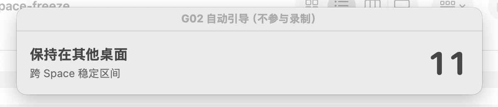

上一篇介绍了自己做的 [Mac 录制工具 Gecko](/posts/gecko-macos-app-recorder)。我希望它不仅能录制一个窗口，还能在录制时切到其他桌面，继续做自己的事情。

听起来没什么特别，实际做下来，最难解决的恰恰是这一点。

## 切换桌面后，帧率突然掉了

Gecko 使用 ScreenCaptureKit 采集指定窗口。最初测试时，目标窗口在当前桌面播放视频，采集基本正常；切到另一个桌面后，画面更新明显变慢，切回来又能恢复。

后来用 Chrome 播放带连续机器帧号的 30 FPS 参考视频，再由 Gecko 录成 MP4。测试中记录到了这样的结果：

| 阶段 | MP4 视频样本数 | 平均样本率 | 最大相邻 PTS 间隔 |
| --- | ---: | ---: | ---: |
| Chrome 在当前桌面（3～18s） | 438 | 29.20 帧/s | 73ms |
| Chrome 在其他桌面（25～88s） | 106 | **1.68 帧/s** | **610ms** |
| 返回 Chrome（91～105s） | 409 | 29.21 帧/s | 70ms |

从录制视频中的机器帧号也能看到同样的问题：离屏时，相邻采集画面最多跳过 **18 个源帧**，但源视频的时间仍以约 30 FPS 前进。这说明不是 Chrome 把视频暂停了，而是采集遗漏了大量中间画面。

录制会话还在运行，也没有收到明确的流错误。

## 问题到底出在哪一环

一开始怀疑写文件：是不是 AVAssetWriter 来不及编码，或者音视频同时写入造成了阻塞？

为了排除文件写入的影响，我单独做了一个最小采集程序，只使用 ScreenCaptureKit 采集窗口画面，不采集音频，也不写入 MP4。

使用这个程序采集 Chrome 时，切换桌面后仍然只有约 3.47 次 complete 回调/秒。

这说明，**帧率下降在采集阶段就已经发生了**，并不是文件写入造成的。

随后又尝试调整 ScreenCaptureKit 的采集参数、回调处理方式，也对比过不同类型的视频源，但始终没能找到稳定的解决办法。

## 一个原本只为方便测试的倒计时浮层

这些实验很折腾：先保持目标窗口可见，切到另一个桌面等待一分钟，再切回来。每次靠手动看时间，很难把前后台阶段准确对齐。

因此，我给受控测试工具加了一个可以跨桌面显示的倒计时浮层：前台观察 15 秒、留 5 秒切走、离屏等待 60 秒、留 5 秒切回、返回后再观察 15 秒。

浮层会显示当前阶段和剩余时间。**它原本只是为了方便测试，跟修复采集冻结没有关系。**

但后来回顾实验时，注意到一个意外现象：**浮层显示并持续更新的某些阶段，采集帧率似乎有所提高。**

当时没有做严格的浮层开关对照，还不能确定帧率变化是不是浮层引起的。

我想起之前 OBS 的录制表现似乎比 Gecko 好，于是决定再仔细对比一下。

## OBS 为什么看起来正常

最初用 OBS 32.2.2 的窗口采集功能录制同一个 Chrome 窗口时，成品看起来比 Gecko 流畅。

在一段约 110 秒的 OBS 录像里，对播放器区域做逐帧画面差异比较，20～100 秒的多数区间每秒都能观察到约 **29～31 次画面变化**。而同一 Chrome 窗口的 Gecko 独立采集测试，离屏阶段只有 **3.47 次 `complete` 回调/秒**。

当时我以为 OBS 已经解决了跨桌面录制的问题，想着可以参考它的实现。

不过，一开始两边的测量方式不同，因此还无法判断 OBS 是否真的解决了跨桌面录制的冻结问题。

为了进一步确认，我用带机器帧号的 30 FPS 视频，又录了几轮 OBS 成品。每一帧都有不同编号，因此能直接计算最终视频里到底有多少个不同画面。

结果并不是「OBS 一直正常」这么简单：

| OBS 窗口采集场景 | 成品标称帧率 | 实际不同画面 |
| --- | ---: | ---: |
| Chrome 留在原桌面，切到另一个应用的原生全屏界面 | 60 FPS | **约 1.95 帧/秒** |
| Chrome 被完全遮挡，OBS 预览可见，但 OBS 不是前台 App | 60 FPS | **约 30 帧/秒** |
| Chrome 被完全遮挡，OBS 主窗口不可见 | 60 FPS | **约 0.1 帧/秒** |
| Chrome 分配给所有桌面、切换后仍可见，OBS 不可见 | 60 FPS | **约 29.9 帧/秒** |

在跨桌面测试中，OBS 在 20 秒内输出了 1200 个视频样本，但只有 **39 个不同的源画面**，实际画面更新率仅为 **1.95 帧/s**。这说明，**OBS 虽然输出了 60 FPS 的视频，但绝大多数都是重复画面**。

同一桌面的遮挡测试也发现了一个有意思的现象：Chrome 被完全遮挡时，OBS 预览可见，实际画面更新率约为 **30 帧/s**；OBS 窗口不可见时，却降到了 **0.1 帧/s**。

OBS 在不同可见状态下的表现差异，让我重新想到了之前的倒计时浮层。

**如果单独放一个能够跨桌面显示、持续绘制的窗口，能不能改善离屏采集的帧率？**

## 从倒计时浮层到 Pulse

这次不再使用倒计时文字，也不依赖 OBS Preview，而是单独做一个能够跨桌面显示、以指定频率持续绘制的小窗口。

实验使用一个 **64×64 的 Pulse 绘制窗口**，设置 `.canJoinAllSpaces` 和 `.stationary`，让它能够出现在所有桌面中：

- 桌面 A 中，Chrome 持续播放不循环的 30 FPS 机器帧号视频。
- 我切换到桌面 B 继续工作。Pulse 持续绘制黑白像素，不显示 Chrome 画面。
- Gecko 的独立采集程序直接捕获 Chrome，不采音频、不写 MP4，也不运行 OBS。
- 在同一轮采集中依次执行 **Pulse 关闭 → 30Hz → 再次关闭**，用真实机器帧号判断画面是否更新。

连续三轮 A-B-A 测试得到：

| 轮次 | Pulse 关闭 | Pulse 30Hz | 再次关闭 |
| --- | ---: | ---: | ---: |
| Run 1 | 1.756 帧/s | **30.001 帧/s** | 0.038 帧/s |
| Run 2 | 0.040 帧/s | **29.995 帧/s** | 0.038 帧/s |
| Run 3 | 0.040 帧/s | **29.976 帧/s** | 0.040 帧/s |

三轮都呈现出相同的趋势：关闭 Pulse 时供帧稀疏，开启 30Hz Pulse 后恢复到约 **30 个不同的真实源帧/s**，再次关闭后又重新下降。

## 最后

这次排查从 Writer、采集配置一路走到倒计时浮层、OBS 对照，最后通过 Pulse 开关实验，验证了持续绘制对跨桌面采集的改善效果。

至少在这组实验中，Pulse 确实解决了跨桌面采集帧率下降的问题。 至于为什么一块小小的绘制区域会改变采集结果，目前还没有找到明确的解释。

一个原本只为方便测试而做的倒计时浮层，最后竟然成了解决问题的线索。
